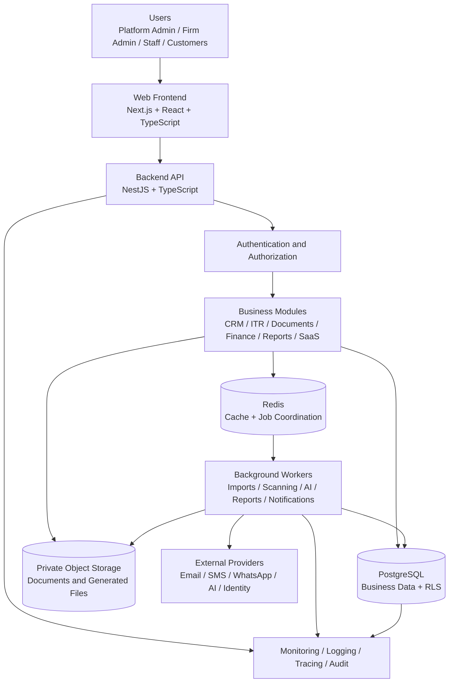
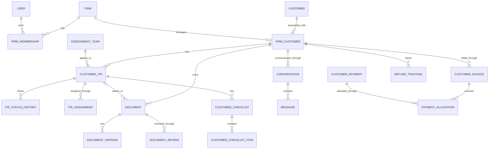

# ITR Management System
# System Architecture and Technical Design

- **Document ID:** ITR-ARCH-001
- **Version:** 0.1.0
- **Status:** Draft — Architecture Planning
- **Related SRS:** `docs/SRS.md`
- **Product Type:** Multi-Tenant SaaS
- **Initial Market:** India
- **Primary Database:** PostgreSQL
**Last Updated:** 6 November 2026

---
## Table of Contents

1. Introduction
2. Architecture Goals and Design Principles
3. High-Level System Architecture
4. Multi-Tenant Architecture
5. Backend Architecture and Module Design
6. Frontend Architecture and User Experience
7. Database Architecture and Data Design
8. Authentication and Authorization Architecture
9. API and Integration Architecture
10. Infrastructure and Deployment Architecture

## 1. Introduction

### 1.1 Purpose

This document defines the proposed system architecture and technical design for the ITR Management System, a commercial multi-tenant Software-as-a-Service (SaaS) platform intended to support multiple Chartered Accountant (CA) firms in managing their Income Tax Return (ITR) preparation and related business operations.

It establishes the architectural foundation for the platform, including its application structure, backend modules, data management, tenant isolation, authentication and authorization, integrations, infrastructure, security, reliability and deployment approach.

The document will guide subsequent database design, API design, implementation, testing and deployment activities.

### 1.2 Scope

This document covers the technical architecture of the ITR Management System, including:

- Overall system architecture and major application components.
- Frontend and backend application organization.
- Backend module boundaries and responsibilities.
- Multi-tenant data architecture and tenant isolation.
- Database architecture and data-access principles.
- Authentication, authorization and session management.
- Document storage and processing architecture.
- Background processing, notifications and integrations.
- API design principles and external service boundaries.
- Infrastructure, deployment and environment strategy.
- Security, observability, reliability and operational considerations.

Detailed functional and non-functional requirements remain governed by the approved Software Requirements Specification (SRS).

### 1.3 Relationship with the SRS

The Software Requirements Specification, identified as `ITR-SaaS-SRS-001`, is the primary source of approved product requirements.

This architecture document translates those requirements into technical design decisions and implementation guidance.

Where a technical design decision appears inconsistent with an approved SRS requirement, the conflict must be identified and resolved through the documented requirements and change-control process. Architecture decisions must not silently weaken approved security, privacy, tenant-isolation or business requirements.

### 1.4 Intended Audience

This document is intended for:

- Product owner and project stakeholders.
- Solution and software architects.
- Frontend and backend developers.
- Database designers and administrators.
- DevOps and infrastructure engineers.
- Quality assurance and security testing teams.
- Technical reviewers and future maintenance teams.

### 1.5 Document Status and Decision Classification

This document is maintained as a controlled technical design artifact.

Architectural statements will be classified as:

- **Confirmed:** Explicitly established by an approved project requirement or decision.
- **Proposed:** A recommended technical design that remains subject to review and approval.
- **Open:** A decision requiring further evaluation or stakeholder confirmation.

Unresolved architectural decisions must be recorded rather than treated as finalized implementation requirements.

## 2. Architecture Goals and Design Principles

### 2.1 Architecture Goals

The architecture of the ITR Management System shall be designed to achieve the following goals:

1. **Strong Multi-Tenant Isolation:** Support multiple CA firms on a shared SaaS platform while ensuring that each firm's business data, documents, users, configurations and operational records remain isolated from unauthorized access by other firms.

2. **Scalability:** Support the initial customer and firm volumes while allowing the platform to scale as additional firms, staff members, customers, documents and transactions are onboarded.

3. **Security by Design:** Incorporate authentication, authorization, tenant isolation, encryption, auditability, privacy and secure data handling into the architecture from the beginning.

4. **Maintainability:** Organize the application into clearly defined modules with controlled dependencies, consistent interfaces and well-documented responsibilities.

5. **Data Integrity:** Preserve the correctness, consistency, traceability and historical integrity of customer records, ITR workflows, documents, financial transactions and audit records.

6. **Reliability and Availability:** Provide resilient application services, controlled failure handling, backup and recovery capabilities, and measurable service availability.

7. **Extensibility:** Allow new assessment years, business workflows, integrations, reports, AI-assisted capabilities and SaaS subscription features to be introduced without requiring a complete architectural redesign.

8. **Operational Visibility:** Provide structured logs, metrics, traces, audit records, health checks and security monitoring to support troubleshooting and operational governance.

9. **Cloud Portability:** Avoid unnecessary dependence on proprietary infrastructure features so that the platform can be deployed and maintained on a suitable major cloud provider.

10. **Cost Awareness:** Balance scalability, security, performance and reliability with infrastructure and operational costs appropriate for a growing SaaS business.

### 2.2 Core Design Principles

#### 2.2.1 Security by Design

Security controls shall be incorporated into application design, database access, file handling, integrations, deployment and operational processes.

Security shall not depend solely on frontend restrictions or application-level role checks.

#### 2.2.2 Tenant Isolation by Default

Every tenant-owned data access operation shall be subject to tenant authorization and isolation controls.

PostgreSQL Row-Level Security (RLS) shall provide an additional database-enforced isolation boundary. Application authorization and database-level isolation shall operate together.

Cross-tenant access shall be denied by default unless a specifically authorized and audited platform-level operation requires otherwise.

#### 2.2.3 Least Privilege

Every user, service, application component and database role shall receive only the minimum permissions required to perform its assigned responsibilities.

Privileged operations shall require explicit authorization and appropriate audit records.

#### 2.2.4 Modular Design

The backend shall be organized as a modular monolith for the initial product architecture.

Each business module shall have defined responsibilities, interfaces and data ownership boundaries. Modules shall not bypass those boundaries through uncontrolled direct dependencies.

#### 2.2.5 Clear Separation of Responsibilities

The architecture shall maintain separation between:

- Presentation and user-interface responsibilities.
- Application and business workflow responsibilities.
- Domain and business rule responsibilities.
- Data persistence and database access responsibilities.
- External integration and provider responsibilities.
- Infrastructure and operational responsibilities.

#### 2.2.6 Data Integrity and Traceability

Important business changes shall be traceable.

Financial records, audit records, document versions and other historically significant information shall not be silently overwritten where immutability or historical preservation is required.

Corrections shall use controlled updates, reversals, adjustments or versioning according to the relevant business rules.

#### 2.2.7 API-First Integration

Application capabilities shall be exposed through documented and consistently designed APIs where appropriate.

External service integrations shall be isolated behind provider-specific adapters so that providers can be replaced without unnecessarily changing core business logic.

#### 2.2.8 Asynchronous Processing

Long-running or resource-intensive tasks shall use background processing where appropriate.

Examples include document scanning, AI-assisted extraction, bulk imports, report generation and notification delivery.

Background jobs shall support appropriate retry, failure handling, monitoring and idempotency controls.

#### 2.2.9 Observability

Application and infrastructure components shall produce structured operational information.

Monitoring shall support detection of performance degradation, application failures, suspicious activity, integration failures and resource constraints.

Sensitive information, including authentication credentials and unnecessary personal or tax data, shall not be exposed in logs.

#### 2.2.10 Testability

Architectural components shall be designed to support automated unit, integration, API, end-to-end, security, performance and recovery testing.

Tenant isolation and authorization controls shall be independently testable and shall not rely only on successful application workflows.

### 2.3 Architectural Quality Priorities

The following priorities shall guide design decisions when architectural goals compete:

1. Security, privacy and tenant isolation.
2. Data integrity and correctness.
3. Reliability and recoverability.
4. Maintainability and testability.
5. Performance and scalability.
6. Extensibility and integration flexibility.
7. Operational simplicity and cost efficiency.

A lower-priority optimization shall not weaken a higher-priority requirement without a documented risk assessment and formal approval.

### 2.4 Architecture Decision Governance

Significant architecture decisions shall be documented in Architecture Decision Records (ADRs).

Each ADR should include:

- Decision identifier and title.
- Context and problem statement.
- Options considered.
- Selected decision.
- Reasons for selection.
- Consequences and trade-offs.
- Security, privacy and operational implications.
- Status and approval details.

Proposed architecture decisions shall remain distinguishable from approved decisions until formally reviewed and accepted.

## 3. High-Level System Architecture

### 3.1 Architectural Style

The ITR Management System shall initially use a **modular monolith architecture** with a separately organized frontend application and backend application.

The backend shall be deployed as a cohesive application containing independently organized business modules with clearly defined responsibilities and interfaces.

The architecture shall avoid premature microservice decomposition while preserving module boundaries that allow selected components to be extracted into independent services in the future if justified by scalability, reliability or operational requirements.

The initial architecture shall consist of:

- A responsive web frontend.
- A backend application exposing versioned APIs.
- A PostgreSQL relational database.
- A private object storage service for documents and generated files.
- Redis for caching and background job coordination.
- Background workers for asynchronous processing.
- External service adapters for notifications, identity and other integrations.
- Centralized monitoring, logging and tracing capabilities.

### 3.2 Logical System Overview

The system shall follow the logical request and processing flow below.



This diagram represents logical responsibilities and communication paths. It does not prescribe the exact deployment topology or imply that every component must run as a separate infrastructure service.

### 3.3 Frontend Application

**Proposed technology:** Next.js, React and TypeScript.

The frontend shall provide responsive and role-appropriate interfaces for:

- Platform Super Admin portal.
- CA Firm Admin portal.
- Firm Staff portal.
- Customer portal.

Frontend responsibilities shall include:

- User interaction and presentation.
- Navigation and role-appropriate interface rendering.
- Client-side input validation for usability.
- API communication and response handling.
- Authentication state and session-aware navigation.
- Accessible forms, dashboards, tables and workflows.
- Responsive layouts for supported desktop, tablet and mobile browsers.

The frontend shall not be treated as a security enforcement boundary. All sensitive authorization decisions and business validations shall be enforced by the backend and, where applicable, the database.

### 3.4 Backend Application

**Proposed technology:** NestJS and TypeScript.

The backend shall expose versioned APIs and coordinate the system's business operations.

Its responsibilities shall include:

- Authentication and authorization enforcement.
- Tenant identification and tenant-context establishment.
- Business rules and workflow orchestration.
- Input validation and controlled data modification.
- Database access and transaction management.
- Document access authorization.
- Background job scheduling and processing coordination.
- External provider integrations.
- Audit event generation.
- Operational logging and monitoring.

The backend shall act as the primary enforcement point for application-level business rules and access permissions.

### 3.5 Database Layer

**Selected database:** PostgreSQL.

The database shall store structured business and operational information, including:

- Platform and firm records.
- User identities and firm memberships.
- Customer and firm-customer relationships.
- Assessment year and ITR records.
- Document metadata and version information.
- Workflow and checklist records.
- Messaging and notification records.
- Invoices, payments and financial transactions.
- SaaS subscriptions and usage information.
- Audit and security records.

Tenant-owned records shall use an explicit tenant ownership model and appropriate relational constraints.

PostgreSQL Row-Level Security (RLS) shall provide database-enforced tenant isolation on applicable tables.

Detailed schemas, relationships, indexing and database security policies shall be defined in the database architecture and ERD documents.

### 3.6 Object Storage Layer

Private object storage shall be used for uploaded and generated files, including:

- Customer tax documents.
- Supporting financial documents.
- ITR-related attachments.
- Generated reports and receipts.
- Import and export artifacts.
- Other authorized business files.

The database shall store file metadata, ownership information, version references and access-control information. File contents shall reside in private object storage rather than being stored directly in ordinary relational database records.

File access shall be authorized through the backend. Public object access shall not be permitted for confidential customer or firm documents.

### 3.7 Cache and Background Processing Layer

**Proposed technology:** Redis with BullMQ.

Redis shall support appropriate caching and background job coordination.

Background workers shall handle tasks that should not block ordinary user-facing API requests, including:

- Excel and CSV import processing.
- Document malware scanning and processing.
- AI-assisted document extraction.
- Report generation.
- Email, SMS and WhatsApp notification delivery.
- Scheduled maintenance and operational tasks.

Jobs shall implement appropriate retry policies, failure handling, idempotency and monitoring.

Redis shall not be treated as the authoritative source of business records or financial transactions.

### 3.8 External Integration Layer

External providers shall be accessed through controlled integration adapters.

Potential integrations include:

- Email delivery providers.
- SMS and OTP providers.
- WhatsApp Business messaging providers.
- Approved AI service providers.
- Identity and authentication providers.
- Payment gateways.
- Cloud storage services.
- Other approved business integrations.

Provider-specific implementations shall remain isolated from core business logic wherever practical.

External integrations shall follow appropriate authentication, encryption, timeout, retry, rate-limiting and failure-handling policies.

### 3.9 Observability and Audit Layer

The architecture shall include centralized operational visibility and business accountability.

The observability layer shall support:

- Structured application logs.
- Infrastructure and application metrics.
- Distributed tracing where applicable.
- Service health checks.
- Error and exception monitoring.
- Background job monitoring.
- Security event monitoring.
- Audit event recording.

Operational logs and audit records shall remain distinct in purpose and retention requirements.

Sensitive information shall be minimized or redacted in operational telemetry. Audit records shall be protected against unauthorized alteration or deletion.

### 3.10 Architecture Evolution

The initial implementation shall prioritize a maintainable modular monolith.

Future extraction of selected capabilities into independent services may be considered only when supported by measurable technical or operational needs.

Potential future candidates may include:

- Document processing.
- AI processing.
- Notification delivery.
- Report generation.
- High-volume import processing.

Any such decomposition shall preserve tenant isolation, authorization, auditability, data integrity and operational reliability.

### 3.11 Technology Decision Status

The following technologies form the current proposed or selected baseline:

| Component | Technology | Status |
|---|---|---|
| Frontend | Next.js, React, TypeScript | Proposed |
| Backend | NestJS, TypeScript | Proposed |
| Primary database | PostgreSQL | Selected |
| ORM and data access | Prisma with controlled SQL | Proposed |
| UI styling | Tailwind CSS and shadcn/ui | Proposed |
| Cache and job coordination | Redis | Proposed |
| Background jobs | BullMQ | Proposed |
| API documentation | OpenAPI | Proposed |
| Automated testing | Jest and Playwright | Proposed |
| Deployment packaging | Docker | Proposed |
| Monitoring and tracing | OpenTelemetry-compatible tooling | Proposed |
| Object storage | Private cloud object storage | Provider open |
| Cloud platform | AWS or Azure | Open |

Technology selections shall be reviewed for compatibility, security, operational complexity, cost and long-term maintainability before implementation.

## 4. Multi-Tenant Architecture

### 4.1 Multi-Tenant Architecture Model

The ITR Management System shall use a shared-application, shared-database multi-tenant architecture.

Multiple CA firms shall use the same application deployment and database infrastructure while maintaining strict logical separation of tenant-owned business data.

Each CA firm shall be represented as an independent tenant.

The architecture shall support:

- Multiple CA firms operating independently on the platform.
- Firm-specific administrators, staff members, customers, configurations and workflows.
- Firm-specific ITR records, documents, financial transactions, reports and audit information.
- A customer identity associated with more than one CA firm.
- Platform-level administration through specifically authorized Platform Super Admin capabilities.
- Independent firm-level access control and operational governance.

Shared infrastructure shall not imply shared business-data access.

### 4.2 Tenant Identification and Ownership

Each CA firm shall have a unique, stable tenant identifier.

The tenant identifier shall be used consistently across tenant-owned application records and applicable database tables.

Tenant-owned records shall include an explicit `tenant_id` ownership reference.

Examples include:

- Firm-specific customer relationships.
- ITR records and assessment-year records.
- Document metadata and document versions.
- Checklists and workflow records.
- Invoices, payments and financial transactions.
- Firm-specific messages and notifications.
- Firm configurations and branding.
- Firm-level reports and operational records.

Tenant ownership shall be established by trusted backend processes and enforced through database constraints and PostgreSQL Row-Level Security (RLS).

A tenant identifier supplied directly by a client request shall not, by itself, be considered proof of authorization.

### 4.3 Customer Identity and Firm Relationship Separation

The architecture shall distinguish between a person's platform-level identity and that person's relationship with an individual CA firm.

A single customer identity may be associated with multiple CA firms.

The following conceptual entities shall be maintained separately:

1. **User Identity:** Represents the person and their platform-level authentication identity.
2. **Tenant:** Represents an individual CA firm.
3. **Tenant Membership:** Represents the association between a user and a particular firm, including the user's firm-specific role and access permissions.
4. **Firm-Specific Customer Record:** Represents the customer relationship and business information maintained by a particular firm.

This separation shall prevent the assumption that a customer has one globally shared firm-specific business record.

Each firm shall independently manage its customer relationship, ITR records, documents, financial information, communications and workflow history.

A customer's association with one firm shall not automatically grant another firm access to that firm's records.

### 4.4 Logical Tenant Data Isolation

Tenant isolation shall be enforced through multiple complementary layers.

#### 4.4.1 Application-Level Authorization

The backend shall verify the authenticated user's identity, active tenant membership, assigned role and permissions before performing tenant-specific operations.

Every tenant-specific API operation shall establish and validate the applicable tenant context.

#### 4.4.2 Database-Level Isolation

PostgreSQL Row-Level Security (RLS) shall restrict access to applicable tenant-owned rows.

RLS policies shall use a trusted tenant context established by the backend within the appropriate database transaction.

Database runtime roles shall not own protected tables or possess `BYPASSRLS` privileges.

`FORCE ROW LEVEL SECURITY` shall be applied where appropriate to ensure table owners are also subject to row-level policies during normal operation.

#### 4.4.3 Relational Integrity

Tenant-aware foreign keys and database constraints shall prevent invalid relationships between records belonging to different tenants.

Where appropriate, composite keys and tenant-aware references shall be used to ensure that related tenant-owned records belong to the same tenant.

#### 4.4.4 File and Object Storage Isolation

Document metadata and ownership information shall be tenant-aware.

Object storage paths and access-control mechanisms shall preserve firm-level separation.

A user shall receive access to a document only after the backend verifies the user's identity, tenant membership, permissions and document ownership.

Public access to confidential tenant documents shall not be permitted.

### 4.5 Tenant Context Establishment and Propagation

Tenant context shall be established through a trusted backend authorization process.

The general request flow shall be:

1. The user authenticates with the platform.
2. The backend identifies the authenticated user.
3. The backend verifies the user's active membership in the requested firm.
4. The backend determines the applicable tenant identifier from trusted membership and authorization data.
5. The backend establishes the tenant context for the database transaction.
6. Database queries execute under the applicable tenant context and RLS policies.
7. The transaction completes, and transaction-scoped tenant context is cleared automatically.

Tenant context shall not be trusted merely because a tenant identifier appears in a request header, URL parameter, query parameter or request body.

The implementation shall use transaction-scoped context and shall be tested against database connection pooling to prevent tenant-context leakage between requests.

Background workers shall independently establish and validate tenant context for each tenant-specific job.

### 4.6 Tenant Switching

Users who are authorized members of multiple CA firms may switch between their permitted firm contexts.

Tenant switching shall:

- Require an authenticated user.
- Verify active membership in the selected firm.
- Re-establish the selected tenant context for subsequent operations.
- Refresh or validate tenant-specific permissions.
- Prevent access to previously selected tenant data under the new tenant context.
- Record relevant tenant-switching and security events in the audit system.

Switching firms shall not combine, transfer or expose firm-specific customer records, documents or business history.

### 4.7 Platform Super Admin Access

Platform Super Admin capabilities shall be logically separated from ordinary firm-level access.

Platform-level administration may include:

- Firm onboarding and approval.
- SaaS plan and subscription administration.
- Platform configuration and operational monitoring.
- Firm suspension and reactivation controls.
- Security and compliance oversight.
- Authorized support and incident management.

Platform-level privileges shall not automatically provide unrestricted access to confidential customer tax documents or firm business data.

Any exceptional access to tenant business data shall require a specifically authorized and auditable process, with appropriate justification, scope limitation and access controls.

### 4.8 Tenant Isolation for Background Jobs and Integrations

Tenant isolation shall apply to asynchronous processing and external integrations, not only synchronous API requests.

Every tenant-specific background job shall carry a validated tenant reference and sufficient authorization context for its assigned operation.

Workers shall establish tenant context before accessing tenant-owned records.

External integration requests shall use only the data required for the authorized tenant operation.

Provider callbacks, webhooks and asynchronous responses shall be validated and associated with the correct tenant and business operation before processing.

Failure, retry and dead-letter handling shall preserve tenant ownership and prevent data from one tenant being processed under another tenant's context.

### 4.9 Tenant Data Lifecycle and Portability

Tenant data shall remain logically associated with its owning firm throughout its lifecycle.

The architecture shall support:

- Firm-specific data export.
- Controlled customer migration and relationship changes.
- Retention and deletion policies.
- Legal holds and compliance requirements.
- Firm suspension and reactivation.
- Secure handling of backups and restored data.

A customer's relationship with one firm may be changed or terminated without automatically deleting or modifying that customer's independent relationship and records with another firm.

Data export, retention, deletion and migration operations shall enforce tenant ownership and preserve required audit history.

### 4.10 Tenant Isolation Testing Requirements

Tenant isolation shall be treated as a critical security property and tested independently.

Testing shall include:

- Attempts to read another tenant's records.
- Attempts to modify or delete another tenant's records.
- Cross-tenant foreign-key and relationship manipulation.
- Unauthorized document and object-storage access.
- Tenant switching and membership revocation.
- Database RLS enforcement using the actual production runtime role.
- Connection-pooling and transaction-context isolation.
- Background job and retry isolation.
- Integration callback and webhook isolation.
- Platform-level privileged access and auditability.

All unauthorized cross-tenant access attempts shall be denied and relevant security events shall be recorded where appropriate.

### 4.11 Multi-Tenant Architecture Invariants

The following principles shall remain mandatory throughout implementation:

1. Every tenant-owned business record has an unambiguous tenant owner.
2. A user's membership in one firm does not grant membership or access to another firm.
3. A customer identity may be shared across firm relationships, but firm-specific business records remain separate.
4. Tenant context is established from trusted authorization data.
5. Application authorization and database RLS operate together.
6. Tenant-aware relational constraints prevent cross-tenant data relationships.
7. Tenant isolation applies to documents, background jobs, integrations, exports and operational workflows.
8. Exceptional platform-level access is explicitly authorized, limited and audited.
9. Tenant isolation must be verified through automated security and integration tests.

## 5. Backend Architecture and Module Design

### 5.1 Backend Architectural Approach

The backend shall initially follow a modular monolith architecture implemented using NestJS and TypeScript.

The application shall be organized into independently defined business and technical modules. Each module shall have clear responsibilities, controlled interfaces and documented dependencies.

The modular monolith approach shall provide:

- A single cohesive backend application for the initial release.
- Clear separation of business capabilities.
- Consistent authentication, authorization and tenant-context enforcement.
- Shared infrastructure capabilities without uncontrolled business-module dependencies.
- Simplified deployment and operational management.
- The ability to extract selected modules into independent services in the future when justified.

Modules shall not directly manipulate another module's internal data structures or bypass its business rules.

### 5.2 Backend Module Organization

The backend shall be organized into the following logical modules.

#### 5.2.1 Platform Administration Module

**Responsibility:** Platform-wide administration and governance.

Key capabilities:

- Platform Super Admin management.
- CA firm onboarding, approval and suspension.
- Platform configuration.
- SaaS plan and feature administration.
- Platform-wide operational dashboards.
- Authorized support and exceptional access governance.
- Platform-level security and audit oversight.

#### 5.2.2 Authentication and Identity Module

**Responsibility:** User authentication and identity-related security.

Key capabilities:

- User identity management.
- Login and logout.
- Password-based authentication.
- Customer OTP authentication.
- Staff and administrator MFA enforcement.
- Session and device management.
- Password recovery.
- Login verification and suspicious activity controls.
- Authentication-provider integration.

Authentication shall be separated from firm-specific authorization and business permissions.

#### 5.2.3 Tenant and Firm Management Module

**Responsibility:** CA firm tenant lifecycle and tenant-level configuration.

Key capabilities:

- Firm registration and onboarding.
- Firm approval and activation.
- Tenant identification and context validation.
- Firm profile and configuration.
- Firm-specific branding.
- Tenant membership management.
- Firm suspension and reactivation.
- Tenant-level operational settings.

#### 5.2.4 User, Membership and Access Control Module

**Responsibility:** Firm-specific user membership, roles and permissions.

Key capabilities:

- Firm administrator and staff membership.
- Customer membership relationships.
- Role assignment.
- Permission management.
- Staff invitations.
- Customer invitations.
- Customer-to-firm relationship management.
- Membership activation and revocation.
- Access-control validation.

A user identity may have multiple firm memberships, each with independent roles and permissions.

#### 5.2.5 Customer Relationship Management Module

**Responsibility:** Firm-specific customer management.

Key capabilities:

- Customer profile management.
- Customer onboarding.
- Customer contact information.
- Customer-to-firm relationships.
- Customer assignment to staff.
- Customer status management.
- Customer search and filtering.
- Customer history and relationship tracking.

Firm-specific customer information shall remain isolated between tenants.

#### 5.2.6 Assessment Year and ITR Management Module

**Responsibility:** Assessment-year configuration and ITR workflow management.

Key capabilities:

- Assessment-year management.
- ITR record creation and maintenance.
- ITR type and applicable workflow management.
- ITR status transitions.
- Staff assignment.
- Filing-readiness tracking.
- Filing date and acknowledgement information.
- ITR history and activity tracking.
- Firm-configurable workflow settings.

Assessment years shall be configurable rather than permanently hardcoded into application logic.

#### 5.2.7 Document Management Module

**Responsibility:** Secure document lifecycle management.

Key capabilities:

- Customer and staff document uploads.
- Document metadata management.
- Document categorization.
- Document review and approval workflows.
- Document rejection and replacement.
- Replacement and Version history.
- Authorized document access.
- Secure download-link generation.
- Document retention and deletion coordination.
- Malware scanning and quarantine coordination.

The module shall coordinate with private object storage and background processing services.

#### 5.2.8 Checklist and Workflow Module

**Responsibility:** Checklist templates and task-based ITR workflow coordination.

Key capabilities:

- Standard checklist templates.
- Firm-specific checklist configuration.
- Customer-specific checklist assignment.
- Task creation and completion.
- Staff responsibility assignment.
- Checklist progress tracking.
- Review and approval steps.
- Workflow activity history.

#### 5.2.9 Communication and Notification Module

**Responsibility:** Customer and staff communication.

Key capabilities:

- In-platform messaging.
- Customer and staff notifications.
- Email notifications.
- SMS and OTP delivery coordination.
- WhatsApp Business integration.
- Notification templates.
- Delivery status tracking.
- Retry and failure handling.
- Communication history.

External notification providers shall be accessed through controlled integration adapters.

#### 5.2.10 Financial Management Module

**Responsibility:** Firm-level customer invoicing and financial transaction management.

Key capabilities:

- Customer invoices.
- Partial and full payments.
- Payment receipts.
- Refund records.
- Credit notes.
- Payment reconciliation.
- Outstanding balance tracking.
- Financial reports.
- Financial transaction history.

Financial records shall preserve transaction history and use controlled corrections, reversals and adjustments where required.

#### 5.2.11 Refund Management Module

**Responsibility:** Manual tracking of customer income tax refund-related information.

Key capabilities:

- Refund status tracking.
- Expected and received refund information.
- Refund-related dates.
- Customer and staff updates.
- Refund history.
- Refund reporting.
- Related customer communication.

The initial release shall not depend on automated government refund APIs.

#### 5.2.12 Assisted Tax and AI Module

**Responsibility:** Controlled AI-assisted document and workflow support.

Key capabilities:

- Document data extraction coordination.
- Extracted data review.
- Checklist suggestions.
- Drafting assistance.
- Source and reference traceability.
- Human review and approval.
- AI provider integration.
- AI usage tracking and audit records.
- Provider failure handling.

AI-generated content shall remain distinguishable from verified business information.

Human review shall be required for consequential tax and filing-related decisions.

#### 5.2.13 Subscription and SaaS Billing Module

**Responsibility:** Platform-level firm subscriptions and commercial plan management.

Key capabilities:

- SaaS subscription management.
- Subscription plan configuration.
- Feature entitlements.
- Firm usage tracking.
- Subscription activation and renewal tracking.
- Plan limit enforcement.
- Grace-period management.
- Subscription invoices and payment tracking.
- Subscription suspension and reactivation.

SaaS subscription billing shall remain logically separate from CA firms' customer invoicing and financial management.

#### 5.2.14 Import and Migration Module

**Responsibility:** Controlled bulk data import and customer migration.

Key capabilities:

- Excel and CSV file processing.
- Column mapping.
- Data validation.
- Duplicate detection.
- Import preview.
- Batch processing.
- Error reporting.
- Import reconciliation.
- Controlled rollback and correction.
- Customer migration support.

Import operations shall not silently overwrite existing business records.

#### 5.2.15 Reporting and Analytics Module

**Responsibility:** Business and operational reporting.

Key capabilities:

- Customer reports.
- ITR workflow reports.
- Staff performance reports.
- Document and checklist reports.
- Financial reports.
- Refund reports.
- Subscription and usage reports.
- Custom report configuration.
- Export generation.

Reports shall enforce tenant ownership and the requesting user's permissions.

#### 5.2.16 Search Module

**Responsibility:** Secure search across authorized platform and firm records.

Key capabilities:

- Customer search.
- ITR record search.
- Document metadata search.
- Invoice and transaction search.
- Firm-level filtering.
- Permission-aware search results.
- Search indexing and maintenance.

Search results shall not expose records outside the requesting user's authorized tenant and permission scope.

#### 5.2.17 Support and Ticketing Module

**Responsibility:** Platform and firm support operations.

Key capabilities:

- Support ticket creation.
- Ticket assignment.
- Ticket status management.
- Customer and firm communication.
- Support escalation.
- Resolution tracking.
- Support history and audit records.

Support access to tenant information shall be limited by explicit authorization and appropriate privacy controls.

#### 5.2.18 Audit and Security Monitoring Module

**Responsibility:** Business auditability and security event coordination.

Key capabilities:

- Audit event recording.
- User activity tracking.
- Privileged action logging.
- Security event recording.
- Suspicious activity monitoring.
- Audit search and reporting.
- Tamper-resistant audit storage.
- Audit retention coordination.

Audit records shall capture relevant actor, tenant, action, target, timestamp and outcome information where applicable.

### 5.3 Shared Technical Modules

In addition to business modules, the backend shall contain shared technical capabilities.

These shall include:

- Database and transaction management.
- Tenant-context management.
- Request validation and exception handling.
- API response and error conventions.
- File storage abstraction.
- Background job coordination.
- Cache management.
- External provider adapters.
- Logging, metrics and tracing.
- Configuration and secrets management.
- Health checks and readiness checks.

Shared technical modules shall provide reusable infrastructure capabilities without becoming uncontrolled locations for business logic.

### 5.4 Proposed Backend Directory Structure

The following directory structure represents the proposed organization of the NestJS backend application.

```text
apps/
└── api/
    ├── src/
    │   ├── main.ts
    │   ├── app.module.ts
    │   │
    │   ├── common/
    │   │   ├── decorators/
    │   │   ├── guards/
    │   │   ├── interceptors/
    │   │   ├── filters/
    │   │   ├── pipes/
    │   │   └── utilities/
    │   │
    │   ├── config/
    │   │
    │   ├── infrastructure/
    │   │   ├── database/
    │   │   ├── cache/
    │   │   ├── storage/
    │   │   ├── queue/
    │   │   ├── integrations/
    │   │   └── observability/
    │   │
    │   ├── modules/
    │   │   ├── platform-admin/
    │   │   ├── auth/
    │   │   ├── tenants/
    │   │   ├── access-control/
    │   │   ├── customers/
    │   │   ├── assessment-years/
    │   │   ├── itr/
    │   │   ├── documents/
    │   │   ├── checklists/
    │   │   ├── communications/
    │   │   ├── finance/
    │   │   ├── refunds/
    │   │   ├── ai-assistance/
    │   │   ├── subscriptions/
    │   │   ├── imports/
    │   │   ├── reporting/
    │   │   ├── search/
    │   │   ├── support/
    │   │   └── audit/
    │   │
    │   └── workers/
    │
    └── test/
```

This structure is a proposed starting point. Exact package boundaries, shared libraries and deployment responsibilities shall be finalized during implementation planning.

### 5.5 Internal Module Structure

Business modules should follow a consistent internal organization where appropriate.

A proposed module may contain:

- **Controllers:** API request and response handling.
- **Application Services:** Use-case orchestration.
- **Domain Logic:** Business rules and domain behavior.
- **Repositories:** Controlled data-access operations.
- **DTOs:** Request and response data structures.
- **Validators:** Input and business validation.
- **Events:** Internal domain and application events.
- **Tests:** Unit and integration tests.

Not every module must use every layer. The design shall remain proportionate to the module's complexity.

### 5.6 Module Communication Rules

Modules shall communicate through documented service interfaces, application events or other controlled internal contracts.

The following rules shall apply:

1. A module shall own its business rules and primary data-access responsibilities.
2. Other modules shall not bypass those responsibilities through uncontrolled direct database access.
3. Shared technical functionality shall be provided through reusable infrastructure components.
4. Cross-module operations shall use explicit interfaces or coordinated application workflows.
5. Cross-module transactions shall be designed carefully to preserve data consistency.
6. Asynchronous events and jobs shall be used where immediate synchronous execution is unnecessary.
7. Circular module dependencies shall be avoided.
8. Module contracts shall be covered by appropriate automated tests.

### 5.7 Cross-Cutting Security Requirements

Every backend module shall follow the platform's common security requirements.

These include:

- Authentication verification.
- Role and permission enforcement.
- Tenant-context validation.
- Database RLS enforcement.
- Input validation.
- Secure file and object access.
- Sensitive-data protection.
- Audit event generation.
- Safe error handling.
- Rate limiting where appropriate.

No business module shall assume that a request is authorized merely because it originated from an authenticated frontend session.

### 5.8 Background Worker Responsibilities

Background workers shall be organized according to the types of asynchronous tasks they perform.

Initial worker categories may include:

- Import and migration processing.
- Document scanning and processing.
- AI-assisted extraction and analysis.
- Report generation.
- Notification delivery.
- Scheduled subscription and maintenance tasks.

Workers shall validate job data, establish the required tenant context, enforce authorization boundaries, implement idempotent processing where necessary and record relevant outcomes.

### 5.9 Module Evolution and Service Extraction

The modular monolith shall remain the default deployment approach for the initial product.

Independent service extraction may be considered only when there is a demonstrated need, such as:

- Significant independent scaling requirements.
- Resource-intensive processing workloads.
- Independent availability or deployment requirements.
- Clear operational benefits.
- A well-defined service ownership boundary.

Any extraction shall preserve the existing security, tenant-isolation, data-integrity and audit requirements.

### 5.10 Module Ownership and Architecture Governance

Every backend module shall have a documented purpose, responsibility boundary, dependencies and security considerations.

New modules, major module changes and changes to module communication shall be reviewed for:

- Alignment with the approved SRS.
- Tenant-isolation impact.
- Authorization and privacy impact.
- Data ownership and integrity.
- Performance and scalability.
- Testability and maintainability.
- Operational and deployment impact.

Significant architectural changes shall be recorded through Architecture Decision Records.

## 6. Frontend Architecture and User Experience

### 6.1 Purpose

This section defines the frontend architecture, portal structure, navigation, user experience principles, and presentation-layer responsibilities of the ITR Management System.

The frontend will provide a secure, responsive and accessible interface for all platform user categories.

The frontend is responsible for:
- Presenting role-specific functionality and information.
- Providing consistent navigation and user experiences.
- Collecting and validating user input before API submission.
- Displaying backend responses, errors and workflow statuses.
- Enforcing presentation-level access restrictions based on user permissions.
- Supporting responsive layouts across desktop, tablet and mobile devices.
- Maintaining consistent branding and reusable UI components.

The frontend is not the authority for security or business-rule enforcement. All authentication, authorization, tenant isolation, validation and business operations must be independently enforced by the backend.

### 6.2 Frontend Technology Stack

The proposed frontend technology stack is:

| Area | Technology | Status |
|---|---|---|
| Framework | Next.js | Proposed |
| UI library | React | Proposed |
| Programming language | TypeScript | Proposed |
| Styling | Tailwind CSS | Proposed |
| Component library | shadcn/ui | Proposed |
| Server state | TanStack Query | Proposed |
| Client state | React Context and/or Zustand | Proposed |
| Form management | React Hook Form | Proposed |
| Schema validation | Zod | Proposed |
| API integration | Typed API client generated from OpenAPI where practical | Proposed |
| Testing | Jest/Vitest and Playwright | Proposed |

Final dependency versions and compatibility will be established during implementation.

### 6.3 Portal Architecture

The frontend will provide four distinct portal experiences.

#### 6.3.1 Platform Super Admin Portal

The Platform Super Admin portal will provide platform-wide administration capabilities.

Expected functionality includes:
- Platform dashboard and operational overview.
- Firm registration review and approval.
- Firm activation, suspension and deactivation.
- Subscription plan and feature configuration.
- Platform-wide user and tenant administration.
- Platform-level audit and security monitoring.
- Platform configuration and system settings.
- Support and operational management.
- Controlled and audited exceptional access where authorized.

Platform-level privileges must remain separate from ordinary firm-level permissions.

#### 6.3.2 Firm Admin Portal

The Firm Admin portal will provide firm-specific administration and operational management.

Expected functionality includes:
- Firm dashboard and business overview.
- Firm profile, branding and configuration.
- Staff invitations and membership management.
- Staff roles and permission configuration.
- Customer onboarding and management.
- Customer-to-staff assignment.
- Assessment year and ITR workflow oversight.
- Document and checklist management.
- Customer financial management.
- Refund tracking.
- Firm reports and analytics.
- Firm-level audit and security information.
- Subscription plan and usage information.

All information displayed in this portal must be restricted to the active firm and its authorized users.

#### 6.3.3 Firm Staff Portal

The Firm Staff portal will provide operational tools according to the staff member's assigned role, permissions and customer assignments.

Expected functionality includes:
- Assigned customer dashboard.
- Customer profile and relationship information.
- ITR preparation and workflow management.
- Assessment-year-specific customer records.
- Document review and management.
- Checklist completion and tracking.
- Customer communication.
- Assigned financial and refund tasks, where permitted.
- Relevant reports and work summaries.
- Personal profile and account settings.

Staff members must not receive access to customers, records or operations outside their authorized scope.

#### 6.3.4 Customer Portal

The Customer portal will provide customers with secure access to their tax-related information and interactions with their associated CA firms.

Expected functionality includes:
- Customer dashboard and personal profile.
- Secure access to linked CA firms and firm-specific relationships.
- Assessment-year-wise ITR status and progress.
- Uploading and viewing authorized tax documents.
- Document review feedback and replacement requests.
- Checklist viewing and completion.
- Communication with authorized firm staff.
- Viewing invoices, payment history and receipts.
- Refund status tracking.
- Notifications and important updates.
- Account security, contact verification and session management.

A customer associated with multiple CA firms must be able to distinguish each firm's information clearly.

Switching between firms must not expose another firm's documents, ITR records, communications or financial information.

### 6.4 Navigation Architecture

The frontend will use role-specific navigation structures.

Navigation items will be displayed according to the authenticated user's role, permissions and active firm context.

#### 6.4.1 Platform Navigation

The Platform Super Admin navigation may include:
- Dashboard
- Firm Management
- User Management
- Subscription Plans
- Platform Configuration
- Audit and Security
- Support Management
- System Monitoring

#### 6.4.2 Firm Admin Navigation

The Firm Admin navigation may include:
- Dashboard
- Customers
- Staff and Permissions
- Assessment Years
- ITR Management
- Documents
- Checklists
- Communications
- Financial Management
- Refund Management
- Reports
- Firm Settings

#### 6.4.3 Staff Navigation

Staff navigation may include:
- Dashboard
- My Assigned Customers
- Customer Search
- ITR Work
- Documents
- Checklists
- Communications
- Tasks and Notifications
- Reports, where authorized
- My Profile

#### 6.4.4 Customer Navigation

Customer navigation may include:
- Dashboard
- My Profile
- My Firms
- My ITRs
- Documents
- Checklists
- Messages
- Invoices and Payments
- Refund Status
- Notifications
- Account Settings

Final navigation items will be configurable where appropriate and must respect backend-enforced permissions.

### 6.5 Shared Layout and UI Components

The frontend will use reusable components to maintain consistency and reduce duplication.

Shared components may include:
- Application header and navigation.
- Sidebar and mobile navigation.
- User profile menu.
- Firm context selector.
- Dashboard cards and summary widgets.
- Data tables with sorting, filtering and pagination.
- Search and filter controls.
- Forms and validation messages.
- Confirmation dialogs.
- File upload and document preview components.
- Status indicators and workflow timelines.
- Notification center.
- Loading, empty, success and error states.

Components must support appropriate accessibility, consistent styling and predictable behavior.

### 6.6 Frontend Authentication and Authorization Handling

The frontend will integrate with the backend authentication and authorization mechanisms.

Responsibilities include:
- Securely handling authentication sessions and tokens according to the selected authentication architecture.
- Supporting login, logout, password recovery and OTP verification flows.
- Supporting mandatory MFA for privileged users.
- Displaying navigation and actions according to the user's permissions.
- Handling session expiry and unauthorized API responses.
- Supporting secure firm switching for users associated with multiple firms.
- Preventing unauthorized access to protected frontend routes.

Frontend route protection is a usability and navigation control. It must never replace backend authorization checks.

Sensitive authentication tokens and session credentials must not be stored in insecure browser storage.

### 6.7 Frontend State Management

Frontend state will be divided into appropriate categories.

#### 6.7.1 Server State

Server state includes information retrieved from backend APIs, such as:
- Customer records.
- ITR records and workflow statuses.
- Documents and metadata.
- Financial records.
- Reports and dashboard information.
- Notifications and messages.

TanStack Query is proposed for API data fetching, caching, synchronization and mutation management.

#### 6.7.2 Client State

Client state includes temporary interface information, such as:
- Open navigation menus.
- Modal visibility.
- Selected filters.
- Temporary form interactions.
- User interface preferences.
- Current interface context.

React Context and/or Zustand may be used where appropriate.

#### 6.7.3 State Management Principles

- Avoid unnecessary duplication of server data in client state.
- Invalidate or refresh relevant data after successful mutations.
- Clear or isolate sensitive cached data when users log out or switch firms.
- Avoid exposing information from a previous user's session.
- Handle loading, error and empty states consistently.

### 6.8 API Integration Architecture

The frontend will communicate with the backend through documented, versioned APIs.

Key principles include:
- Use a centralized API client.
- Follow the backend OpenAPI specification.
- Use TypeScript types for API requests and responses.
- Apply consistent error handling.
- Handle authentication and session-related responses securely.
- Support pagination, sorting and filtering.
- Avoid embedding business rules in frontend API wrappers.
- Do not expose backend secrets or privileged credentials in browser code.

All API operations involving tenant-owned data must rely on trusted tenant context and authorization established by the backend.

### 6.9 Frontend Forms and Validation

Forms will use reusable form components and consistent validation patterns.

React Hook Form and Zod are proposed for form management and client-side schema validation.

Frontend validation should:
- Provide clear and useful input guidance.
- Detect common input errors before submission.
- Display field-level and form-level validation messages.
- Support accessible labels and error announcements.
- Prevent accidental duplicate submissions where practical.

Client-side validation is for user experience. The backend must independently validate all submitted data.

### 6.10 Responsive Design and Accessibility

The frontend must support responsive use across desktop, tablet and mobile devices.

Accessibility target:
- WCAG 2.2 Level AA.

The implementation should address:
- Keyboard navigation.
- Visible focus indicators.
- Appropriate color contrast.
- Accessible labels and form instructions.
- Screen-reader-compatible components.
- Clear validation and error messages.
- Responsive tables and navigation.
- Appropriate dialog and modal behavior.
- Accessible status and notification indicators.

Accessibility will be included in frontend design reviews and release acceptance testing.

### 6.11 Frontend Performance and Optimization

The frontend should provide a responsive and efficient experience as the number of firms, customers, records and documents grows.

Performance practices will include:
- Route-based code splitting and lazy loading where appropriate.
- Optimized images and static assets.
- Efficient API requests and caching.
- Server-side rendering or other Next.js rendering strategies where appropriate.
- Pagination or virtualized rendering for large data sets.
- Avoiding unnecessary component re-renders.
- Monitoring frontend performance and Core Web Vitals.
- Defining measurable performance targets during implementation and performance testing.

Performance optimizations must not weaken tenant isolation, authorization or data confidentiality.

### 6.12 Frontend Error Handling and User Feedback

The frontend must handle application and API errors consistently.

It should provide:
- Clear validation feedback.
- Useful error messages without exposing sensitive technical details.
- Appropriate handling of network failures and timeouts.
- Session-expiry and reauthentication flows.
- Loading indicators for long-running operations.
- Confirmation before important or potentially destructive actions.
- Success and failure notifications for user operations.
- Retry mechanisms where safe and appropriate.

Unexpected frontend errors should be captured by the monitoring system without unnecessarily collecting sensitive customer or tax information.

### 6.13 Frontend Testing Strategy

Frontend quality will be verified through multiple testing levels.

#### 6.13.1 Component and Unit Testing
Test reusable components, UI logic, validation and state-management behavior.

#### 6.13.2 Integration Testing
Test interactions between frontend components and backend APIs, including authentication, authorization responses and error handling.

#### 6.13.3 End-to-End Testing
Use Playwright to test complete user journeys for:
- Platform Super Admin.
- Firm Admin.
- Firm Staff.
- Customers.

#### 6.13.4 Security and Tenant Isolation Testing
Verify that:
- Unauthorized navigation and actions are appropriately blocked.
- Firm switching does not expose data from another firm.
- Cached data is cleared or isolated after logout and account switching.
- Frontend restrictions do not substitute for backend authorization.
- Sensitive information is not unnecessarily exposed in browser logs, URLs or client-side state.

#### 6.13.5 Accessibility and Responsive Testing
Test keyboard navigation, screen-reader compatibility, color contrast and layouts across supported screen sizes.

### 6.14 Frontend Architecture Constraints

The following constraints are mandatory:
- The frontend must not independently determine tenant authorization.
- The frontend must not contain privileged backend credentials or secrets.
- The frontend must not bypass backend validation or business rules.
- Sensitive customer and tax information must not be exposed through insecure client-side storage.
- User interface permissions must be derived from trusted backend authorization information.
- All protected operations must be authorized by the backend.
- Shared UI components must not introduce cross-tenant data leakage.

### 6.15 Frontend Architecture Decisions and Open Items

| Decision Area | Current Position |
|---|---|
| Frontend framework | Next.js — Proposed |
| UI library | React — Proposed |
| Language | TypeScript — Proposed |
| Styling | Tailwind CSS — Proposed |
| Component library | shadcn/ui — Proposed |
| Server state | TanStack Query — Proposed |
| Client state | React Context and/or Zustand — Proposed |
| Form handling | React Hook Form — Proposed |
| Validation | Zod — Proposed |
| End-to-end testing | Playwright — Proposed |
| Accessibility target | WCAG 2.2 AA |
| Portal structure | Four role-specific portals |
| Final visual design | To be established |
| Final frontend dependency versions | To be established |

Technology choices marked Proposed remain subject to implementation validation and architecture review.

## 7. Database Architecture and Data Design

### 7.1 Database Architecture Overview

#### 7.1.1 Purpose

This section defines the database architecture, data organization, relationships, tenant isolation mechanisms, integrity constraints and data lifecycle requirements of the ITR Management System.

The database must support:
- Multiple CA firms operating on a shared SaaS platform.
- Strict separation of firm-specific information.
- Customers associated with multiple CA firms.
- Assessment-year-wise ITR records.
- Secure document metadata and storage references.
- Customer financial records and SaaS subscription records.
- Workflow, communication and audit history.
- Reporting, analytics and operational search.
- Scalable data access and reliable recovery.

#### 7.1.2 Primary Database Technology

PostgreSQL is the selected primary relational database.

The proposed database technology approach is:

| Area | Technology or Approach | Status |
|---|---|---|
| Primary database | PostgreSQL | Selected |
| Data access layer | Prisma ORM | Proposed |
| Advanced database controls | Controlled SQL migrations and queries | Proposed |
| Tenant isolation | PostgreSQL Row-Level Security (RLS) | Mandatory architectural requirement |
| Database migrations | Version-controlled migrations | Mandatory architectural requirement |
| Financial precision | Appropriate fixed-precision decimal types | Mandatory architectural requirement |
| Database backups | Encrypted backups and point-in-time recovery | Mandatory architectural requirement |

#### 7.1.3 Database Architecture Model

The initial architecture will use a shared PostgreSQL database with shared application tables and logical tenant separation.

Each firm will operate within its authorized tenant context.

Tenant-owned records must be associated with the appropriate firm or tenant identifier.

The design must distinguish between:
- Platform-wide records.
- Customer identity records.
- Firm-specific customer relationships.
- Firm-owned operational records.
- Shared reference and configuration data.

A customer may have relationships with multiple CA firms. Therefore, customer identity must not be duplicated merely because the customer works with another firm.

Firm-specific ITR records, documents, communications, financial records and other operational information must remain isolated.

#### 7.1.4 Database Design Principles

The database design will follow these principles:

1. **Tenant isolation:** Firm-owned data must remain separated through database-level and application-level controls.
2. **Referential integrity:** Foreign keys and relational constraints must protect relationships between records.
3. **Least privilege:** Database users and application services must receive only the permissions required for their responsibilities.
4. **Data consistency:** Transactions and appropriate constraints must protect related data changes.
5. **Financial accuracy:** Financial values must use precise decimal representations rather than floating-point arithmetic.
6. **Auditability:** Important changes must be traceable through appropriate audit records.
7. **Scalability:** Indexes, queries and data access patterns must support increasing customer and transaction volumes.
8. **Recoverability:** Backup, restoration and disaster recovery must be part of the database design.
9. **Privacy:** Sensitive personal and tax information must receive appropriate encryption and access protection.
10. **Maintainability:** Schema changes must be introduced through controlled, versioned database migrations.

#### 7.1.5 Database Architecture Decision Status

PostgreSQL is confirmed as the primary database.

The detailed schema, entity relationships, indexing strategy, RLS policies, migration implementation and operational database configuration will be finalized through the remaining database design sections and implementation validation.

### 7.2 Core Database Entities

#### 7.2.1 Entity Design Approach

The database will be organized into logical entity groups based on business responsibilities.

The initial design will distinguish:
- Platform and tenant management.
- User identity and access management.
- Customer identity and firm relationships.
- Assessment years and ITR management.
- Documents and checklists.
- Communication and notifications.
- Customer financial management.
- SaaS subscriptions and billing.
- Refund management.
- Import and migration.
- Support and ticketing.
- Audit and security monitoring.

The entities listed below represent the proposed logical data model. Exact table names, columns, data types and constraints will be finalized during detailed schema design.

#### 7.2.2 Platform and Tenant Entities

| Entity | Purpose |
|---|---|
| PlatformUser | Platform-level administrator identity |
| Tenant/Firm | Represents a CA firm using the SaaS platform |
| FirmProfile | Stores firm-specific profile and configuration information |
| FirmBranding | Stores firm-specific branding and presentation settings |
| FirmOnboardingRequest | Tracks firm registration and approval requests |
| TenantConfiguration | Stores firm-level configurable settings |

A firm represents an independent tenant boundary for firm-owned business data.

#### 7.2.3 User and Access Management Entities

| Entity | Purpose |
|---|---|
| User | Represents an individual user identity |
| UserCredential | Stores or references authentication-related credential information |
| UserSession | Tracks authenticated sessions |
| UserMFA | Stores MFA enrollment and related metadata |
| FirmMembership | Connects a user to a particular firm |
| Role | Defines a named access role |
| Permission | Defines an individual application permission |
| RolePermission | Maps permissions to roles |
| MembershipRole | Assigns roles to firm memberships |
| Invitation | Tracks invitations and their acceptance or expiry |

A single user identity may have memberships in multiple firms.

Roles and permissions must be evaluated within the relevant firm context, except for separately controlled platform-level privileges.

#### 7.2.4 Customer Identity and Relationship Entities

| Entity | Purpose |
|---|---|
| Customer | Represents the customer's core identity |
| CustomerContact | Stores customer contact information |
| CustomerTaxIdentity | Stores protected tax identity information, including PAN |
| FirmCustomer | Connects a customer to a particular firm |
| CustomerStaffAssignment | Tracks staff assignments for a firm-specific customer relationship |
| CustomerStatusHistory | Tracks changes in customer status |
| CustomerRelationshipHistory | Records relevant relationship events |

The Customer entity represents the underlying customer identity.

The FirmCustomer entity represents the relationship between that customer and an individual CA firm.

This separation is mandatory because one customer may work with multiple firms while each firm's operational records remain separate.

#### 7.2.5 Assessment Year and ITR Entities

| Entity | Purpose |
|---|---|
| AssessmentYear | Stores configurable assessment-year definitions |
| CustomerITR | Represents an ITR engagement or record for a customer within a firm and assessment year |
| ITRStatus | Defines supported ITR workflow statuses |
| ITRStatusHistory | Tracks status transitions |
| ITRAssignment | Tracks staff responsibility for ITR work |
| ITRFilingDetails | Stores external filing and acknowledgement information |
| ITRNote | Stores authorized internal or relevant case notes |

The model must support multiple ITR records across assessment years without hardcoding assessment years into application logic.

ITR records must be associated with the correct firm-specific customer relationship.

#### 7.2.6 Document and Checklist Entities

| Entity | Purpose |
|---|---|
| Document | Stores document metadata and ownership context |
| DocumentVersion | Tracks document versions and replacements |
| DocumentReview | Records document review decisions and feedback |
| DocumentAccessLog | Tracks relevant document access events |
| ChecklistTemplate | Defines reusable checklist templates |
| ChecklistItemTemplate | Defines individual checklist items |
| CustomerChecklist | Represents a checklist assigned to a customer or ITR |
| CustomerChecklistItem | Tracks completion and review of individual items |

Actual document files will reside in private object storage. The database will store metadata and secure storage references rather than public file URLs.

#### 7.2.7 Communication and Notification Entities

| Entity | Purpose |
|---|---|
| Conversation | Represents a communication thread |
| Message | Stores communication content and metadata |
| MessageAttachment | References authorized message attachments |
| Notification | Represents a notification for a user |
| NotificationTemplate | Stores configurable notification templates |
| NotificationDelivery | Tracks delivery attempts and outcomes |

Communication records must remain associated with the correct firm and authorized customer relationship.

#### 7.2.8 Customer Financial and Refund Entities

| Entity | Purpose |
|---|---|
| CustomerInvoice | Represents an invoice issued by a firm to a customer |
| CustomerPayment | Records customer payments |
| PaymentAllocation | Maps payments to invoices |
| CustomerReceipt | Represents a payment receipt |
| CreditNote | Records credit adjustments |
| CustomerRefund | Records refunds or payment reversals where applicable |
| FinancialAdjustment | Records authorized financial corrections |
| RefundTracking | Tracks tax refund progress and updates |

Customer financial records must remain separate from platform-level SaaS subscription billing records.

Financial corrections should preserve transaction history through appropriate reversals or adjustments rather than silently overwriting historical financial data.

#### 7.2.9 SaaS Subscription Entities

| Entity | Purpose |
|---|---|
| SubscriptionPlan | Defines available SaaS subscription plans |
| PlanFeature | Defines features and limits associated with plans |
| FirmSubscription | Represents a firm's subscription |
| SubscriptionPayment | Records SaaS subscription payments |
| SubscriptionHistory | Tracks subscription changes |
| SubscriptionUsage | Tracks applicable plan usage |
| SubscriptionEvent | Records important subscription lifecycle events |

These entities represent the commercial relationship between the platform operator and each CA firm.

They must not be confused with invoices and payments that a CA firm manages for its own customers.

#### 7.2.10 Import, Support and Audit Entities

| Entity | Purpose |
|---|---|
| ImportJob | Represents an Excel or CSV import operation |
| ImportMapping | Stores column mapping configuration |
| ImportRowResult | Tracks validation and import results |
| ImportError | Records import errors |
| SupportTicket | Represents a support request |
| SupportTicketMessage | Stores ticket discussion and updates |
| AuditEvent | Records important application and business activities |
| SecurityEvent | Records security-related events |
| DataExportJob | Tracks authorized data export operations |

These entities support operational traceability, customer support, secure migration and platform governance.

#### 7.2.11 Entity Ownership and Tenant Classification

Every entity must be classified according to its ownership and security boundary.

The detailed schema will distinguish:

1. **Platform-owned entities:** Platform administration, global plans and platform configuration.
2. **Global identity entities:** User identity and authentication records that may be associated with multiple firms.
3. **Tenant-owned entities:** Firm-specific customers, ITR records, documents, communications, financial records and operational data.
4. **Relationship entities:** Records connecting global identities or customers to a particular firm.
5. **Reference entities:** Shared definitions such as configurable assessment-year reference data and standardized status definitions.

Tenant-owned records must carry an appropriate tenant ownership reference or be protected through an explicitly documented relationship to a tenant-owned parent record.

#### 7.2.12 Detailed Schema Validation

Before implementation, each proposed entity will be reviewed for:
- Primary key design.
- Foreign key relationships.
- Tenant ownership and access boundaries.
- Required and optional fields.
- Unique constraints.
- Indexing requirements.
- Data retention requirements.
- Audit and history requirements.
- Sensitive data classification.
- Expected record volume and query patterns.

The final database schema must be validated against the SRS and the multi-tenant security requirements.

### 7.3 Entity Relationships and Ownership

#### 7.3.1 Relationship Design Principles

The database relationship model must preserve tenant isolation, customer identity consistency and referential integrity.

The following principles apply:

- A firm may have multiple users through firm memberships.
- A user may be associated with multiple firms through separate memberships.
- A customer may be associated with multiple firms through separate firm-customer relationships.
- Firm-specific operational records must belong to the appropriate firm-customer relationship.
- Relationships between tenant-owned records must preserve tenant ownership.
- Foreign keys and appropriate database constraints must prevent invalid cross-firm relationships.
- Deleting or deactivating a relationship must not unintentionally delete another firm's independent records.

#### 7.3.2 Firm and User Relationships

The relationship between firms and users will be managed through the FirmMembership entity.

Expected cardinality:

- One Firm may have many FirmMembership records.
- One User may have many FirmMembership records.
- Each FirmMembership belongs to exactly one Firm and one User.

This supports users who work with multiple firms while preserving firm-specific roles and permissions.

#### 7.3.3 Customer and Firm Relationships

The relationship between Customer and Firm will be managed through FirmCustomer.

Expected cardinality:

- One Customer may have many FirmCustomer records.
- One Firm may have many FirmCustomer records.
- Each FirmCustomer record belongs to exactly one Customer and one Firm.

FirmCustomer is the ownership and operational boundary for a customer's relationship with a particular firm.

#### 7.3.4 ITR Relationships

Each CustomerITR record must be associated with the appropriate firm-specific customer relationship and assessment year.

Expected cardinality:

- One FirmCustomer may have many CustomerITR records.
- One AssessmentYear may be referenced by many CustomerITR records.
- One CustomerITR may have many ITRStatusHistory records.
- One CustomerITR may have many ITRAssignment records.

The database must prevent an ITR record from referencing a customer relationship belonging to a different firm.

#### 7.3.5 Document and Checklist Relationships

Documents and checklists must maintain their correct ownership and operational context.

Expected relationships include:

- One CustomerITR may have many associated documents.
- One Document may have many DocumentVersion records.
- One Document may have associated DocumentReview records.
- One CustomerITR may have many checklist records.
- One CustomerChecklist may have many CustomerChecklistItem records.
- Customer-level documents may be associated with the relevant FirmCustomer relationship even when they are not linked to a specific ITR.

Document ownership and access must be validated against the active firm context.

#### 7.3.6 Communication and Financial Relationships

Communication and financial records must remain associated with the correct firm and customer relationship.

Expected relationships include:

- One FirmCustomer may have many communication conversations.
- One Conversation may have many Message records.
- One FirmCustomer may have many CustomerInvoice records.
- One CustomerInvoice may have many payment allocations.
- One CustomerPayment may be allocated across one or more invoices where permitted.
- One FirmCustomer may have many RefundTracking records.

Customer financial records must remain separate from platform-level subscription billing.

#### 7.3.7 Tenant Ownership and Referential Integrity

Tenant-owned entities must maintain an explicit and verifiable ownership path.

Where appropriate, tenant-owned child records should carry tenant_id and use composite foreign key constraints to ensure that their parent records belong to the same tenant.

For example, a tenant-owned ITR record should not be able to reference a FirmCustomer relationship belonging to another tenant.

The detailed implementation must establish:
- Appropriate primary and foreign keys.
- Composite unique constraints where required.
- Composite tenant-aware foreign keys.
- Controlled deletion and archival behavior.
- Consistent tenant ownership across related records.

Application-level validation alone is not sufficient to guarantee relational tenant isolation.

#### 7.3.8 Initial Core Entity Relationship Diagram

The following diagram represents the initial logical relationship model. It is not yet the complete physical database schema.



#### 7.3.9 ERD Validation Requirements

The logical relationship model must be validated during detailed schema design.

Validation must confirm:
- Customer identity is independent of individual firm relationships.
- Users can belong to multiple firms without sharing firm-specific permissions.
- ITR records cannot cross firm boundaries.
- Documents and communication records cannot be accessed through unauthorized firm relationships.
- Financial records preserve firm ownership and transaction history.
- Composite foreign keys and database constraints enforce required tenant relationships.

The diagram will evolve as additional entities, constraints and detailed relationships are defined.

### 7.4 Tenant Isolation and PostgreSQL Row-Level Security

#### 7.4.1 Purpose

Tenant isolation is a mandatory security requirement of the ITR Management System.

The database architecture must prevent one CA firm from accessing, modifying or deleting another firm's data without explicit and authorized platform-level controls.

Tenant isolation must be enforced through multiple independent security layers:
- Application-level authentication and authorization.
- Trusted tenant context management.
- Database-level Row-Level Security (RLS).
- Tenant-aware relational constraints.
- Secure document and object storage access.
- Comprehensive security and tenant-isolation testing.

No single security layer should be treated as sufficient on its own.

#### 7.4.2 Tenant Identification

Each CA firm will be represented by a unique tenant identifier.

The proposed database column name is:

`tenant_id`

Tenant-owned records must contain an appropriate tenant identifier or have an explicitly documented and enforceable ownership relationship to a tenant-owned parent record.

Examples include:
- FirmCustomer
- CustomerITR
- Document
- CustomerInvoice
- CustomerPayment
- Conversation
- Message
- SupportTicket
- ImportJob
- Firm-specific configuration records

The detailed schema will define tenant ownership for every table.

Global identity records and platform-owned records will follow separately documented access rules.

#### 7.4.3 Trusted Tenant Context

The backend must establish the active tenant context using the authenticated user's verified firm membership.

The tenant context must not be trusted directly from:
- Client-submitted tenant IDs.
- Request parameters.
- Browser storage.
- Unverified HTTP headers.
- User-controlled API payloads.

Before executing tenant-owned database operations, the backend must:
1. Authenticate the user.
2. Verify the user's active membership in the selected firm.
3. Validate the user's permissions for the requested operation.
4. Establish the trusted tenant context for the database transaction.
5. Execute database operations within that context.

Unauthorized or missing tenant context must result in denied access.

#### 7.4.4 PostgreSQL Row-Level Security

PostgreSQL Row-Level Security (RLS) will be used as a mandatory database-level tenant-isolation control.

RLS policies will restrict which tenant-owned rows can be selected, inserted, updated or deleted.

Policies must ensure that:
- Users operating within one firm context cannot read another firm's records.
- Inserts cannot create records under an unauthorized tenant.
- Updates cannot move records into another tenant.
- Deletes cannot affect records belonging to another tenant.
- Missing or invalid tenant context fails closed rather than granting access.

RLS policies must be designed for the specific ownership and access requirements of each table.

#### 7.4.5 FORCE ROW LEVEL SECURITY

Where appropriate, tenant-owned tables will use PostgreSQL's:

`FORCE ROW LEVEL SECURITY`

This ensures that table owners are also subject to row-level security policies during normal access, subject to PostgreSQL's documented superuser and BYPASSRLS exceptions.

The application runtime role must not be a superuser, table owner with unrestricted access, or a role with the BYPASSRLS attribute.

Privileged database administration must use separate controlled credentials and processes.

#### 7.4.6 Database Runtime Roles and Least Privilege

The database access model must follow least-privilege principles.

Separate roles will be used for appropriate responsibilities, such as:
- Database administration and schema migrations.
- Normal application runtime.
- Background job processing, where separate permissions are required.
- Read-only reporting, where appropriate.

The application runtime role must:
- Have only the permissions required for application operations.
- Not own tenant-owned tables.
- Not have superuser privileges.
- Not have BYPASSRLS privileges.
- Be subject to the applicable RLS policies.

Migration and administration privileges must not be exposed to ordinary application requests.

#### 7.4.7 Transaction-Scoped Tenant Context

The backend must establish tenant context within the database transaction.

The proposed PostgreSQL mechanism is a transaction-local configuration value, established using an appropriately controlled operation such as:

`set_config('app.current_tenant_id', tenant_id, true)`

The transaction-local setting must be established before tenant-owned queries are executed.

The implementation must ensure:
- Tenant context is set only by trusted backend code.
- Context is established for every relevant transaction.
- Context does not leak into subsequent transactions.
- Missing context denies tenant-owned access.
- Database queries cannot accidentally execute under a previous tenant's context.

The exact implementation will be validated during database and connection-pooling development.

#### 7.4.8 Connection Pooling Protection

The application is expected to use database connection pooling.

Connection pooling introduces a potential risk if tenant context is not properly isolated between transactions.

Mandatory safeguards include:
- Use transaction-scoped tenant context rather than persistent session-level tenant settings.
- Establish tenant context within each relevant transaction.
- Ensure transactions are committed or rolled back correctly.
- Prevent connection reuse with stale tenant context.
- Test sequential requests from different tenants using the same pooled connections.
- Verify that missing tenant context never inherits a previous tenant's permissions.

Connection-pooling behavior must be explicitly tested before production deployment.

#### 7.4.9 Tenant-Aware Foreign Keys and Constraints

RLS alone does not guarantee that relationships between records belong to the same tenant.

Tenant-owned relationships must also be protected through database constraints.

Where appropriate, the schema will use:
- Composite unique constraints containing tenant_id.
- Composite foreign keys containing tenant_id.
- Tenant-aware primary and alternate keys where required.
- Appropriate uniqueness rules scoped to the tenant.

For example, a CustomerITR record must not be able to reference a FirmCustomer record belonging to another firm.

Database constraints must reject cross-tenant relationships even when application-level validation fails.

#### 7.4.10 Background Job Tenant Isolation

Background workers must preserve tenant isolation when processing asynchronous tasks.

Every tenant-specific job must contain sufficient trusted context to identify the intended tenant and relevant resource.

Before processing:
- Validate the tenant and resource relationship.
- Establish a fresh transaction-scoped tenant context.
- Apply the worker's authorized access scope.
- Avoid reusing tenant context from a previous job.
- Record relevant job activity for audit purposes.

Background jobs must not bypass RLS simply because they execute outside a normal user request.

#### 7.4.11 Platform-Level Administrative Access

Platform Super Admin access must remain separate from ordinary tenant access.

Any authorized platform-level operation requiring access across firms must use an explicitly designed privileged access mechanism.

Such access must:
- Be restricted to authorized platform administrators.
- Follow least-privilege principles.
- Have a documented business purpose.
- Be logged and auditable.
- Be limited to the required records and duration.
- Avoid unrestricted database access through ordinary application workflows.

Exceptional access must never become an undocumented bypass of tenant isolation.

#### 7.4.12 Tenant Isolation Testing Requirements

Tenant isolation must be verified through automated security and integration tests.

Mandatory test scenarios include:
- Firm A cannot read Firm B's customer records.
- Firm A cannot access Firm B's ITR records.
- Firm A cannot access Firm B's documents.
- Firm A cannot access Firm B's invoices or payment records.
- Firm A cannot update or delete Firm B's records.
- Cross-tenant foreign key relationships are rejected.
- Missing tenant context denies access.
- Invalid tenant context denies access.
- Tenant context does not leak between pooled database connections.
- Background jobs cannot access unauthorized tenant records.
- Firm switching establishes the correct tenant context.
- Platform-level exceptional access is restricted and audited.

Both positive and negative authorization scenarios must be tested.

#### 7.4.13 Mandatory Tenant Isolation Invariants

The following rules are mandatory:
1. No firm may access another firm's business data through ordinary firm-level operations.
2. Every tenant-owned record must have a verifiable ownership path.
3. Tenant context must be established by trusted backend logic.
4. PostgreSQL RLS must enforce tenant-level row restrictions.
5. Application runtime database roles must not bypass RLS.
6. Tenant-aware relational constraints must prevent cross-firm relationships.
7. Connection pooling must not permit tenant context leakage.
8. Background processing must preserve tenant isolation.
9. Exceptional platform access must be explicitly authorized and audited.
10. Tenant isolation must be continuously tested throughout development and before production releases.

### 7.5 Database Constraints, Indexing and Performance

#### 7.5.1 Purpose

Database constraints and indexes will protect data integrity, prevent invalid relationships and support efficient queries as the platform grows.

The database design must enforce important business and security rules at the database level wherever practical.

#### 7.5.2 Primary Key Strategy

Every database entity must have a clearly defined primary key.

The proposed approach is:
- Use stable, unique identifiers for database records.
- Prefer UUID identifiers for entities exposed through application APIs.
- Avoid using sensitive customer information such as PAN, email or mobile number as a primary key.
- Ensure primary keys remain stable throughout the record lifecycle.

The final identifier strategy will be validated during physical schema design.

#### 7.5.3 Foreign Key Constraints

Foreign keys must enforce valid relationships between related entities.

Examples include:
- FirmMembership must reference an existing Firm and User.
- FirmCustomer must reference an existing Firm and Customer.
- CustomerITR must reference an existing FirmCustomer and AssessmentYear.
- Document must reference its appropriate firm-specific ownership context.
- CustomerInvoice must reference the appropriate FirmCustomer relationship.
- PaymentAllocation must reference valid invoices and payments.

Foreign key constraints must prevent orphaned records and invalid relationships.

#### 7.5.4 Tenant-Aware Unique Constraints

Unique constraints must reflect the correct ownership boundary.

Examples include:
- Firm membership uniqueness within the relevant firm and user combination.
- Firm-customer relationship uniqueness within the relevant firm and customer combination.
- Customer PAN uniqueness within a firm, subject to the applicable customer identity and business rules.
- Tenant-scoped business reference uniqueness where required.
- Subscription uniqueness according to the subscription lifecycle rules.

Global uniqueness must not be imposed where the business model permits the same customer or user to be associated with multiple firms.

Sensitive identity fields must be protected and must not be exposed merely because they participate in uniqueness checks.

#### 7.5.5 Composite Constraints

Composite constraints will be used where multiple fields together establish the validity of a relationship.

Examples include:
- `(tenant_id, customer_id)` for firm-specific customer relationships.
- `(tenant_id, firm_customer_id)` for tenant-owned customer operations.
- `(tenant_id, itr_id)` for tenant-specific ITR references.

Composite foreign keys must ensure that a child record cannot reference a parent record belonging to another tenant.

The final combinations will be defined according to the physical schema and actual entity relationships.

#### 7.5.6 Data Validation Constraints

The database should enforce suitable constraints for important business data.

Examples include:
- NOT NULL constraints for mandatory fields.
- CHECK constraints for valid numeric ranges and permitted values.
- Unique constraints for business identifiers within their correct scope.
- Foreign keys for required relationships.
- Appropriate date and timestamp constraints.
- Valid financial amount constraints.

Business rules that require complex contextual validation must also be enforced by the backend.

#### 7.5.7 Indexing Strategy

Indexes will be designed around expected query patterns rather than added indiscriminately.

Important indexing areas include:

**Tenant and firm data**
- tenant_id
- tenant_id with frequently filtered business fields
- firm membership lookups

**Customer data**
- FirmCustomer relationship lookups
- customer name searches
- protected PAN lookup mechanisms
- customer contact lookup mechanisms
- customer status and staff assignment filters

**ITR data**
- tenant_id and assessment_year_id
- tenant_id and ITR status
- firm_customer_id
- frequently used ITR reference fields

**Documents**
- tenant_id and firm_customer_id
- associated ITR identifiers
- document status and creation timestamps

**Financial data**
- tenant_id and invoice status
- customer invoice references
- payment dates and payment references
- outstanding balance reporting queries

**Audit and operational data**
- tenant_id and event timestamp
- actor and event type
- background job status and creation time

The final index definitions must be based on measured query performance and actual usage patterns.

#### 7.5.8 Sensitive Data Indexing

Sensitive information such as PAN must not be indexed or searched in a manner that exposes plaintext values unnecessarily.

Where exact lookup is required for encrypted sensitive fields, the design may use a separately protected deterministic lookup value, such as a keyed cryptographic HMAC.

Requirements include:
- Store encryption and lookup keys securely outside the database.
- Never use an ordinary unsalted hash of PAN as a substitute for secure lookup protection.
- Restrict access to lookup values.
- Prevent sensitive values from appearing in logs and query diagnostics.
- Apply appropriate key rotation and migration procedures.

The exact encryption and lookup implementation will be established during detailed security and database design.

#### 7.5.9 Query Performance and Optimization

Database queries must be designed for predictable performance as data volume increases.

Practices will include:
- Use pagination for large result sets.
- Avoid unnecessary retrieval of sensitive or unused fields.
- Use appropriate joins and selective filtering.
- Avoid N+1 query patterns.
- Use query plans and PostgreSQL EXPLAIN ANALYZE during performance investigation.
- Apply indexes according to measured query patterns.
- Monitor slow queries.
- Review database connection usage and transaction duration.
- Optimize reporting queries without weakening tenant isolation.

#### 7.5.10 Pagination and Sorting

Large customer, ITR, document and financial lists must support pagination.

The API and database query design should support:
- Page-based pagination for suitable administrative interfaces.
- Cursor-based pagination for large or frequently changing result sets where appropriate.
- Allowlisted sorting fields.
- Controlled filter combinations.
- Stable ordering to prevent missing or duplicated records between pages.

Pagination and filtering must always respect the active tenant and user's authorization scope.

#### 7.5.11 Search and Filtering

Search and filtering must support relevant business operations, including:
- Customer lookup.
- Assessment-year-wise ITR search.
- ITR status filtering.
- Staff assignment filtering.
- Document search.
- Invoice and payment search.
- Audit event search.

Search results must remain tenant-scoped and permission-aware.

PostgreSQL full-text search may be used for appropriate searchable content. Sensitive tax identity information requires separate protected lookup mechanisms.

#### 7.5.12 Financial Data Integrity

Financial values must use suitable fixed-precision decimal types.

The database must:
- Avoid floating-point representations for financial amounts.
- Enforce appropriate currency and amount constraints.
- Preserve payment and allocation history.
- Prevent invalid payment allocations.
- Support partial payments.
- Preserve invoice and receipt references.
- Record authorized reversals and adjustments.
- Protect historical financial records from silent modification.

Financial calculations and balance reconciliation must be tested for accuracy.

#### 7.5.13 Database Performance Monitoring

Database performance must be continuously monitored.

Monitoring should cover:
- Query execution time.
- Slow query frequency.
- Connection pool utilization.
- Transaction duration.
- Lock contention.
- Index usage.
- Database storage growth.
- CPU and memory utilization.
- Replication and backup health where applicable.

Performance issues must be investigated without weakening tenant isolation or access controls.

#### 7.5.14 Database Constraint and Performance Testing

Testing must verify:
- Primary key uniqueness.
- Foreign key integrity.
- Tenant-aware unique constraints.
- Cross-tenant foreign key rejection.
- Invalid financial values being rejected.
- Duplicate customer relationships being prevented.
- Appropriate index usage.
- Query performance under representative data volumes.
- Pagination consistency.
- Search isolation across firms.

Performance testing must include realistic multi-tenant workloads rather than testing only a single firm.

#### 7.5.15 Database Constraint and Performance Decisions

The exact primary key format, index definitions, composite constraints, query optimization settings and performance thresholds will be finalized during detailed physical schema design and implementation testing.

No performance optimization may weaken the mandatory tenant isolation and data integrity requirements.

### 7.6 Database Migrations, Backup and Recovery

#### 7.6.1 Purpose

The database migration, backup and recovery strategy will ensure that database changes are controlled, existing data remains protected, and the platform can recover from operational failures or data corruption.

All database changes and recovery procedures must be documented, version-controlled and tested.

#### 7.6.2 Database Migration Strategy

Database schema changes will be managed through version-controlled migrations.

The proposed migration approach will use Prisma Migrate for standard schema changes and controlled SQL migrations for database-specific features such as:
- PostgreSQL Row-Level Security policies.
- FORCE ROW LEVEL SECURITY configuration.
- Composite foreign keys and advanced constraints.
- Specialized indexes.
- Database functions and triggers where justified.
- Other PostgreSQL-specific security or performance requirements.

Every migration must:
- Have a unique and ordered version.
- Be reviewed before deployment.
- Be tested against representative data.
- Preserve existing records unless an approved data migration requires changes.
- Include appropriate validation.
- Be traceable to the relevant development change.

#### 7.6.3 Migration Safety

Database migrations must follow a controlled deployment process.

Requirements include:
- Take and verify a suitable backup before high-risk migrations.
- Test migrations in development and staging environments.
- Review potentially destructive operations carefully.
- Avoid unnecessary table locks and long-running transactions.
- Use backward-compatible changes where practical.
- Separate large data migrations from schema changes when appropriate.
- Verify application compatibility with the migrated schema.
- Record migration results and failures.

Destructive migrations must require explicit review and approval.

#### 7.6.4 Database Migration Rollback

Migration rollback procedures must be defined for changes that may cause deployment failures or data integrity issues.

Requirements include:
- Provide rollback scripts where safe and practical.
- Prefer forward-fix migrations when reversing a change could cause data loss.
- Preserve data during rollback.
- Test rollback or recovery procedures in non-production environments.
- Document migrations that cannot safely be reversed.
- Maintain a recovery plan for failed or partially completed migrations.

A migration must not be considered reversible merely because its schema changes can be undone; any data transformation must also be considered.

#### 7.6.5 Backup Strategy

The production PostgreSQL database must have automated and protected backups.

The proposed strategy includes:
- Regular automated database backups.
- Point-in-Time Recovery (PITR) using appropriate transaction log or write-ahead log archiving.
- Encrypted backup storage.
- Restricted backup access.
- Separation of backup credentials from normal application credentials.
- Backup retention according to approved retention policies.
- Monitoring of backup completion and failures.

Backup frequency and retention periods will be finalized according to business recovery requirements, regulatory obligations and cloud infrastructure costs.

#### 7.6.6 Backup Protection

Database backups contain confidential customer and firm information and must receive protection equivalent to production data.

Requirements include:
- Encryption at rest and during transfer.
- Strict role-based access to backup systems.
- Secure key management.
- Protection against unauthorized deletion or alteration.
- Separate backup storage or account boundaries where appropriate.
- Audit logging of backup access and administrative operations.
- Secure disposal after the approved retention period, subject to legal holds.

Backups must never be publicly accessible.

#### 7.6.7 Recovery Objectives

The platform must define and measure two recovery objectives:

**Recovery Point Objective (RPO):** The maximum acceptable amount of data loss measured in time.

**Recovery Time Objective (RTO):** The maximum acceptable time required to restore the service after a disruptive incident.

Initial RPO and RTO targets must be established during infrastructure planning and approved according to business requirements.

Actual recovery capability must be measured through restoration exercises rather than assumed from backup configuration.

#### 7.6.8 Database Recovery Procedures

Documented recovery procedures must cover:
- Accidental data deletion.
- Database corruption.
- Failed database migrations.
- Database infrastructure failure.
- Availability-zone or regional disruption, where applicable.
- Security incidents affecting database integrity.
- Recovery from a selected point in time.

Recovery procedures must define responsibilities, approval requirements, verification steps and communication procedures.

#### 7.6.9 Backup Restoration Testing

Backups must be restored and verified periodically in an isolated non-production environment.

Testing must verify:
- Backup files are accessible and usable.
- Database restoration completes successfully.
- Restored records are consistent.
- Database constraints remain valid.
- RLS policies and tenant isolation remain effective.
- Application connectivity works.
- Critical business workflows operate correctly.
- Recovery time and recovery point objectives are measured.

A backup must not be considered reliable until successful restoration has been demonstrated.

#### 7.6.10 Disaster Recovery

The platform must maintain a documented disaster recovery strategy.

The strategy should address:
- Infrastructure failure.
- Database service disruption.
- Loss of a deployment region, where supported by the selected cloud provider.
- Backup storage failure.
- Compromised credentials or security incidents.
- Recovery coordination and authorized decision-making.

The initial deployment may use a simpler recovery architecture, with more advanced cross-region recovery introduced according to availability requirements and cost.

#### 7.6.11 Data Consistency During Recovery

Database recovery must preserve relationships and business history.

Special attention must be given to:
- Customer and firm relationships.
- ITR records and assessment-year associations.
- Document metadata and corresponding private object storage files.
- Financial invoices, payments and allocations.
- Refund tracking records.
- Audit and security events.
- Background jobs and pending integrations.

Database records and associated object storage files must be reconciled after recovery to identify missing or inconsistent data.

#### 7.6.12 Migration, Backup and Recovery Monitoring

Operational monitoring must cover:
- Migration execution status.
- Migration failures.
- Backup completion and failure.
- Backup age and retention compliance.
- PITR availability.
- Storage capacity.
- Restoration test results.
- Recovery objective compliance.

Failures and recovery risks must generate appropriate operational alerts.

#### 7.6.13 Migration and Recovery Governance

Database migrations, backup policies and recovery procedures must be documented and reviewed.

Production changes must follow the established release approval process.

Recovery exercises must produce documented results, identified issues and corrective actions.

Any change affecting backup frequency, retention, recovery objectives or recovery architecture must receive appropriate review and approval.

#### 7.6.14 Database Migration and Recovery Decisions

The following remain subject to infrastructure and operational planning:
- Backup frequency and retention duration.
- Final RPO and RTO targets.
- PITR configuration.
- Backup storage provider and account separation.
- Cross-region disaster recovery requirements.
- Restoration testing frequency.
- Production migration approval and execution procedures.

These decisions must be finalized before production launch.

### 7.7 Database Security and Data Privacy

#### 7.7.1 Purpose

Database security and privacy controls will protect customer, firm, financial, tax and operational information against unauthorized access, disclosure, modification or loss.

Security must be enforced through multiple layers, including application authorization, database permissions, PostgreSQL Row-Level Security, encryption, monitoring and operational controls.

#### 7.7.2 Data Classification

Database information must be classified according to its sensitivity and business purpose.

The proposed classification levels are:

- **Public:** Information explicitly approved for public access, such as selected public firm profile details.
- **Internal:** General operational information that is not intended for public access.
- **Confidential:** Customer, firm, employee, business and financial information.
- **Highly Sensitive:** PAN, identity information, tax records, credentials, authentication secrets and other information requiring stronger protection.

Classification must determine access permissions, encryption requirements, logging restrictions, retention and handling procedures.

#### 7.7.3 Encryption in Transit

All communication between application components and the database must use encrypted connections.

Requirements include:
- TLS-protected database connections.
- Certificate validation.
- Secure application-to-database communication.
- No transmission of database credentials through unsecured channels.
- Secure connections between background workers and database services.
- Appropriate TLS configuration for production environments.

Unencrypted database connections must not be permitted in production.

#### 7.7.4 Encryption at Rest

Production database storage and database backups must be encrypted at rest.

Requirements include:
- Encryption using supported cloud or database encryption capabilities.
- Secure key management through an appropriate Key Management Service (KMS) or equivalent.
- Restricted access to encryption keys.
- Key rotation according to approved security policies.
- Encrypted backup storage.
- Documented procedures for key compromise and recovery.

Encryption at rest does not replace application-level access controls or tenant isolation.

#### 7.7.5 Sensitive Field Protection

Highly sensitive fields must receive additional protection.

PAN and other sensitive tax identity information must be protected using suitable application-level or field-level encryption where required.

Requirements include:
- Store sensitive values in encrypted form where appropriate.
- Keep encryption keys outside the database.
- Restrict decryption operations to authorized application services.
- Avoid exposing plaintext sensitive values in API responses unnecessarily.
- Mask PAN and similar identifiers in user interfaces where full values are not required.
- Prevent sensitive values from appearing in application logs, error messages and monitoring systems.
- Protect lookup mechanisms for encrypted fields.
- Support secure key rotation and re-encryption procedures.

The exact field-level encryption design will be finalized during detailed security implementation.

#### 7.7.6 Database Roles and Least Privilege

Database access must follow the principle of least privilege.

Separate database roles must be used for distinct operational responsibilities.

The proposed roles include:
- Application runtime role.
- Database migration role.
- Backup and recovery role.
- Read-only reporting role, where required.
- Restricted operational administration role.

Requirements include:
- The application runtime role must not be a PostgreSQL superuser.
- The runtime role must not own tenant tables or have BYPASSRLS privileges.
- Database migration privileges must not be available to normal application requests.
- Reporting roles must have only the access required for approved reporting.
- Administrative privileges must be restricted and audited.
- Credentials must be managed securely and rotated according to policy.

#### 7.7.7 Credential and Encryption Key Management

Database credentials, encryption keys, API secrets and other sensitive configuration must not be stored directly in source code.

Requirements include:
- Use an approved secrets manager or secure environment-specific secret injection mechanism.
- Restrict access according to operational responsibilities.
- Maintain separate credentials for development, staging and production.
- Rotate credentials and keys according to approved policies.
- Avoid exposing secrets in logs, deployment output or error reports.
- Document secure recovery and replacement procedures.
- Revoke compromised credentials promptly.

Production secrets must never be committed to GitHub.

#### 7.7.8 Database Access Authorization

Database access must be limited to approved application services and authorized operational personnel.

Requirements include:
- Application-level role and permission checks.
- Tenant context established from verified user membership.
- PostgreSQL RLS enforcement for tenant-owned records.
- Restricted administrative database access.
- Separate authorization for exceptional support or emergency access.
- Time-limited access where practical.
- Audit records for privileged database operations.

Direct database access must not become a mechanism for bypassing application authorization or tenant isolation.

#### 7.7.9 Audit Logging and Monitoring

Security-relevant database and application events must be recorded.

Events should include:
- Database administrative access.
- Changes to database roles and privileges.
- Migration execution.
- Changes to RLS policies.
- Sensitive data access where appropriate.
- Exceptional administrative access.
- Suspicious access patterns.
- Failed authorization attempts.
- Security-related configuration changes.

Audit records must be protected against unauthorized modification and deletion.

Logs must not contain plaintext PAN, passwords, authentication tokens, encryption keys or other secrets.

#### 7.7.10 Data Privacy and Minimization

The platform must collect and process only information necessary for its defined business purposes.

Requirements include:
- Limit collection of unnecessary personal information.
- Restrict access to customer records according to assigned responsibilities.
- Avoid unnecessary duplication of sensitive information.
- Use masked or anonymized data in development and testing.
- Define permitted uses of customer information.
- Record relevant consent and privacy preferences.
- Support applicable data access and portability requirements.
- Ensure integrations receive only the information required for their purpose.

Production customer data must not be copied into development or testing environments without an approved protection process.

#### 7.7.11 Data Retention and Deletion

Data retention and deletion must follow configurable platform and firm policies, subject to applicable legal and regulatory requirements.

Requirements include:
- Define retention rules for customer, tax, financial, communication and audit records.
- Allow firms to apply longer retention periods where permitted.
- Support legal holds that prevent premature deletion.
- Apply retention policies to associated documents and stored files.
- Maintain appropriate records of authorized deletion.
- Ensure deletion processes account for backups and replicated storage.
- Document how data becomes eligible for deletion after backup retention expires.

Deletion of a customer identity must not automatically delete another firm's independent records or relationships.

#### 7.7.12 Privacy Across Multiple Firms

A customer may have relationships with multiple CA firms.

Privacy controls must ensure:
- Each firm can access only its authorized customer relationship and associated records.
- One firm's documents, ITR details, financial records and communications are not visible to another firm without an authorized basis.
- Shared customer identity information is restricted to the minimum necessary.
- Firm-specific deletion or retention does not unintentionally affect another firm's records.
- Customer access to multiple firms is handled through verified and authorized relationships.
- Platform-level exceptional access is controlled and audited.

#### 7.7.13 Development and Testing Data Protection

Development, testing and staging environments must follow appropriate data protection requirements.

Requirements include:
- Prefer synthetic or anonymized customer data.
- Do not use real PAN or financial information in test fixtures.
- Protect database snapshots and test exports.
- Restrict access to non-production environments.
- Prevent test systems from sending real customer notifications.
- Ensure test credentials and secrets are separate from production.
- Verify that security controls remain enabled in staging and production.

#### 7.7.14 Security Testing

Database security and privacy controls must be included in the security testing program.

Testing must verify:
- Unauthorized database access is rejected.
- Runtime roles cannot bypass RLS.
- Cross-tenant database access is blocked.
- Sensitive values are protected at rest and in transit.
- Sensitive values do not leak through logs or API responses.
- Database credentials are not exposed in source control.
- Privileged operations are audited.
- Data retention and deletion rules work correctly.
- Legal holds prevent unauthorized deletion.
- Customer records belonging to separate firms remain isolated.
- Backup and recovery processes preserve security controls.

#### 7.7.15 Database Security Governance

Database security controls must be reviewed throughout development and operation.

Security reviews must cover:
- Database role and permission changes.
- Encryption configuration.
- Key management.
- RLS policy changes.
- Sensitive data handling.
- Retention and deletion policy changes.
- Privileged access procedures.
- Security findings and remediation.

Material security changes must follow the project's formal review and release governance process.

#### 7.7.16 Database Security Decisions

The following details remain subject to detailed security and infrastructure design:
- Encryption algorithms and implementation.
- KMS or secrets management provider.
- Key rotation intervals.
- Exact database role permissions.
- Sensitive field encryption implementation.
- Data retention periods.
- Audit log retention.
- Exceptional administrative access procedures.

These decisions must be finalized and validated before production launch.

## 8. Authentication and Authorization Architecture

### 8.1 Authentication and Authorization Overview

#### 8.1.1 Purpose

This section defines the architecture for authenticating users, managing identities, controlling permissions and protecting access to the ITR Management System.

The architecture must ensure that every user can access only the portals, firms, customers, records and operations permitted by their identity, membership, role and assigned permissions.

Authentication and authorization must be enforced consistently across the frontend, backend APIs, database and supporting services.

#### 8.1.2 Authentication and Authorization Principles

The architecture will follow these principles:

- **Identity verification:** Users must prove their identity through approved authentication methods.
- **Least privilege:** Users receive only the permissions required for their responsibilities.
- **Role-based access control:** Access is determined by assigned roles and permissions.
- **Tenant isolation:** Authentication must establish a trusted identity and active firm membership before tenant-specific access is granted.
- **Server-side enforcement:** The backend must independently validate authorization for every protected operation.
- **Multi-factor authentication:** Privileged users must use mandatory MFA.
- **Secure sessions:** Sessions must be protected, time-limited and revocable.
- **Auditability:** Important authentication and authorization events must be recorded.
- **Separation of responsibilities:** Platform administration, firm administration, staff operations and customer access must remain distinct.
- **Defense in depth:** No single security mechanism must be treated as sufficient protection.

#### 8.1.3 User Categories

The system supports four primary user categories:

1. **Platform Super Admin**
   - Manages the SaaS platform.
   - Reviews and approves CA firm onboarding.
   - Manages platform-level configuration and subscriptions.
   - Has access to restricted platform administration functions.

2. **Firm Admin**
   - Manages an individual CA firm's workspace.
   - Invites and manages staff.
   - Configures firm-level roles, permissions and workflows.
   - Manages customer relationships and firm settings.

3. **Firm Staff**
   - Performs assigned customer and ITR operations.
   - Accesses records according to assigned roles, permissions and customer assignments.
   - Cannot perform unauthorized firm administration or platform administration.

4. **Customer**
   - Accesses their customer portal.
   - Views and manages permitted tax-related information.
   - Uploads documents and communicates with authorized firm personnel.
   - Can access multiple linked firms only through separately authorized relationships.

#### 8.1.4 Identity and Membership Separation

Authentication identity and firm membership must be treated as separate concepts.

A user identity represents the person or account authenticating to the platform.

A firm membership represents that user's authorized relationship with a particular CA firm.

Requirements include:
- One user identity may have memberships with multiple firms where permitted.
- Each firm membership must have its own roles, permissions and status.
- A customer may be associated with multiple firms through separate customer-firm relationships.
- Access to one firm's records must not automatically grant access to another firm's records.
- Membership activation, suspension and revocation must affect access appropriately.
- Platform-level privileges must remain separate from firm-level permissions.

#### 8.1.5 Authentication and Authorization Responsibilities

Authentication is responsible for:
- Verifying user identity.
- Managing login credentials and approved authentication factors.
- Handling MFA.
- Managing login sessions.
- Supporting account recovery.
- Detecting and responding to suspicious authentication activity.

Authorization is responsible for:
- Validating user permissions.
- Checking active firm membership.
- Enforcing role and permission assignments.
- Enforcing customer and record assignments.
- Validating access to individual resources.
- Enforcing tenant boundaries.
- Controlling privileged operations.

Authentication success must never be interpreted as automatic authorization to access every resource.

#### 8.1.6 Proposed Authentication Architecture

The system will use a replaceable, standards-compatible identity provider approach.

The proposed architecture will support:
- OpenID Connect (OIDC) for user authentication.
- OAuth 2.0-compatible authorization flows where applicable.
- Secure token and session handling.
- Multi-factor authentication.
- Identity-provider integration without tightly coupling business modules to one vendor.

The final identity provider has not yet been selected.

The implementation must avoid building a complete authentication platform from scratch unless a clearly justified requirement demands it.

#### 8.1.7 Authorization Architecture

The proposed authorization model will combine:
- Role-Based Access Control (RBAC).
- Permission-based access checks.
- Firm membership validation.
- Customer assignment restrictions.
- Resource-level authorization.
- PostgreSQL Row-Level Security as an additional database protection layer.

The backend must evaluate authorization before executing protected business operations.

Frontend navigation and visibility controls are for user experience only and must not replace backend authorization.

#### 8.1.8 Security Boundaries

Authentication and authorization controls must apply consistently to:
- Web application pages.
- Backend APIs.
- Document access.
- Background jobs.
- Reporting and exports.
- Communication features.
- Financial operations.
- Administrative operations.
- External integrations.

Every access path must enforce the appropriate identity, permission and tenant restrictions.

#### 8.1.9 Architecture Decisions and Open Items

The following decisions are established:

- Four primary user categories.
- Mandatory MFA for privileged staff and administrators.
- Customer authentication through password or verified-contact OTP.
- Identity separated from firm-specific membership.
- Backend authorization required for protected operations.
- Tenant isolation enforced independently of frontend controls.
- Replaceable OIDC-compatible identity provider approach.

The following remain open for detailed design:
- Final identity provider selection.
- Exact token and session architecture.
- Access-token and refresh-token lifetimes.
- MFA provider and supported factors.
- Detailed password and account recovery policies.
- Exact permission matrix and policy evaluation implementation.

### 8.2 User Identity and Account Lifecycle

#### 8.2.1 Purpose

This section defines how user identities and accounts are created, maintained, activated, suspended, recovered and deactivated.

The account lifecycle must protect user identity, preserve business records and ensure that access is granted only through valid and authorized relationships.

#### 8.2.2 User Identity Model

The platform will maintain a central user identity for each authenticated person or account.

Requirements include:
- Each user must have a unique internal identifier.
- Login identifiers must be verified before being used for authentication.
- Email addresses and mobile numbers must be stored and managed securely.
- A user identity must remain separate from firm-specific roles and memberships.
- A user may have multiple firm memberships where permitted.
- Customer identity must remain separate from firm-specific customer records.
- Changes to identity information must be validated and recorded.

Sensitive identity information must not be used as an authentication secret.

#### 8.2.3 Account Creation

Account creation must follow approved onboarding and invitation workflows.

**Platform Super Admin**
- Created through a controlled platform administration process.
- Must complete required identity verification and MFA setup.

**Firm Admin**
- Created after the platform approves the firm's onboarding.
- Receives a secure, time-limited, single-use invitation.
- Must configure mandatory MFA during initial account setup.

**Firm Staff**
- Invited by an authorized Firm Admin.
- Receives a secure invitation.
- Is associated with the appropriate firm and assigned roles and permissions.

**Customer**
- Onboarded through an authorized firm invitation.
- Must verify an approved email address or mobile number.
- May link to additional firms only through separately authorized relationships.

Account creation must not automatically grant access to unrelated firm records.

#### 8.2.4 Invitation Management

Invitations must be securely generated and managed.

Requirements include:
- Invitations must use unpredictable, securely generated tokens.
- Invitation tokens must be stored securely.
- Tokens must be single-use.
- Invitations must expire after a configurable period.
- Expired or revoked invitations must not be accepted.
- Resending an invitation must invalidate the previous token where appropriate.
- Invitation acceptance must validate the intended recipient and organization.
- Invitation creation, acceptance, expiry and revocation must be audited.

#### 8.2.5 Account Activation

An account may become active only after the required onboarding steps are completed.

Activation requirements may include:
- Successful invitation verification.
- Email or mobile verification.
- Credential setup or approved authentication configuration.
- Mandatory MFA enrollment for privileged users.
- Acceptance of applicable terms and privacy notices.
- Valid firm membership or customer-firm relationship.

The system must distinguish between an account that exists and an account that is authorized to access a particular firm.

#### 8.2.6 Account and Membership Status

The architecture must support appropriate account and membership lifecycle statuses.

Examples include:

**Account status**
- Pending activation.
- Active.
- Temporarily locked.
- Suspended.
- Deactivated.

**Membership status**
- Invited.
- Active.
- Suspended.
- Revoked.

Account status and firm membership status must be evaluated independently.

Suspending a user's membership with one firm must not automatically revoke valid memberships with other firms unless a separate platform-level security action requires it.

#### 8.2.7 Account Updates

Users may update permitted account information through authenticated workflows.

Requirements include:
- Verify changes to email addresses and mobile numbers.
- Require reauthentication for sensitive account changes where appropriate.
- Notify users of important identity or credential changes.
- Maintain an audit history of security-relevant changes.
- Prevent unauthorized modification of account ownership or identity associations.

#### 8.2.8 Account Suspension and Deactivation

Authorized administrators may suspend or deactivate accounts according to their responsibilities.

Requirements include:
- Platform Super Admin may manage platform-level account restrictions.
- Firm Admin may manage memberships and access within their own firm.
- Staff access must be revoked when the relevant membership is suspended or revoked.
- Existing sessions and refresh tokens must be invalidated as appropriate.
- Pending invitations and relevant access grants must be reviewed.
- Account deactivation must not silently delete business records.
- Actions must be recorded in the audit system.

A firm's action against a user must not automatically alter unrelated firm memberships.

#### 8.2.9 Account Recovery

The platform must provide secure account recovery procedures.

Requirements include:
- Verify ownership using approved recovery methods.
- Avoid revealing whether an account exists through public recovery responses.
- Apply rate limits to recovery attempts.
- Invalidate affected sessions after successful security-sensitive recovery.
- Notify users of successful recovery and important credential changes.
- Require MFA re-enrollment when necessary.
- Record recovery events for security monitoring.

Support personnel must not be able to bypass identity verification simply by receiving a support request.

#### 8.2.10 Duplicate Identity Handling

The platform must avoid unnecessary duplicate user identities.

Requirements include:
- Detect potential duplicate identities during onboarding.
- Verify email or mobile ownership before linking accounts.
- Use approved identity matching procedures.
- Never merge identities solely because names or PAN values match.
- Preserve separate firm-specific relationships during any approved identity consolidation.
- Record identity-linking and consolidation operations.

#### 8.2.11 Multi-Firm Membership Lifecycle

A user may have valid relationships with multiple CA firms.

The platform must:
- Maintain independent membership records for each firm.
- Maintain separate firm-specific roles and permissions.
- Validate membership before granting access to a firm's workspace.
- Allow authorized firm switching.
- Revalidate permissions whenever the active firm changes.
- Prevent cached data from one firm from appearing in another firm's workspace.
- Maintain independent suspension and revocation operations.

#### 8.2.12 Account Lifecycle Audit

The following events must be recorded:
- Account creation.
- Invitation creation and acceptance.
- Email and mobile verification.
- Account activation.
- Credential changes.
- MFA enrollment and removal.
- Account recovery.
- Account suspension and deactivation.
- Membership creation and changes.
- Identity linking or consolidation.
- Session revocation.

Audit records must identify the actor, relevant account or membership, timestamp and outcome, without exposing passwords, tokens or authentication secrets.

#### 8.2.13 Account Lifecycle Decisions

The following remain subject to detailed implementation design:
- Invitation validity duration.
- Account lockout and suspension thresholds.
- Recovery verification methods.
- Identity consolidation approval procedures.
- Account deactivation and retention procedures.
- Notification channels and templates.

All lifecycle operations must follow the platform's security, privacy and audit requirements.

### 8.3 Login and Authentication Methods

#### 8.3.1 Purpose

This section defines the login methods, authentication flows and security controls used to verify users accessing the ITR Management System.

Authentication methods must be appropriate to the user's category and security responsibilities.

#### 8.3.2 Supported Login Methods

The platform will support the following authentication methods:

**Platform Super Admin**
- Email and password authentication.
- Mandatory multi-factor authentication.
- Additional security verification for sensitive administrative operations where required.

**Firm Admin**
- Email and password authentication.
- Mandatory multi-factor authentication.
- Reauthentication for sensitive firm administration operations where appropriate.

**Firm Staff**
- Email and password authentication.
- Mandatory multi-factor authentication according to the established staff security policy.
- Access determined by active firm membership and assigned permissions.

**Customer**
- Password-based authentication, or
- One-time password (OTP) authentication through a verified email address or mobile number.

Customer OTP authentication must use a contact method previously verified and associated with the customer's account.

#### 8.3.3 Email and Password Authentication

Staff and administrators will authenticate using their registered email address and password.

Requirements include:
- Email addresses must be verified.
- Passwords must be stored using a secure, approved password-hashing algorithm.
- Argon2id is the proposed password-hashing algorithm if password management is handled by the platform.
- Passwords must never be stored in plaintext.
- Passwords must not appear in application logs or error messages.
- Login attempts must be rate-limited.
- Repeated failed attempts must trigger appropriate security controls.
- Password changes must require appropriate identity verification.
- Password reset operations must use secure, time-limited verification mechanisms.

If an external identity provider manages credentials, the platform must rely on its approved authentication mechanisms and security configuration rather than duplicating password storage.

#### 8.3.4 Multi-Factor Authentication

Multi-factor authentication is mandatory for privileged users.

The initial policy requires MFA for:
- Platform Super Admin.
- Firm Admin.
- Firm Staff.

The final supported MFA methods will be selected during identity-provider evaluation.

The proposed methods may include:
- Time-based one-time passwords (TOTP) through an authenticator application.
- Other secure MFA methods supported by the selected identity provider.

Requirements include:
- MFA enrollment during privileged account activation.
- Verification of the configured MFA factor during login.
- Secure storage of MFA-related secrets.
- Protected MFA recovery procedures.
- Revocation of compromised or replaced MFA factors.
- Audit logging of enrollment, recovery, reset and removal.
- Reauthentication before sensitive MFA configuration changes.

MFA recovery must not become a mechanism for bypassing account security.

#### 8.3.5 Customer OTP Authentication

Customers may authenticate using an OTP delivered to a verified email address or mobile number.

Requirements include:
- OTPs must be generated using a cryptographically secure random mechanism.
- OTPs must have a short, configurable validity period.
- Each OTP must be single-use.
- OTPs must expire after successful use or timeout.
- OTP requests and verification attempts must be rate-limited.
- Repeated incorrect attempts must trigger appropriate restrictions.
- OTPs must never be written to application logs.
- OTP delivery failures must be handled securely.
- The system must not reveal whether an unverified email address or mobile number belongs to an existing account.

The OTP delivery provider must be replaceable without changing the core authentication business logic.

#### 8.3.6 Login Flow

The proposed login flow is:

1. User opens the appropriate platform login page.
2. User submits the registered email address or approved login identifier.
3. Backend or identity provider validates the authentication request.
4. Password or OTP verification is performed according to the user's authentication method.
5. Mandatory MFA is verified for privileged users.
6. Account status is checked.
7. The system determines the user's available memberships and access context.
8. An authenticated session is established.
9. The user is directed to the appropriate portal or authorized firm workspace.

Successful authentication must not automatically grant access to all firms or records associated with the platform.

#### 8.3.7 Login Failure Handling

Login failures must be handled securely.

Requirements include:
- Use generic authentication error messages where necessary to prevent account enumeration.
- Apply rate limits to repeated login attempts.
- Detect suspicious authentication patterns.
- Temporarily restrict authentication when security thresholds are reached.
- Avoid exposing internal authentication errors to users.
- Record relevant failed attempts for security monitoring.
- Notify users of significant suspicious activity where appropriate.

#### 8.3.8 Brute-Force and Automated Attack Protection

Authentication endpoints must be protected against automated attacks.

Controls should include:
- Rate limiting by account and source characteristics.
- Progressive delays or temporary restrictions.
- Detection of repeated OTP requests.
- Protection against credential stuffing.
- Appropriate CAPTCHA or additional verification when risk justifies it.
- Monitoring for unusual login patterns.
- Alerts for suspected automated attacks.

Security controls must be designed carefully to reduce the risk of attackers intentionally locking out legitimate users.

#### 8.3.9 Suspicious Login Detection

The platform should identify potentially suspicious authentication activity.

Examples include:
- Repeated failed login attempts.
- Unusual login locations or patterns.
- New or unrecognized devices.
- Unexpected changes in login behavior.
- Repeated MFA failures.
- Attempts to access suspended or revoked accounts.

Risk-based security actions may include additional verification, session revocation, temporary restrictions or security alerts.

Suspicious activity detection must not rely on a single signal as conclusive proof of account compromise.

#### 8.3.10 Secure Logout

The platform must support secure logout.

Requirements include:
- Invalidate the active session.
- Revoke or invalidate relevant refresh tokens.
- Clear authentication-related client state.
- Clear tenant-specific cached data where appropriate.
- Prevent reuse of revoked sessions.
- Support logout from all devices where appropriate.
- Record important logout and session-revocation events.

Logging out from one firm workspace must not leave sensitive cached information visible after switching users or firms.

#### 8.3.11 Authentication Provider Integration

The authentication architecture must support a replaceable identity provider.

Requirements include:
- Use standards-compatible authentication protocols.
- Validate issuer, audience, signature and token expiration where applicable.
- Securely validate authentication responses.
- Keep identity-provider integration separate from business modules.
- Handle provider outages and authentication failures safely.
- Support migration to another approved provider without redesigning the entire application.

The final identity provider and integration configuration remain open decisions.

#### 8.3.12 Authentication Audit Events

The system must record relevant authentication events, including:
- Successful login.
- Failed login.
- OTP request and verification outcome.
- MFA verification outcome.
- MFA enrollment and recovery.
- Password change and reset.
- Suspicious login detection.
- Session creation and revocation.
- Logout.
- Account lockout or restriction.

Audit events must not contain plaintext passwords, OTPs, access tokens, refresh tokens or MFA secrets.

#### 8.3.13 Authentication Testing

Authentication testing must verify:
- Valid and invalid login attempts.
- Mandatory MFA enforcement.
- Customer OTP delivery and verification.
- OTP expiration and single-use behavior.
- Password reset security.
- Rate limiting and brute-force protection.
- Account suspension and revocation.
- Session invalidation after logout.
- Suspicious login handling.
- Authentication provider failure handling.
- Protection against account enumeration.

#### 8.3.14 Authentication Decisions and Open Items

The following decisions are established:
- Staff and administrators use email/password authentication with mandatory MFA.
- Customers may use password or verified-contact OTP.
- OTPs must expire and be single-use.
- Authentication endpoints must be rate-limited.
- Authentication events must be audited.
- The identity provider must remain replaceable.

The following remain open for detailed design:
- Final identity provider.
- Password policy parameters.
- OTP validity period and request limits.
- Supported MFA factors.
- Session and token architecture.
- Suspicious login risk thresholds.
- Authentication provider and OTP delivery providers.

### 8.4 Session and Token Management

#### 8.4.1 Purpose

This section defines how authenticated sessions and security tokens are created, maintained, protected, renewed and revoked.

Session management must prevent unauthorized session reuse, token theft, session fixation and access after account or membership revocation.

#### 8.4.2 Session Architecture

The platform must maintain secure authenticated sessions for users accessing the web application.

Requirements include:
- Establish a session only after successful authentication.
- Associate sessions with the authenticated user identity.
- Maintain appropriate session status and expiration information.
- Support session revocation.
- Enforce account and membership status during protected operations.
- Prevent unauthorized session reuse.
- Maintain session isolation between users and browser contexts.

The final session architecture will be selected alongside the identity provider and application deployment architecture.

#### 8.4.3 Access Token Management

Access tokens, where used, will provide short-lived authorization credentials for protected application resources.

Requirements include:
- Access tokens must have a limited validity period.
- Tokens must be issued by an approved authentication authority.
- Token signatures must be validated.
- Issuer and audience must be checked.
- Expiration and other relevant claims must be validated.
- Tokens must not grant permissions beyond the user's current authorization.
- Revoked or invalid tokens must not be accepted.
- Sensitive information must not be unnecessarily included in token claims.

The exact access-token format and lifetime remain subject to identity-provider evaluation.

#### 8.4.4 Refresh Token Management

Refresh tokens may be used to renew authenticated sessions without requiring users to log in repeatedly.

Requirements include:
- Refresh tokens must be protected against unauthorized access.
- Refresh tokens must have defined validity and expiration policies.
- Token rotation should be implemented where supported.
- Reuse of an already rotated refresh token must trigger appropriate security controls.
- Refresh tokens must be revocable.
- Refresh operations must validate the associated account and session status.
- Refresh tokens must not be exposed in application logs or URLs.

The final refresh-token implementation must follow the selected identity provider's recommended secure architecture.

#### 8.4.5 Secure Browser Storage

Authentication credentials and tokens must be protected from browser-based attacks.

The preferred approach for the web application is a Backend-for-Frontend (BFF) pattern or equivalent secure session architecture where practical.

Requirements include:
- Prefer secure, HttpOnly cookies for browser session credentials.
- Apply the Secure cookie attribute in production.
- Configure an appropriate SameSite policy.
- Use suitable cookie scope and expiration settings.
- Protect cookie-authenticated state-changing requests against Cross-Site Request Forgery (CSRF).
- Avoid storing long-lived access or refresh tokens in localStorage or sessionStorage.
- Avoid exposing authentication secrets to frontend JavaScript unnecessarily.
- Apply appropriate Content Security Policy (CSP) and other browser security controls.

The final implementation must be consistent with the chosen authentication provider and frontend architecture.

#### 8.4.6 Session Expiration

Sessions must expire according to approved security policies.

The architecture must support:
- Idle session timeout.
- Absolute session lifetime.
- Refresh-token expiration.
- Reauthentication after sensitive operations.
- Different session policies for privileged and customer accounts where justified.

The exact expiration periods will be configured during detailed security design.

#### 8.4.7 Concurrent Sessions and Device Management

The platform should support management of multiple active sessions.

Requirements include:
- Associate sessions with appropriate device and session metadata.
- Allow users to view relevant active session information where supported.
- Support revocation of an individual session.
- Support logout from all active sessions.
- Apply stricter session controls to privileged accounts where appropriate.
- Notify users of significant security-related session events.
- Avoid collecting unnecessary device or location information.

Device metadata must not be treated as definitive proof of user identity.

#### 8.4.8 Session Revocation

Sessions and associated credentials must be revocable when security or account lifecycle events require it.

Revocation triggers include:
- User logout.
- Logout from all devices.
- Password reset or significant credential change.
- Account suspension or deactivation.
- Firm membership suspension or revocation.
- MFA compromise or security recovery.
- Detection of suspicious activity.
- Administrative security intervention.

Revocation must take effect within the defined security enforcement period.

The system must not rely exclusively on access-token expiration when immediate revocation is required.

#### 8.4.9 Firm Switching and Tenant Context

Users who have access to multiple firms must be able to switch between authorized firm workspaces securely.

Requirements include:
- Validate active membership before switching firms.
- Establish the new firm context through trusted backend logic.
- Never trust a client-supplied tenant identifier as proof of membership.
- Re-evaluate permissions for the selected firm.
- Apply the correct tenant context to subsequent backend operations.
- Clear or isolate tenant-specific frontend caches and state.
- Prevent data from the previous firm from appearing in the new workspace.
- Record important firm-switching events for audit purposes.

A firm switch must not automatically create a new authenticated identity or grant additional privileges.

#### 8.4.10 Session Security Controls

The platform must implement appropriate controls against session-related attacks.

These include:
- Protection against session fixation.
- Secure cookie configuration.
- CSRF protection.
- Protection against token replay where applicable.
- XSS risk reduction.
- Session identifier regeneration after authentication or privilege changes where appropriate.
- Secure session invalidation.
- Rate limiting of sensitive session operations.
- Monitoring for suspicious session behavior.

#### 8.4.11 Background Jobs and Service Authentication

Background workers and internal services must use controlled authentication mechanisms.

Requirements include:
- Do not reuse a user's browser session as a background service credential.
- Use dedicated service identities where required.
- Apply least-privilege service permissions.
- Establish trusted tenant context for tenant-specific jobs.
- Validate job ownership and authorization context.
- Protect service credentials and tokens.
- Record security-relevant job execution events.

#### 8.4.12 Session Audit and Monitoring

The system must record important session events, including:
- Session creation.
- Session renewal.
- Session expiration.
- User logout.
- Session revocation.
- Logout from all devices.
- New device or suspicious session detection.
- Firm switching where relevant.
- Administrative session restrictions.

Audit events must not contain raw session identifiers, access tokens, refresh tokens or other authentication secrets.

#### 8.4.13 Session and Token Testing

Testing must verify:
- Secure session creation.
- Access-token validation.
- Refresh-token rotation and reuse detection.
- Session expiration.
- Logout and revocation.
- Password-reset session invalidation.
- Account suspension and membership revocation.
- Secure cookie configuration.
- CSRF protection.
- Firm switching and tenant isolation.
- Concurrent session behavior.
- Background worker authentication.

Security testing must include attempts to reuse expired, revoked or stolen credentials in controlled test environments.

#### 8.4.14 Session and Token Decisions

The following principles are established:
- Sessions must be securely managed and revocable.
- Access tokens must be short-lived where used.
- Refresh tokens must be protected and revocable.
- Browser authentication must avoid unnecessary exposure of tokens to JavaScript.
- Secure cookie-based session handling is preferred.
- Firm switching must revalidate membership and permissions.
- Tenant context must be established by trusted backend logic.

The following remain open for detailed design:
- Final session architecture and BFF implementation.
- Access-token lifetime.
- Refresh-token lifetime and rotation policy.
- Idle and absolute session timeouts.
- Concurrent session limits, if any.
- Cookie configuration.
- Immediate revocation implementation.
- Final identity-provider session integration.

### 8.5 Role-Based Access Control (RBAC)

#### 8.5.1 Purpose

This section defines the Role-Based Access Control (RBAC) architecture for the ITR Management System.

RBAC will determine which operations users can perform based on their assigned roles and permissions.

The authorization model must support platform-level roles, firm-specific roles, customer access restrictions and resource-level authorization.

#### 8.5.2 RBAC Architecture

The platform will use a combination of:
- Role-Based Access Control (RBAC).
- Fine-grained permission checks.
- Firm membership validation.
- Customer assignment restrictions.
- Resource-level authorization.
- Tenant isolation enforcement.

A role represents a collection of permissions.

A permission represents authorization to perform a specific action on a particular resource or business function.

Users receive permissions through their assigned roles and authorized membership context.

#### 8.5.3 Platform-Level Roles

Platform-level roles will control access to SaaS administration functions.

The primary platform-level role is:

**Platform Super Admin**

Responsibilities may include:
- Approving and managing CA firm registrations.
- Managing platform users and administrative access.
- Managing SaaS subscription plans and platform configuration.
- Monitoring platform-wide operational information.
- Managing platform-level security settings.
- Reviewing authorized security and audit events.
- Managing exceptional support access according to approved procedures.

Platform-level permissions must be separate from firm-level permissions.

Platform privileges must not automatically grant unrestricted access to customer tax records.

#### 8.5.4 Firm-Level Roles

Each CA firm will have its own role and permission configuration.

The initial predefined firm-level roles will include:

**Firm Admin**
- Manage firm profile and settings.
- Invite, manage and deactivate firm staff.
- Assign roles and permissions within authorized limits.
- Manage customers and customer assignments.
- Manage ITR workflows and firm operations.
- Access authorized financial and operational reports.
- Review firm-level audit information.

**Firm Staff**
- Access assigned customers.
- Perform authorized ITR operations.
- Review and manage documents according to permissions.
- Update checklists and workflow information.
- Communicate with authorized customers.
- Access permitted reports and operational information.

**Customer**
- Access their own customer portal.
- View permitted tax and ITR information.
- Upload and manage their documents.
- View authorized communications and notifications.
- View permitted invoices, receipts and payment information.
- Update permitted profile information.

These predefined roles will provide initial defaults. Firms may receive configurable roles and permissions within platform-defined security boundaries.

#### 8.5.5 Role and Permission Structure

The authorization model will support the following conceptual relationships:

- User.
- Firm membership.
- Role.
- Permission.
- Role-permission association.
- Membership-role association.
- Customer assignment.
- Resource ownership.

A user may have multiple roles within an authorized firm membership where permitted.

Permissions must be evaluated in the context of the active firm and relevant resource.

The database design will maintain firm-specific role assignments and permission relationships.

#### 8.5.6 Permission Categories

Permissions should be organized into functional categories.

**Platform administration**
- Firm approval.
- Platform user management.
- Subscription plan management.
- Platform configuration.
- Platform security administration.

**Firm administration**
- Firm profile management.
- Staff invitation and management.
- Role and permission configuration.
- Firm settings.
- Firm-level reporting.

**Customer management**
- View customers.
- Create and update customers.
- Manage customer relationships.
- Assign staff.
- Manage customer status.

**ITR management**
- View ITR records.
- Create and update ITR records.
- Assign ITR work.
- Change permitted workflow statuses.
- Record filing information.
- View ITR history.

**Document management**
- Upload documents.
- View documents.
- Review documents.
- Approve or reject documents.
- Replace documents.
- Access document history.

**Financial management**
- View invoices.
- Create invoices.
- Record payments.
- Issue receipts.
- Create authorized credit notes and adjustments.
- View financial reports.

**Communication**
- View conversations.
- Send messages.
- Manage notification settings.
- Access communication history.

**Reporting and audit**
- View operational reports.
- Export authorized data.
- Access permitted audit information.
- Review relevant security events.

Permissions must be granular enough to distinguish viewing, creating, updating, deleting, approving, exporting and administrative actions where applicable.

#### 8.5.7 Custom Roles and Permissions

Firm Admins may create and manage custom firm-level roles within approved platform limits.

Requirements include:
- Provide predefined role templates.
- Allow authorized permission combinations.
- Restrict assignment of platform-level permissions.
- Prevent a Firm Admin from granting privileges beyond their own authorized administrative scope.
- Prevent unauthorized changes to protected system roles.
- Maintain a history of role and permission changes.
- Apply permission changes consistently to subsequent requests.

Custom roles must never override tenant isolation or platform security boundaries.

#### 8.5.8 Customer Assignment Restrictions

Staff access must be restricted according to customer assignment rules.

Requirements include:
- Staff may access customers assigned to them or otherwise explicitly authorized.
- Firm Admins may manage customer assignments within their firm.
- Unassigned staff must not automatically gain access to every customer.
- Assignment changes must take effect according to the authorization policy.
- Customer assignment must be validated by the backend.
- Customer reassignment must be recorded in the audit history.
- Access to documents, ITR records and financial information must respect the same customer access restrictions.

Any firm-level exception to assignment restrictions must be explicitly authorized and configurable.

#### 8.5.9 Resource-Level Authorization

Permission to access a functional module does not automatically authorize access to every record in that module.

The backend must verify:
- User identity.
- Active firm membership.
- Assigned roles and permissions.
- Active customer relationship where relevant.
- Customer assignment restrictions.
- Resource ownership and tenant context.
- Specific operation being requested.

For example, permission to view ITR records does not automatically authorize a staff member to view every firm's ITR records.

#### 8.5.10 Authorization Enforcement

Authorization must be enforced on the backend for every protected operation.

Requirements include:
- Validate permissions before executing business operations.
- Apply authorization checks consistently across API endpoints.
- Validate ownership and tenant context.
- Enforce restrictions on background jobs and exports.
- Prevent direct object reference manipulation from bypassing authorization.
- Reject unauthorized operations even when the frontend displays the relevant controls.
- Use PostgreSQL RLS as an additional database-level protection mechanism.

Authorization must fail securely when required identity, membership or permission information cannot be established.

#### 8.5.11 Permission Changes and Revocation

Permission changes must take effect within the defined security enforcement period.

Requirements include:
- Record role assignments and removals.
- Record permission changes.
- Revalidate authorization after relevant changes.
- Prevent stale sessions or cached permissions from preserving revoked access.
- Revoke affected sessions where required.
- Maintain an audit history of authorization changes.

Changes to one firm's roles must not affect another firm's independent role configuration.

#### 8.5.12 Separation of Duties

The platform should support separation of duties for sensitive business operations.

Examples include:
- Firm onboarding approval.
- Privileged role assignment.
- Financial adjustments.
- Credit note authorization.
- Sensitive data exports.
- Exceptional administrative access.

Where required, the system should support approval workflows so that a user cannot approve their own restricted operation.

The exact approval requirements will be finalized during detailed business workflow design.

#### 8.5.13 Authorization Audit Logging

The platform must record important authorization events, including:
- Role creation and modification.
- Permission changes.
- Role assignment and removal.
- Customer assignment changes.
- Unauthorized access attempts.
- Privileged operation attempts.
- Administrative overrides.
- Access revocation.

Audit records must identify the actor, relevant firm or resource, action, timestamp and outcome without exposing authentication secrets.

#### 8.5.14 RBAC Testing

Authorization testing must verify:
- Correct permissions for all predefined roles.
- Custom role creation and assignment.
- Firm-specific role isolation.
- Customer assignment restrictions.
- Resource-level authorization.
- Unauthorized API access rejection.
- Cross-tenant access prevention.
- Permission revocation effectiveness.
- Protection against privilege escalation.
- Separation of duties for restricted operations.
- Consistent authorization across APIs, exports and background jobs.

Testing must include both permitted and denied access scenarios.

#### 8.5.15 RBAC Decisions and Open Items

The following principles are established:
- Four primary user categories.
- Separate platform-level and firm-level permissions.
- Predefined roles with configurable firm-level roles.
- Fine-grained permissions.
- Customer assignment restrictions.
- Backend authorization for every protected operation.
- Resource-level and tenant-aware authorization.
- Auditing of role and permission changes.

The following remain open for detailed design:
- Complete permission catalogue.
- Exact predefined role-permission matrix.
- Custom role limitations.
- Customer assignment exception policies.
- Separation-of-duties approval requirements.
- Permission caching and revocation strategy.
- Detailed authorization policy implementation.

### 8.6 Authorization Policies and Permission Enforcement

#### 8.6.1 Purpose

This section defines how authorization policies are evaluated and enforced throughout the ITR Management System.

The objective is to ensure that every protected operation is performed only by an authenticated user with the appropriate permissions, active firm membership, valid customer assignment and resource-level access.

Authorization must be enforced consistently across all application layers.

#### 8.6.2 Authorization Policy Model

The platform will use a centralized and consistent authorization policy model.

An authorization decision must consider:
- Authenticated user identity.
- Account status.
- Active firm membership.
- Assigned roles.
- Granted permissions.
- Customer assignment.
- Resource ownership.
- Active tenant context.
- Requested operation.
- Additional restrictions applicable to sensitive operations.

Authorization decisions must be based on trusted server-side information.

Client-provided role names, permission lists or tenant identifiers must never be accepted as authoritative proof of access.

#### 8.6.3 Authorization Evaluation Flow

Every protected backend operation must follow an authorization evaluation process.

The proposed flow is:

1. Receive the incoming request.
2. Validate the authentication session or token.
3. Identify the authenticated user.
4. Verify that the account is active.
5. Resolve the requested firm context.
6. Verify active membership in that firm.
7. Load or evaluate applicable roles and permissions.
8. Validate customer assignment and resource ownership where applicable.
9. Apply tenant-specific database context.
10. Execute the operation only if authorization succeeds.
11. Record relevant security and audit events.

If any mandatory authorization check fails, the operation must be denied.

#### 8.6.4 Default Deny Policy

The authorization system must follow a default-deny approach.

Requirements include:
- Deny access unless explicitly authorized.
- Require explicit permission for protected operations.
- Reject unknown or undefined permissions.
- Reject invalid or inactive memberships.
- Prevent authorization based only on frontend visibility.
- Avoid implicit privilege inheritance.
- Fail securely when authorization information is unavailable.

Public endpoints must be explicitly identified and must not expose protected customer or firm information.

#### 8.6.5 Centralized Permission Evaluation

Authorization logic should be implemented through reusable backend services, policies or guards.

Requirements include:
- Maintain a consistent permission evaluation mechanism.
- Avoid duplicating authorization rules across unrelated modules.
- Define permission identifiers consistently.
- Validate permissions at API and business-service boundaries.
- Apply resource ownership checks where required.
- Keep platform-level and firm-level authorization separate.
- Make authorization decisions testable independently.

Business modules must not bypass the central authorization framework.

#### 8.6.6 API-Level Authorization

Every protected API endpoint must define its authorization requirements.

Examples include:

- Viewing customer information requires appropriate customer-view permission and valid customer access.
- Updating customer information requires customer-update permission.
- Viewing ITR information requires ITR-view permission and authorized access to the relevant firm-specific record.
- Changing an ITR workflow status requires the appropriate workflow permission.
- Downloading a document requires document-view permission and valid ownership context.
- Recording a payment requires the appropriate financial-management permission.
- Exporting customer information requires explicit export authorization.

API authorization must be validated independently for every request, including requests made directly without using the frontend.

#### 8.6.7 Resource-Level Authorization

Permission to access a module does not automatically grant access to every resource within that module.

The backend must verify that the requested resource belongs to the appropriate firm and is accessible to the requesting user.

Resource-level checks must apply to:
- Customers.
- Customer contacts and tax identities.
- ITR records.
- Assessment-year records.
- Documents and document versions.
- Checklists.
- Conversations and messages.
- Invoices and payments.
- Refund tracking records.
- Reports and exports.
- Support tickets.
- Audit information.

Resource identifiers supplied by clients must never be treated as proof of ownership or authorization.

#### 8.6.8 Tenant-Aware Authorization

All tenant-owned operations must be restricted to the active authorized firm context.

Requirements include:
- Resolve the active firm through verified membership.
- Establish tenant context through trusted backend logic.
- Apply tenant context to database transactions.
- Enforce PostgreSQL RLS for tenant-owned records.
- Validate tenant-aware relationships and foreign keys.
- Reject cross-tenant resource references.
- Prevent tenant context from being changed through unauthorized client input.

Application authorization and database RLS must operate together as independent security layers.

#### 8.6.9 Customer Assignment Enforcement

Customer assignment restrictions must be checked before granting staff access to customer-related resources.

Requirements include:
- Verify that staff are assigned to the requested customer or have an explicitly authorized firm-level exception.
- Apply assignment checks to customer profiles, ITRs, documents and related operations.
- Revalidate assignments when access is requested.
- Prevent access through indirect API routes or nested resource identifiers.
- Ensure assignment revocation removes the relevant access.
- Record unauthorized access attempts.

Customer assignment restrictions must not be bypassed by accessing a document, ITR or invoice through a different API endpoint.

#### 8.6.10 Privilege Escalation Prevention

The platform must protect against unauthorized privilege escalation.

Requirements include:
- Prevent users from assigning roles beyond their authorized scope.
- Prevent Firm Admins from granting platform-level permissions.
- Prevent staff from modifying their own privileged permissions.
- Protect predefined system roles from unauthorized modification.
- Validate permission changes on the backend.
- Restrict sensitive administrative operations.
- Record privileged changes in the audit system.

The system must not trust role or permission information supplied in request bodies.

#### 8.6.11 Sensitive Operation Authorization

Certain operations require stronger authorization controls.

Examples include:
- Firm approval and suspension.
- Staff privilege changes.
- Sensitive customer data exports.
- Financial adjustments and credit notes.
- Exceptional customer record access.
- Bulk document downloads.
- Security configuration changes.
- Data deletion and retention overrides.

Depending on the operation, additional controls may include:
- Reauthentication.
- MFA verification.
- Approval by another authorized user.
- Time-limited elevated access.
- Mandatory audit records.
- Additional confirmation.

The exact requirements must be defined according to the risk and business workflow of each operation.

#### 8.6.12 Platform Administrator Access

Platform Super Admin privileges must remain separate from ordinary firm-level permissions.

Requirements include:
- Platform administrators must use authorized platform administration functions.
- Platform-level access must not automatically expose all customer tax information.
- Exceptional customer or firm data access must require an approved purpose.
- Emergency access must be explicitly authorized, time-limited and audited.
- Administrative actions must identify the actor and reason.
- Access must be revoked when the approved purpose or authorization expires.

Support and operational convenience must not become a general-purpose mechanism for bypassing tenant isolation.

#### 8.6.13 Authorization Caching and Consistency

Authorization information may be cached where necessary for performance, but cached permissions must not preserve revoked access.

Requirements include:
- Define a controlled authorization cache strategy.
- Invalidate relevant cache entries after role or permission changes.
- Revalidate sensitive permissions when required.
- Avoid sharing cached authorization results across firms.
- Ensure account suspension and membership revocation take effect promptly.
- Apply safe fallback behavior when authorization cache services are unavailable.

Security-sensitive authorization decisions must not rely indefinitely on stale cached data.

#### 8.6.14 Background Jobs and Export Authorization

Authorization must also apply to asynchronous operations.

Requirements include:
- Verify that the initiating user was authorized to request the operation.
- Capture the required firm and resource context securely.
- Revalidate relevant permissions before sensitive execution where appropriate.
- Establish trusted tenant context for database operations.
- Restrict generated files to authorized recipients.
- Prevent one firm's background jobs from accessing another firm's data.
- Expire or revoke access to generated exports according to policy.
- Record job initiation, execution and completion.

Background workers must not bypass normal business authorization merely because they execute outside an HTTP request.

#### 8.6.15 Authorization Error Handling

Authorization failures must be handled consistently.

Requirements include:
- Return appropriate HTTP authorization error responses.
- Use 401 Unauthorized for missing or invalid authentication.
- Use 403 Forbidden when an authenticated user lacks permission.
- Use 404 Not Found where revealing the existence of a protected resource would create an information disclosure risk.
- Avoid exposing internal policy details.
- Record relevant security events.
- Never include sensitive resource information in error responses.

#### 8.6.16 Authorization Testing

Authorization testing must verify:
- Default-deny behavior.
- Correct permission evaluation.
- API-level enforcement.
- Resource-level ownership validation.
- Tenant isolation.
- Customer assignment restrictions.
- Privilege escalation prevention.
- Platform and firm permission separation.
- Sensitive operation controls.
- Cache invalidation after permission changes.
- Background job authorization.
- Consistent authorization error handling.

Tests must include direct API requests and attempts to manipulate resource identifiers, tenant identifiers and permission-related request data.

#### 8.6.17 Authorization Governance

Authorization policies must be reviewed whenever new business modules, APIs, roles or permissions are introduced.

Requirements include:
- Document permissions for new protected operations.
- Review authorization changes during code review.
- Maintain a traceable permission catalogue.
- Include authorization tests in release gates.
- Review privileged access periodically.
- Investigate repeated authorization failures and suspicious access attempts.

No new protected feature may be released without clearly defined authorization requirements.

#### 8.6.18 Authorization Decisions and Open Items

The following principles are established:
- Default-deny authorization.
- Centralized backend permission evaluation.
- Resource-level authorization.
- Tenant-aware access enforcement.
- Customer assignment validation.
- Privilege escalation prevention.
- Separate platform and firm authorization.
- Additional controls for sensitive operations.
- Authorization enforcement for background jobs and exports.
- Auditable permission changes and access decisions.

The following remain open for detailed implementation:
- Final permission policy framework.
- Exact API permission catalogue.
- Authorization cache invalidation strategy.
- Sensitive operation approval matrix.
- Emergency access approval workflow.
- Authorization error disclosure policy.
- Exact authorization enforcement components and testing implementation.

### 8.7 Multi-Factor Authentication and Account Security Policies

#### 8.7.1 Purpose

This section defines the additional authentication and account security controls required to protect user accounts against unauthorized access.

The platform handles sensitive customer tax information, financial records and confidential documents. Strong account security is therefore mandatory, particularly for users with administrative or privileged access.

#### 8.7.2 MFA Requirements by User Category

Multi-factor authentication requirements will depend on the user's role and access level.

**Platform Super Admin**
- MFA is mandatory.
- Access to privileged operations must require an authenticated MFA-protected session.
- Sensitive operations may require additional MFA verification.

**Firm Admin**
- MFA is mandatory.
- Initial Firm Admin onboarding must include secure MFA setup.
- Privileged firm-management operations must be protected.

**Firm Staff**
- MFA is mandatory for staff accounts.
- Access must be denied until required MFA enrollment is completed.
- MFA recovery must follow a controlled verification process.

**Customer**
- MFA is optional at launch.
- Customers may authenticate using a password or OTP sent to a verified contact method.
- The platform may introduce additional authentication requirements for sensitive customer operations in the future.

#### 8.7.3 Supported MFA Methods

The initial implementation should evaluate secure, standards-based MFA methods.

Proposed methods include:
- Time-based One-Time Password (TOTP) authenticator applications.
- Recovery codes generated during MFA enrollment.
- Additional MFA methods where supported by the selected identity provider.

TOTP should be preferred over SMS as the primary MFA method for privileged accounts because SMS-based verification can be exposed to SIM-swap and interception risks.

The final supported methods will depend on the selected authentication provider.

#### 8.7.4 MFA Enrollment

MFA enrollment must follow a secure and auditable process.

Requirements include:
- Require authentication before beginning enrollment.
- Verify successful MFA setup before marking enrollment complete.
- Protect MFA secrets against unauthorized access.
- Store MFA secrets securely using appropriate encryption.
- Do not expose MFA secrets through logs, API responses or support tools.
- Record enrollment, replacement and removal events.
- Prevent users from bypassing mandatory MFA enrollment.

Initial Firm Admin invitations must require MFA configuration before privileged access is granted.

#### 8.7.5 MFA Verification

MFA verification must be performed by the backend or trusted identity provider.

Requirements include:
- Validate the submitted verification code securely.
- Enforce code expiry.
- Prevent reuse of previously accepted codes.
- Apply attempt limits and rate limiting.
- Prevent brute-force verification attempts.
- Avoid revealing whether a particular MFA secret or account exists.
- Record relevant authentication events.

MFA verification must not be considered successful merely because the frontend reports it as completed.

#### 8.7.6 MFA Recovery and Device Replacement

MFA recovery must be designed to prevent attackers from taking over accounts through weak recovery procedures.

Requirements include:
- Provide secure recovery-code handling.
- Allow recovery only after appropriate identity verification.
- Require stronger verification for privileged accounts.
- Notify users when MFA settings are changed.
- Record recovery attempts and successful recovery events.
- Revoke compromised or replaced MFA credentials.
- Require re-enrollment where necessary.
- Avoid support-based MFA bypass without an approved and audited process.

Recovery codes must be securely generated, stored in a protected form and invalidated after use.

#### 8.7.7 Password Security

Where the platform manages passwords, the following controls must apply:

- Use a strong password-hashing algorithm such as Argon2id.
- Never store passwords in plaintext.
- Enforce appropriate password length and security requirements.
- Reject commonly compromised passwords where feasible.
- Prevent brute-force login attempts.
- Apply rate limits and progressive protections.
- Provide secure password-reset workflows.
- Invalidate relevant sessions after password changes or resets.
- Never send passwords through email or messaging channels.
- Avoid logging passwords or authentication secrets.

Password requirements must balance security and usability and should follow current security guidance.

#### 8.7.8 OTP Security for Customer Authentication

Customers may use OTP-based authentication through verified email or mobile contact methods.

Requirements include:
- Generate OTPs using a cryptographically secure random mechanism.
- Enforce short validity periods.
- Allow each OTP to be used only once.
- Apply rate limits to OTP generation and verification.
- Limit repeated failed verification attempts.
- Prevent excessive OTP delivery requests.
- Bind verification to the intended user and authentication transaction.
- Avoid exposing OTPs through application logs or support interfaces.
- Notify users about relevant account-security events.

OTP authentication must not rely on PAN alone or any other publicly obtainable tax identifier.

#### 8.7.9 Suspicious Login Detection

The platform should monitor authentication activity for suspicious patterns.

Examples include:
- Repeated failed login attempts.
- Unusual login locations or device changes.
- Login attempts from suspicious IP addresses.
- Repeated MFA failures.
- Unexpected account recovery attempts.
- Attempts to access suspended or disabled accounts.
- Unusual session activity.

Possible responses include:
- Additional verification.
- Temporary login restrictions.
- Session revocation.
- Security notifications.
- Administrative investigation.

Detection rules must be configurable and must avoid unnecessary disruption to legitimate users.

#### 8.7.10 Account Lockout and Abuse Prevention

Authentication endpoints must be protected against automated attacks.

Requirements include:
- Apply rate limits to login, OTP and MFA endpoints.
- Use progressive delays or temporary restrictions where appropriate.
- Prevent account enumeration through inconsistent error messages.
- Monitor repeated failed attempts.
- Provide secure account recovery.
- Avoid permanent lockout mechanisms that can be abused to deny service to legitimate users.
- Record significant abuse-prevention events.

Rate limits should account for both account-level and network-level activity.

#### 8.7.11 Session Security After MFA

Successful MFA verification must establish an appropriately protected authenticated session.

Requirements include:
- Record the authentication assurance level of the session.
- Apply appropriate session expiry.
- Protect session cookies and tokens.
- Revoke sessions when compromise is suspected.
- Require additional verification for selected sensitive operations.
- Revalidate authentication where required after significant account changes.

A successful MFA challenge must not grant permissions beyond those authorized by the user's role and membership.

#### 8.7.12 Security Notifications

Users should receive notifications for important account-security events.

Examples include:
- New device or suspicious login.
- Password change or reset.
- MFA enrollment or removal.
- MFA recovery.
- Repeated failed login attempts.
- Session revocation.
- Account suspension or reactivation.

Notifications must avoid including passwords, OTPs, MFA secrets or other authentication credentials.

#### 8.7.13 Administrative Security Controls

Administrative users must be subject to additional safeguards.

Requirements include:
- Mandatory MFA for privileged accounts.
- Restricted administrative access.
- Periodic review of privileged accounts.
- Immediate revocation of access when no longer required.
- Auditing of role and authentication-setting changes.
- Secure recovery and emergency access procedures.
- Strong protection of identity-provider and application configuration.

Privileged accounts must not be shared between individuals.

#### 8.7.14 MFA and Account Security Testing

Security testing must cover:
- Mandatory MFA enforcement for privileged users.
- MFA enrollment and verification.
- OTP expiry and single-use behavior.
- Recovery-code validity and reuse prevention.
- MFA recovery and device replacement.
- Password hashing and reset workflows.
- Login and OTP rate limiting.
- Brute-force protection.
- Account enumeration resistance.
- Suspicious login detection.
- Session revocation.
- Security notification delivery.
- Attempts to bypass MFA through direct API requests.

Testing must include both normal authentication flows and deliberate abuse scenarios.

#### 8.7.15 Security Decisions and Open Items

The following requirements are established:
- Mandatory MFA for Platform Super Admin, Firm Admin and Firm Staff.
- Optional MFA for customers at launch.
- TOTP as the preferred MFA method for privileged users.
- Secure recovery codes and controlled recovery workflows.
- Strong password hashing where passwords are managed by the platform.
- Secure customer OTP authentication through verified contacts.
- Rate limiting and brute-force protection.
- Suspicious login detection and security notifications.
- Session protection following MFA verification.

The following remain open for implementation:
- Final identity and authentication provider.
- Exact supported MFA methods.
- MFA enrollment and recovery user experience.
- OTP delivery provider and failover strategy.
- Authentication risk-scoring rules.
- Login notification preferences.
- Exact lockout and rate-limit thresholds.
- Step-up authentication requirements for sensitive operations.

### 8.8 Account Recovery, Password Reset and Identity Verification

#### 8.8.1 Purpose

This section defines secure procedures for recovering user accounts, resetting passwords, verifying user identity and restoring access when authentication credentials or devices are lost or compromised.

Account recovery must preserve the platform's authentication, authorization and tenant-isolation requirements.

#### 8.8.2 Account Recovery Principles

Account recovery must follow these principles:
- Verify identity before restoring access.
- Use trusted and previously verified contact methods.
- Apply stronger verification for privileged accounts.
- Prevent unauthorized changes to account ownership.
- Avoid revealing whether an account exists.
- Record recovery attempts and important recovery actions.
- Notify users about successful and suspicious recovery activity.
- Never use PAN alone as proof of identity.

Account recovery must not become a shortcut around mandatory MFA or normal authorization controls.

#### 8.8.3 Password Reset Workflow

Users who authenticate using passwords must have a secure password-reset process.

Requirements include:
- Allow users to request a password reset through an approved recovery channel.
- Generate cryptographically secure, single-use reset tokens.
- Set a short expiration period for reset tokens.
- Store reset tokens securely, preferably as hashes.
- Bind reset tokens to the intended account and recovery transaction.
- Invalidate tokens after successful use.
- Prevent repeated or excessive reset requests through rate limiting.
- Avoid disclosing account existence through response messages.
- Notify the user after a successful password reset.

A password reset must not automatically grant access to an account without completing the required verification process.

#### 8.8.4 Identity Verification

The platform must verify the user's identity before allowing sensitive recovery operations.

Possible verification factors include:
- Access to a previously verified email address.
- Access to a previously verified mobile number.
- Existing authenticated sessions, where appropriate.
- Existing MFA credentials.
- Recovery codes.
- Additional identity verification for privileged accounts.

The verification method must be appropriate to the risk of the requested recovery operation.

Sensitive identity information must not be requested or exposed unnecessarily.

#### 8.8.5 Privileged Account Recovery

Recovery for Platform Super Admin, Firm Admin and Firm Staff accounts must follow stronger controls.

Requirements include:
- Verify the account holder through approved recovery methods.
- Preserve mandatory MFA requirements.
- Require additional verification when MFA devices are lost.
- Record the recovery reason and relevant administrative actions.
- Notify the account holder through trusted contact methods.
- Revoke compromised sessions and credentials where necessary.
- Require MFA re-enrollment when appropriate.

Privileged account recovery must not rely solely on an ordinary password-reset link.

#### 8.8.6 Customer Account Recovery

Customers must be able to recover access without weakening account security.

Requirements include:
- Support password reset for password-based accounts.
- Support verified email or mobile-based OTP recovery where applicable.
- Verify control of the registered contact method.
- Provide a secure process when the registered contact details are no longer accessible.
- Prevent PAN-only account recovery.
- Notify customers when recovery details or credentials change.
- Preserve firm-specific customer relationships and historical records.

A customer account linked to multiple firms must remain a single identity. Recovery must not create duplicate customer identities or unintentionally change firm relationships.

#### 8.8.7 Lost or Compromised Contact Details

Users may lose access to their registered email address or mobile number.

Requirements include:
- Provide a controlled contact-detail change process.
- Verify the user's identity before updating contact information.
- Apply stronger verification for privileged users.
- Notify the old verified contact method when feasible.
- Notify the new contact method after successful verification.
- Record previous and updated contact details in an appropriate audit history.
- Prevent unauthorized contact changes from being used to take over accounts.

Contact-detail changes must not automatically transfer account ownership.

#### 8.8.8 Lost or Compromised MFA Device

When a user loses access to an MFA device, recovery must follow a controlled process.

Requirements include:
- Accept valid unused recovery codes where configured.
- Require additional identity verification when recovery codes are unavailable.
- Revoke compromised MFA credentials.
- Record the recovery event.
- Notify the account holder.
- Require enrollment of a new MFA method when necessary.
- Revoke suspicious or compromised sessions.

Privileged account MFA recovery must be more restrictive than ordinary customer account recovery.

#### 8.8.9 Session and Credential Revocation

Recovery operations may indicate that existing credentials or sessions are no longer trustworthy.

Requirements include:
- Revoke active sessions when required.
- Invalidate relevant refresh tokens.
- Revoke compromised recovery tokens.
- Invalidate password-reset tokens after use.
- Revoke compromised MFA credentials.
- Require fresh authentication after significant credential changes.
- Apply appropriate revocation to other active devices.

The platform must define which recovery events require revoking all sessions and which allow selected trusted sessions to remain active.

#### 8.8.10 Account Lockout and Restoration

Accounts may be temporarily restricted because of suspicious activity or repeated authentication failures.

Requirements include:
- Distinguish temporary security restrictions from permanent account suspension.
- Provide a secure restoration process.
- Verify identity before removing security restrictions.
- Notify users about significant restrictions and restoration events.
- Record the reason for restrictions and restoration.
- Prevent unauthorized administrators from restoring accounts outside their permission scope.

Account restoration must not automatically restore revoked roles, permissions or firm memberships.

#### 8.8.11 Duplicate Identity and Account Linking Protection

Account recovery must preserve the separation between central user identity and firm-specific customer relationships.

Requirements include:
- Avoid creating duplicate user identities during recovery.
- Verify identity before linking accounts.
- Prevent PAN-only identity matching.
- Require appropriate verification before merging duplicate identities.
- Preserve firm-specific customer records and document ownership.
- Record account-linking and identity-merging operations.
- Prevent one firm's recovery process from changing another firm's relationship or access rights.

Identity merging must be treated as a sensitive operation with explicit authorization and audit history.

#### 8.8.12 Recovery Notifications and Audit Logging

The platform must record and notify users about important recovery activities.

Events may include:
- Password-reset requests.
- Successful password resets.
- Failed recovery attempts.
- MFA recovery.
- Contact-detail changes.
- Session revocation.
- Account lockout and restoration.
- Identity linking or merging.
- Privileged account recovery.

Audit records must identify the relevant user, event, timestamp, result and available security context without storing passwords, OTPs or recovery secrets.

#### 8.8.13 Recovery Abuse Prevention

Recovery endpoints must be protected against automated and targeted attacks.

Requirements include:
- Apply rate limits to recovery requests.
- Prevent account enumeration.
- Enforce token expiry and single-use behavior.
- Prevent token replay.
- Apply additional controls to privileged accounts.
- Monitor repeated failed recovery attempts.
- Prevent unauthorized contact-detail replacement.
- Avoid revealing sensitive account information through error responses.

#### 8.8.14 Account Recovery Testing

Testing must cover:
- Password-reset token generation, expiry and reuse prevention.
- Identity verification.
- Customer recovery through verified contact methods.
- Privileged account recovery.
- Lost MFA device recovery.
- Contact-detail change verification.
- Session and credential revocation.
- Account lockout and restoration.
- Duplicate identity prevention.
- Account linking and merging authorization.
- Recovery abuse and rate limiting.
- Recovery notification and audit completeness.

#### 8.8.15 Recovery Decisions and Open Items

The following requirements are established:
- Secure password-reset workflows.
- Verified-contact identity verification.
- Stronger recovery controls for privileged accounts.
- Separate customer and privileged recovery requirements.
- Controlled email and mobile changes.
- Secure lost-MFA-device recovery.
- Session and credential revocation.
- Duplicate identity and account-linking protection.
- Recovery notifications and audit logging.
- Protection against recovery abuse.

The following remain open for implementation:
- Exact recovery-token validity periods.
- Recovery verification thresholds.
- Privileged account recovery approval workflow.
- Contact-change notification and waiting periods.
- Session revocation rules for each recovery event.
- Identity-merging approval process.
- Exact recovery rate limits and abuse-detection thresholds.

### 8.9 Authentication and Authorization Audit Logging

#### 8.9.1 Purpose

This section defines the audit logging requirements for authentication, authorization and account-security activities.

The platform must maintain reliable security records to support:
- Security investigations.
- Unauthorized access detection.
- Privileged activity monitoring.
- Compliance and accountability.
- Incident response.
- Access reviews.
- Dispute investigation.

Security audit records must be protected against unauthorized modification and deletion.

#### 8.9.2 Audit Logging Principles

Authentication and authorization audit logging must follow these principles:
- Record security-relevant events consistently.
- Identify the actor responsible for each event where possible.
- Record the relevant firm and tenant context.
- Use reliable timestamps.
- Preserve event outcomes.
- Protect logs against tampering.
- Restrict access to authorized personnel.
- Avoid recording passwords, OTPs, tokens or other authentication secrets.
- Maintain appropriate retention periods.
- Support investigation and reporting.

Audit logging must not unnecessarily collect sensitive personal information.

#### 8.9.3 Authentication Events

The platform must record important authentication events, including:

- Successful login.
- Failed login.
- Logout.
- Password change.
- Password-reset request.
- Successful password reset.
- MFA enrollment.
- MFA verification success or failure.
- MFA removal or replacement.
- MFA recovery.
- OTP generation and verification outcomes.
- Account lockout and restoration.
- Session creation and revocation.
- Suspicious login detection.
- Authentication-related security restrictions.

Logs must record event outcomes without storing actual passwords, OTP values, MFA secrets or session credentials.

#### 8.9.4 Authorization Events

The platform must record relevant authorization events, including:

- Privileged permission changes.
- Role assignments and removals.
- Membership activation and revocation.
- Failed access to protected resources.
- Unauthorized customer access attempts.
- Cross-tenant access attempts.
- Unauthorized document access attempts.
- Denied financial operations.
- Denied data exports.
- Attempts to perform restricted administrative operations.
- Exceptional access requests and approvals.

The system should distinguish ordinary permission denials from suspicious patterns requiring investigation.

#### 8.9.5 Audit Event Structure

Security audit events should contain a consistent set of structured fields.

Proposed fields include:

| Field | Purpose |
|---|---|
| Event ID | Unique audit event identifier |
| Event type | Authentication, authorization or security event |
| Actor ID | User or service responsible for the action |
| Actor type | Customer, staff, administrator or service |
| Firm ID | Relevant firm context, where applicable |
| Tenant ID | Relevant tenant context, where applicable |
| Resource type | Type of affected resource |
| Resource ID | Identifier of the affected resource, where appropriate |
| Action | Operation attempted or performed |
| Outcome | Success, failure, denied or restricted |
| Timestamp | Event time in UTC |
| IP context | Available network context subject to privacy policy |
| Device context | Available device or session context |
| Correlation ID | Identifier for tracing related operations |
| Reason | Reason or policy outcome where appropriate |

The final database schema may introduce additional fields based on implementation requirements.

#### 8.9.6 Tenant-Aware Audit Logging

Audit records must preserve firm and tenant boundaries.

Requirements include:
- Associate firm-level events with the relevant firm.
- Record platform-level events separately.
- Preserve the correct tenant context.
- Prevent ordinary firm users from viewing another firm's audit records.
- Apply authorization checks to audit search and export operations.
- Ensure background jobs record their originating context.
- Prevent tenant switching from altering historical audit ownership.

Platform administrators may access cross-firm security information only through explicitly authorized platform-level functions.

#### 8.9.7 Tamper Resistance and Integrity

Security audit records must be protected against unauthorized alteration.

Requirements include:
- Restrict write access to approved application services.
- Prevent ordinary users and firm administrators from modifying audit records.
- Prevent unauthorized deletion of historical records.
- Apply appropriate database and infrastructure permissions.
- Consider append-only or immutable storage controls.
- Protect backups and exported audit records.
- Monitor attempts to alter or delete audit data.
- Record administrative access to audit systems.

Additional integrity mechanisms, such as cryptographic hashing or immutable archival storage, may be evaluated during implementation.

#### 8.9.8 Sensitive Data Protection in Logs

Audit logs must not become an alternative source of sensitive data exposure.

The platform must not log:
- Passwords.
- OTP values.
- MFA secrets.
- Recovery codes.
- Access tokens.
- Refresh tokens.
- Full session credentials.
- Private encryption keys.
- Unnecessary PAN or financial information.
- Complete document contents.

Sensitive values must be masked, omitted or represented through safe references where necessary.

#### 8.9.9 Audit Access and Investigation

Access to security audit information must be restricted according to role and responsibility.

Requirements include:
- Platform administrators may review authorized platform-level security events.
- Firm Admins may review relevant events within their own firm.
- Firm Staff must not receive unrestricted access to audit information.
- Customers must not access internal security audit records.
- Security investigations must be traceable.
- Audit exports must require explicit permission.
- Access to sensitive audit information must itself be audited.

Investigation tools should support filtering by event type, actor, firm, resource, outcome and time period.

#### 8.9.10 Security Monitoring and Alerts

The platform should support monitoring of significant authentication and authorization patterns.

Examples include:
- Repeated failed login attempts.
- Repeated MFA failures.
- Unusual account recovery activity.
- Suspicious session creation.
- Repeated cross-tenant access attempts.
- Privilege escalation attempts.
- Unusual bulk data exports.
- Repeated document access denials.
- Attempts to modify audit records.

Alerts should be configurable according to event severity and operational requirements.

The system should avoid excessive false-positive alerts that reduce the effectiveness of security monitoring.

#### 8.9.11 Audit Retention and Archival

Audit records must follow the platform's approved retention policy.

Requirements include:
- Define retention periods by event category.
- Protect records during their required retention period.
- Support secure archival for older records.
- Prevent premature deletion of records subject to legal holds.
- Apply approved deletion procedures after retention expires.
- Preserve necessary records for security investigations.
- Maintain tenant-specific and platform-level retention requirements.

Exact retention periods remain subject to legal, regulatory and business review.

#### 8.9.12 Integration with Application Monitoring

Security audit logging must work alongside application logs, metrics and distributed tracing.

Requirements include:
- Use correlation IDs to connect related events.
- Keep security audit records separate from ordinary diagnostic logs.
- Prevent diagnostic log configuration from exposing authentication secrets.
- Support centralized monitoring.
- Protect log transport and storage.
- Monitor audit pipeline failures.
- Ensure important security events are not silently discarded.

Operational monitoring must not replace the authoritative security audit trail.

#### 8.9.13 Audit Logging Testing

Testing must verify:
- Required authentication events are recorded.
- Authorization denials are recorded appropriately.
- Correct actor and tenant context is captured.
- Sensitive credentials are never logged.
- Unauthorized users cannot modify audit records.
- Cross-tenant audit access is prevented.
- Audit search and export permissions work correctly.
- Retention and archival rules are enforced.
- Correlation IDs connect related events.
- Audit pipeline failures generate appropriate alerts.
- Significant security patterns trigger monitoring rules.

#### 8.9.14 Audit Logging Decisions and Open Items

The following requirements are established:
- Structured authentication and authorization audit events.
- Tenant-aware audit ownership.
- Tamper-resistant audit storage.
- Sensitive credential exclusion.
- Role-restricted audit access.
- Security monitoring and alerts.
- Retention and archival controls.
- Integration with application monitoring and tracing.
- Auditing of access to audit records.

The following remain open for implementation:
- Final audit event schema.
- Immutable storage or cryptographic integrity mechanism.
- Event severity classification.
- Retention periods by event category.
- Audit archival infrastructure.
- Alert thresholds and escalation rules.
- Security investigation workflow.
- Audit export format and approval requirements.

### 8.10 Security Architecture Review and Implementation Requirements

#### 8.10.1 Purpose

This section consolidates the authentication and authorization architecture requirements and establishes the implementation and verification expectations.

The objective is to ensure that authentication, authorization, account security and audit controls are implemented consistently across the platform.

#### 8.10.2 Authentication Architecture Summary

The platform must provide:
- Centralized user identity management.
- Separate firm membership and customer-firm relationship management.
- Secure invitation and account activation workflows.
- Staff and administrator email/password authentication with mandatory MFA.
- Customer password or verified-contact OTP authentication.
- Secure password hashing where passwords are platform-managed.
- Protected session and token management.
- Secure account recovery and password reset.
- Controlled identity linking and duplicate-account prevention.
- Replaceable OIDC-compatible identity provider architecture.

#### 8.10.3 Authorization Architecture Summary

The platform must provide:
- Separate platform-level and firm-level authorization.
- Role-based access control with configurable permissions.
- Centralized backend authorization evaluation.
- Default-deny permission enforcement.
- Resource-level authorization.
- Tenant-aware access enforcement.
- Customer assignment validation.
- Privilege escalation prevention.
- Additional controls for sensitive operations.
- Authorization enforcement for API requests and background jobs.

RBAC must not be treated as a replacement for resource ownership, customer assignment or tenant isolation checks.

#### 8.10.4 Tenant Isolation Security Requirements

Tenant isolation must remain a mandatory security boundary.

Requirements include:
- Resolve tenant context through verified server-side membership.
- Never trust client-provided tenant identifiers.
- Apply tenant context to database transactions.
- Enforce PostgreSQL Row-Level Security.
- Use restricted application database roles.
- Validate tenant-aware foreign keys and relationships.
- Protect connection pooling against tenant-context leakage.
- Apply tenant isolation to background jobs, exports and integrations.
- Test cross-tenant access prevention at database and application levels.

#### 8.10.5 Account Security Requirements

Account security must include:
- Mandatory MFA for privileged staff and administrators.
- Secure MFA enrollment and recovery.
- OTP expiry, single-use behavior and rate limiting.
- Password-reset token protection.
- Brute-force and account-enumeration protections.
- Suspicious login detection.
- Session revocation and device management.
- Security notifications.
- Stronger recovery requirements for privileged accounts.

#### 8.10.6 Audit and Monitoring Requirements

The platform must maintain a reliable security audit trail.

Requirements include:
- Authentication event logging.
- Authorization event logging.
- Privileged action logging.
- Tenant-aware audit records.
- Tamper-resistant audit storage.
- Sensitive credential exclusion.
- Restricted audit access.
- Security monitoring and alerting.
- Retention and archival controls.
- Investigation and export capabilities subject to authorization.

#### 8.10.7 Security Architecture Implementation Dependencies

The following dependencies must be resolved before or during implementation:

| Dependency | Required consideration |
|---|---|
| Identity provider | OIDC compatibility, MFA, session management and account recovery |
| Authentication strategy | Password and OTP flows, token lifecycle and recovery |
| Backend authorization | Centralized policies, guards and resource-level checks |
| Tenant context | Trusted membership resolution and transaction-scoped context |
| Database security | RLS policies, restricted roles and connection pooling |
| MFA infrastructure | TOTP support, secure recovery and enrollment |
| OTP delivery | Verified email/mobile delivery and provider failover |
| Session infrastructure | Secure cookies, refresh-token rotation and revocation |
| Audit infrastructure | Structured event storage, integrity and retention |
| Security monitoring | Alerting, investigation and incident response |

The final provider and implementation choices must be recorded through architecture decision records where appropriate.

#### 8.10.8 Security Testing and Verification

Security verification must cover the complete authentication and authorization lifecycle.

Required test categories include:

**Authentication**
- Valid and invalid login attempts.
- Password security and reset.
- OTP expiry and reuse prevention.
- MFA enrollment, verification and recovery.
- Session creation and revocation.

**Authorization**
- Role and permission enforcement.
- Resource-level access checks.
- Customer assignment restrictions.
- Privilege escalation prevention.
- Sensitive operation authorization.

**Tenant isolation**
- Cross-firm customer access attempts.
- Cross-firm document access attempts.
- Cross-firm API resource manipulation.
- Database RLS enforcement.
- Connection pooling and background job context.

**Account security**
- Brute-force protection.
- Account enumeration resistance.
- Suspicious login detection.
- Recovery abuse prevention.
- Contact-detail change verification.

**Audit and monitoring**
- Event completeness.
- Correct actor and tenant context.
- Sensitive data exclusion.
- Audit tampering prevention.
- Alert generation and investigation traceability.

Security testing must include direct API requests and attempts to bypass frontend restrictions.

#### 8.10.9 Security Release Gates

Authentication and authorization features must not be released unless the applicable security requirements have passed verification.

Minimum release gates include:
- No unresolved critical or high-severity security defects.
- Mandatory MFA enforcement for privileged accounts.
- Successful tenant-isolation testing.
- Successful authorization and privilege-escalation testing.
- Secure session and recovery verification.
- Audit event generation and protection verified.
- Sensitive credential exposure checks passed.
- Security regression tests passed.
- Documented approval of relevant security exceptions.

Any exception must have an owner, documented risk, compensating controls and an approved remediation plan.

#### 8.10.10 Security Governance and Change Management

Authentication and authorization changes must be reviewed carefully.

Requirements include:
- Review security-sensitive code changes.
- Maintain documented permission definitions.
- Review privileged access periodically.
- Update tests when permissions or roles change.
- Perform threat modeling for significant security changes.
- Track security defects through remediation.
- Maintain architecture decision records for major changes.
- Reassess security controls when introducing new integrations or modules.

Security controls must evolve as the platform's functionality and threat landscape change.

#### 8.10.11 Architecture Decisions and Open Items

The following architectural principles are established:
- Centralized identity management.
- Replaceable OIDC-compatible authentication provider.
- Mandatory MFA for privileged accounts.
- Optional customer MFA at launch.
- Secure customer OTP authentication.
- Centralized default-deny authorization.
- Resource-level and tenant-aware access enforcement.
- PostgreSQL RLS as an additional tenant-isolation layer.
- Secure session and recovery management.
- Structured and tamper-resistant security audit logging.
- Security testing as a mandatory release requirement.

The following decisions remain open:
- Final identity provider selection.
- Final authentication provider configuration.
- Exact session and token lifetime values.
- Final MFA and recovery methods.
- OTP delivery provider.
- Detailed authorization policy framework.
- Audit storage and integrity implementation.
- Security alert thresholds.
- Exact security testing tools and CI/CD integration.

These decisions must be resolved before the corresponding production features are implemented.

## 9. API and Integration Architecture

### 9.1 API Architecture Overview

#### 9.1.1 Purpose

This section defines the overall API architecture of the ITR Management System.

The API layer will provide standardized communication between:
- Frontend applications and the backend.
- Backend modules and shared application services.
- Background workers and backend services.
- External service providers and the platform.
- Authorized third-party integrations.

The API architecture must support secure access, consistent data exchange, maintainability, tenant isolation and future extensibility.

#### 9.1.2 API Architectural Style

The platform will use a REST-based API architecture for primary application communication.

The proposed backend will be implemented using NestJS and TypeScript.

The API architecture should follow these principles:
- Resource-oriented endpoint design.
- Standard HTTP methods and status codes.
- Consistent request and response structures.
- Explicit authentication and authorization.
- Centralized validation and error handling.
- Tenant-aware request processing.
- Versioned public API contracts.
- OpenAPI-based documentation.
- Consistent logging and observability.

REST is the proposed primary API style. Other communication mechanisms may be introduced where justified by specific integration or operational requirements.

#### 9.1.3 API Consumers

The API layer will support the following consumers:

**Frontend applications**
- Platform Super Admin portal.
- Firm Admin portal.
- Firm Staff portal.
- Customer portal.

**Internal application services**
- Business modules.
- Shared technical services.
- Background processing services.

**External integrations**
- Email providers.
- SMS and OTP providers.
- WhatsApp providers.
- Payment providers.
- Object storage services.
- Identity providers.
- Other approved third-party services.

External integrations must use approved service interfaces and must not bypass platform authorization or tenant-isolation controls.

#### 9.1.4 API Architectural Layers

The proposed API request-processing layers are:

1. API routing and endpoint handling.
2. Authentication and session validation.
3. Request validation and sanitization.
4. Tenant and firm context resolution.
5. Authorization and permission evaluation.
6. Business module execution.
7. Database and external service interaction.
8. Response transformation and serialization.
9. Logging, auditing and monitoring.

Each layer must have clearly defined responsibilities.

Authentication, authorization and tenant-context enforcement must be applied before protected business operations are executed.

#### 9.1.5 API Design Principles

The API design must follow these principles:

- Use predictable resource names and endpoint structures.
- Use appropriate HTTP methods.
- Keep request and response contracts consistent.
- Validate all incoming data on the backend.
- Avoid exposing internal database implementation details.
- Return only information the requesting user is authorized to access.
- Use pagination for potentially large collections.
- Support filtering and sorting where appropriate.
- Handle errors consistently.
- Avoid unnecessary data exposure.
- Maintain backward compatibility where practical.
- Document all supported endpoints and their authorization requirements.

#### 9.1.6 API Security

All protected APIs must enforce the authentication and authorization architecture defined in Section 8.

Requirements include:
- Secure authentication.
- Backend permission enforcement.
- Resource-level authorization.
- Tenant-aware access restrictions.
- Input validation.
- Rate limiting.
- Secure error handling.
- Protection against common API attacks.
- Secure handling of sensitive information.
- Audit logging for security-relevant operations.

The frontend must never be treated as the security boundary.

#### 9.1.7 API and Tenant Context

Every tenant-owned API operation must execute within a trusted firm context.

Requirements include:
- Resolve firm context through verified membership.
- Do not trust client-provided tenant identifiers.
- Validate access to requested resources.
- Establish the appropriate database tenant context.
- Enforce tenant-aware data relationships.
- Apply the same restrictions to exports and background operations.

The API layer must work together with PostgreSQL RLS and backend authorization policies.

#### 9.1.8 API Documentation

OpenAPI will be used as the proposed API documentation standard.

Requirements include:
- Document endpoint paths and HTTP methods.
- Define request and response schemas.
- Document authentication requirements.
- Document required permissions.
- Define response status codes.
- Describe validation errors.
- Document pagination and filtering.
- Maintain versioned API specifications.
- Keep documentation synchronized with implementation.

API documentation must not expose secrets, internal credentials or sensitive operational details.

#### 9.1.9 API Observability

The API layer must support operational monitoring and troubleshooting.

Requirements include:
- Request correlation IDs.
- Structured request logging.
- Response status monitoring.
- Latency and error-rate metrics.
- Distributed tracing where appropriate.
- Security event integration.
- Monitoring of external provider failures.
- Protection against sensitive data appearing in logs.

Observability must be implemented without unnecessarily recording customer tax information or authentication secrets.

#### 9.1.10 API Architecture Decisions and Open Items

The following principles are established:
- REST-based primary application APIs.
- NestJS and TypeScript backend.
- Centralized authentication and authorization.
- Trusted tenant-context resolution.
- Standard request and response contracts.
- Backend validation and error handling.
- OpenAPI documentation.
- API observability and security monitoring.

The following remain open for detailed design:
- Exact endpoint naming conventions.
- API versioning strategy.
- Standard response envelope.
- Standard pagination format.
- Exact error response schema.
- Public API exposure and partner access policy.
- Additional communication protocols where required.

### 9.2 REST API Design Standards and Endpoint Conventions

#### 9.2.1 Purpose

This section defines the REST API design standards and endpoint conventions for the ITR Management System.

The objective is to ensure that all API endpoints follow consistent naming, resource modelling, HTTP method usage and response behavior.

These standards must be followed across all backend modules.

#### 9.2.2 Resource-Oriented Design

API endpoints should represent business resources rather than implementation-specific functions.

Requirements include:
- Use nouns to identify resources.
- Prefer plural resource names for collections.
- Use consistent naming conventions.
- Represent relationships through nested resources where appropriate.
- Avoid unnecessarily deep resource nesting.
- Avoid exposing internal database table names.
- Keep endpoint names independent of internal implementation details.

Proposed examples:

| Resource | Example endpoint |
|---|---|
| Customers | `/api/v1/customers` |
| Individual customer | `/api/v1/customers/{customerId}` |
| Customer ITRs | `/api/v1/customers/{customerId}/itrs` |
| Assessment years | `/api/v1/assessment-years` |
| Documents | `/api/v1/documents` |
| Invoices | `/api/v1/invoices` |
| Payments | `/api/v1/payments` |
| Support tickets | `/api/v1/support-tickets` |

These are illustrative endpoint conventions. Final endpoint structures must be reviewed against resource ownership and authorization requirements.

#### 9.2.3 HTTP Method Standards

The API must use HTTP methods according to their intended semantics.

| HTTP method | Purpose | Example |
|---|---|---|
| GET | Retrieve resources | `GET /api/v1/customers` |
| POST | Create a resource or initiate an operation | `POST /api/v1/customers` |
| PUT | Replace a resource representation | `PUT /api/v1/customers/{customerId}` |
| PATCH | Partially update a resource | `PATCH /api/v1/customers/{customerId}` |
| DELETE | Delete or initiate an authorized deletion | `DELETE /api/v1/customers/{customerId}` |

Requirements include:
- GET requests must not modify business data.
- POST must be used for resource creation and suitable command operations.
- PUT and PATCH must follow clearly documented update semantics.
- DELETE must respect retention, legal-hold and audit requirements.
- Destructive operations must never bypass authorization or business validation.

#### 9.2.4 URL and Naming Conventions

Endpoint naming must follow a consistent convention.

Requirements include:
- Use lowercase resource names.
- Use hyphens for multiword resource names.
- Use plural resource names for collections.
- Use stable resource identifiers.
- Avoid exposing sequential database IDs where this creates unnecessary enumeration risk.
- Avoid placing sensitive information such as PAN or OTP values in URLs.
- Keep endpoint paths predictable and readable.

Examples:

- `/api/v1/firm-memberships`
- `/api/v1/customer-checklists`
- `/api/v1/document-versions`
- `/api/v1/refund-tracking`

#### 9.2.5 API Versioning

The initial public API convention will use URL-based versioning.

Example:

`/api/v1/customers`

Requirements include:
- Maintain an explicit API version.
- Introduce a new version when a breaking contract change is required.
- Preserve compatibility for supported older versions according to a defined policy.
- Document deprecated endpoints.
- Communicate planned removals.
- Avoid unnecessary version changes for backward-compatible additions.

The exact deprecation and support periods remain open for implementation planning.

#### 9.2.6 Collection Endpoints and Pagination

Collection endpoints must support pagination when returning potentially large datasets.

Examples include:
- Customer lists.
- ITR records.
- Document lists.
- Invoice and payment histories.
- Audit events.
- Support tickets.

Requirements include:
- Apply a safe default page size.
- Enforce a maximum page size.
- Return pagination metadata.
- Use stable ordering.
- Avoid unbounded collection responses.
- Ensure pagination queries remain tenant-aware.
- Avoid exposing unauthorized records through counts or metadata.

Offset-based pagination may be used initially. Cursor-based pagination may be introduced for large or frequently changing datasets where appropriate.

#### 9.2.7 Filtering and Sorting

Collection endpoints should support controlled filtering and sorting.

Examples include:
- Customer status.
- Assessment year.
- ITR workflow status.
- Assigned staff member.
- Document review status.
- Invoice payment status.
- Refund status.

Requirements include:
- Document supported filters.
- Validate filter values.
- Allowlist sortable fields.
- Use safe and parameterized database queries.
- Restrict results to authorized resources.
- Avoid allowing arbitrary database field selection.
- Define consistent sorting behavior.

Filtering and sorting must never weaken tenant or resource-level authorization.

#### 9.2.8 Request and Response Contracts

API requests and responses must use consistent, documented schemas.

Requirements include:
- Use JSON for standard API request and response bodies.
- Define required and optional fields.
- Validate data types and allowed values.
- Reject unexpected or invalid input where appropriate.
- Avoid returning unnecessary internal fields.
- Use consistent date and timestamp formats.
- Represent financial values with precision-safe formats.
- Define consistent handling of nullable fields.
- Maintain backward compatibility where practical.

Financial amounts must not be processed using unsafe floating-point representations.

#### 9.2.9 Resource Identifiers and Relationship Handling

Resource identifiers must be validated by the backend.

Requirements include:
- Validate identifier format.
- Verify resource existence within the authorized firm context.
- Verify relationships between parent and child resources.
- Prevent cross-tenant resource references.
- Avoid trusting identifiers supplied by the frontend.
- Use appropriate composite database constraints.
- Return safe errors when resources are inaccessible.

Possession of a valid resource identifier must never be treated as proof of access.

#### 9.2.10 Idempotency and Duplicate Request Protection

Operations that may create financial transactions, initiate payments, create exports or trigger external actions must be protected against accidental duplicate execution.

Requirements include:
- Identify operations that require idempotency protection.
- Support idempotency keys where appropriate.
- Associate keys with the authenticated actor and relevant operation context.
- Define key expiry and reuse behavior.
- Prevent duplicate financial processing.
- Handle network retries safely.
- Record relevant operation outcomes.

The exact idempotency mechanism must be finalized during detailed API and financial workflow design.

#### 9.2.11 Bulk Operations

Bulk operations may be required for customer imports, document processing and administrative workflows.

Requirements include:
- Define explicit bulk-operation endpoints.
- Validate each submitted item.
- Enforce authorization for every affected resource.
- Apply tenant isolation to all processed records.
- Define partial-success and failure behavior.
- Return a structured result summary.
- Apply appropriate size and rate limits.
- Use background jobs for long-running operations where appropriate.
- Maintain audit history.

Bulk operations must not become a way to bypass individual resource permissions.

#### 9.2.12 API Endpoint Documentation

Every endpoint must have documented:
- Endpoint path.
- HTTP method.
- Purpose.
- Authentication requirements.
- Required permissions.
- Request schema.
- Response schema.
- Validation rules.
- Possible error responses.
- Pagination and filtering behavior where applicable.
- Idempotency behavior where applicable.

OpenAPI specifications must be maintained alongside implementation.

#### 9.2.13 API Design Testing

Testing must cover:
- Endpoint naming and routing consistency.
- Correct HTTP method behavior.
- Request validation.
- Response schema consistency.
- Pagination limits.
- Filtering and sorting restrictions.
- Resource identifier validation.
- Tenant-aware relationship validation.
- Idempotency behavior.
- Bulk-operation authorization.
- API version compatibility.
- OpenAPI documentation accuracy.

#### 9.2.14 API Design Decisions and Open Items

The following principles are established:
- REST resource-oriented API design.
- Consistent HTTP method semantics.
- Lowercase, hyphen-separated resource names.
- URL-based API versioning.
- Pagination for large collections.
- Controlled filtering and sorting.
- Consistent JSON contracts.
- Secure resource identifier handling.
- Idempotency protection for sensitive operations.
- Explicit bulk-operation controls.
- OpenAPI-based endpoint documentation.

The following remain open:
- Final pagination response structure.
- Default and maximum page sizes.
- Cursor versus offset pagination rules.
- Exact error response schema.
- Identifier format.
- API deprecation policy.
- Idempotency-key storage and expiry strategy.
- Bulk-operation size and processing limits.

### 9.3 API Authentication, Authorization and Security Controls

#### 9.3.1 Purpose

This section defines the security controls that must be applied to all protected API endpoints.

The objective is to ensure that every API request is authenticated, authorized, tenant-aware and protected against unauthorized access, manipulation and abuse.

#### 9.3.2 API Authentication

All protected API endpoints must require valid authentication.

Requirements include:
- Validate the user's authenticated session or access token.
- Verify token signature, issuer, audience and expiry where applicable.
- Reject expired, invalid or revoked credentials.
- Resolve the authenticated user through the trusted identity system.
- Verify account status before processing protected operations.
- Support the authentication methods defined in Section 8.
- Reject unauthenticated access to protected resources.
- Avoid trusting identity information supplied through arbitrary request headers.

Public endpoints must be explicitly identified and must expose only approved information.

#### 9.3.3 API Authorization

Authentication alone must not grant access to protected API operations.

Requirements include:
- Evaluate permissions on the backend.
- Verify the user's active firm membership.
- Validate applicable roles and permissions.
- Enforce resource-level authorization.
- Enforce customer assignment restrictions.
- Validate ownership and relationships between requested resources.
- Apply additional approval requirements for sensitive operations.
- Deny requests when authorization cannot be established.

Every protected endpoint must have documented authorization requirements.

#### 9.3.4 Tenant Context Enforcement

Tenant context must be established using trusted server-side information.

Requirements include:
- Resolve the active firm through authenticated membership.
- Verify that the user is authorized to operate within the selected firm.
- Never trust client-provided tenant identifiers as authorization evidence.
- Establish tenant context for the database transaction.
- Apply PostgreSQL RLS to tenant-owned data.
- Validate tenant-aware relationships.
- Prevent cross-firm resource references.
- Apply equivalent controls to background operations and exports.

Tenant context must be cleared or replaced safely when a user switches firms.

#### 9.3.5 Token and Session Security

API authentication must follow the session and token-management architecture defined in Section 8.4.

Requirements include:
- Use short-lived access credentials.
- Protect refresh credentials.
- Apply refresh-token rotation and revocation where supported.
- Prefer secure HttpOnly cookies through the proposed backend-for-frontend approach.
- Apply Secure and appropriate SameSite cookie settings.
- Protect cookie-authenticated requests against CSRF.
- Avoid storing long-lived authentication credentials in browser local storage or session storage.
- Enforce session expiry and revocation.
- Revalidate access after significant account or membership changes.

The exact token format and lifetime will depend on the selected identity provider and final implementation design.

#### 9.3.6 API Input Validation and Injection Protection

All incoming API data must be validated by the backend.

Requirements include:
- Validate request bodies, query parameters, headers and path parameters.
- Use defined DTOs and validation schemas.
- Reject invalid data types and unsupported values.
- Apply length and size limits.
- Normalize input where appropriate.
- Use parameterized database queries.
- Avoid unsafe dynamic SQL construction.
- Protect against SQL injection, command injection and other injection attacks.
- Validate uploaded file metadata and content through the document security workflow.

Frontend validation is useful for user experience but must never replace backend validation.

#### 9.3.7 Rate Limiting and Abuse Prevention

API endpoints must be protected against excessive requests and automated abuse.

Rate limits should be applied according to endpoint sensitivity and usage patterns.

Higher-risk endpoints include:
- Login and authentication.
- OTP generation and verification.
- Password reset and account recovery.
- MFA verification.
- Customer and document searches.
- Bulk imports and exports.
- Financial operations.
- File uploads.
- Administrative operations.

Requirements include:
- Apply configurable rate limits.
- Consider user, account, IP and tenant context.
- Apply stricter limits to sensitive endpoints.
- Prevent brute-force and automated abuse.
- Return consistent rate-limit responses.
- Monitor repeated violations.
- Avoid allowing one tenant's traffic to disrupt other tenants.

Distributed rate limiting may use Redis or another appropriate shared infrastructure component.

#### 9.3.8 Cross-Site Request Forgery and Cross-Origin Controls

The API must apply appropriate browser security controls.

Requirements include:
- Apply CSRF protection to cookie-authenticated state-changing requests.
- Configure an explicit allowlist of trusted frontend origins.
- Avoid permissive cross-origin configurations.
- Validate credentials and origin settings.
- Use appropriate browser security headers.
- Avoid accepting unsafe cross-origin requests.
- Review security settings whenever new frontend domains are introduced.

CORS must not be treated as a replacement for authentication or authorization.

#### 9.3.9 Sensitive Data Protection

API responses and request handling must minimize exposure of sensitive information.

Requirements include:
- Return only fields required by the authorized operation.
- Apply field-level access restrictions where appropriate.
- Protect PAN and other sensitive tax identifiers.
- Mask sensitive values in ordinary responses where full values are unnecessary.
- Avoid exposing passwords, OTPs, tokens or recovery secrets.
- Avoid placing sensitive information in URLs.
- Protect sensitive API traffic using HTTPS/TLS.
- Avoid logging complete request bodies containing confidential information.

Sensitive document access must use the private storage and controlled-access architecture defined elsewhere in this document.

#### 9.3.10 API Error and Information Disclosure Protection

API errors must not reveal sensitive internal information.

Requirements include:
- Use consistent error response structures.
- Avoid exposing stack traces in production.
- Avoid returning SQL queries or database details.
- Avoid revealing protected resource existence where this creates a security risk.
- Return appropriate HTTP status codes.
- Provide safe validation messages.
- Record relevant failures through approved logging and audit mechanisms.

Detailed diagnostic information must remain available only through authorized internal monitoring systems.

#### 9.3.11 Security Headers and Transport Protection

All production API communication must use HTTPS.

Requirements include:
- Enforce secure TLS configuration.
- Redirect or reject insecure production HTTP access as appropriate.
- Apply appropriate security headers.
- Configure HSTS where applicable.
- Protect cookies using Secure and HttpOnly attributes.
- Define an appropriate Content Security Policy for the frontend.
- Avoid transmitting credentials through insecure channels.
- Review TLS certificates and renewal processes.

#### 9.3.12 API Access for Background Services

Internal services and background workers must use controlled service identities.

Requirements include:
- Authenticate service-to-service requests.
- Apply least-privilege service permissions.
- Avoid sharing human user credentials with workers.
- Validate the initiating user's authorization for user-requested operations.
- Preserve trusted tenant context.
- Protect service credentials.
- Rotate credentials according to security policy.
- Record important service actions.

Background processing must not become a mechanism for bypassing normal API security controls.

#### 9.3.13 API Security Monitoring and Audit

The API layer must integrate with the security audit architecture defined in Section 8.9.

Relevant events include:
- Repeated authentication failures.
- Authorization denials.
- Cross-tenant access attempts.
- Rate-limit violations.
- Suspicious resource enumeration.
- Repeated invalid requests.
- Privileged API operations.
- Unusual bulk exports.
- Service authentication failures.

Monitoring must support investigation while avoiding unnecessary collection of sensitive data.

#### 9.3.14 API Security Testing

Security testing must include:
- Missing or invalid authentication.
- Expired and revoked tokens.
- Unauthorized endpoint access.
- Resource-level authorization bypass attempts.
- Cross-tenant identifier manipulation.
- Customer assignment bypass attempts.
- SQL injection and other input attacks.
- Rate-limit and brute-force behavior.
- CSRF and CORS configuration.
- Sensitive response-field exposure.
- Error information disclosure.
- Background service authorization.
- Session and token revocation behavior.

Testing must include direct API requests rather than relying exclusively on frontend tests.

#### 9.3.15 API Security Decisions and Open Items

The following principles are established:
- Authentication for all protected endpoints.
- Backend-enforced authorization.
- Trusted tenant-context resolution.
- Secure session and token handling.
- Backend input validation.
- Injection protection.
- Configurable rate limiting.
- CSRF and CORS protection.
- Sensitive data minimization.
- Secure error handling.
- HTTPS/TLS enforcement.
- Least-privilege service authentication.
- Security audit and monitoring integration.

The following remain open for implementation:
- Final authentication middleware and provider configuration.
- Exact token validation strategy.
- Rate-limit thresholds by endpoint category.
- CSRF implementation details.
- Trusted frontend origin list.
- Security header configuration.
- API gateway or reverse-proxy requirements.
- Service-to-service authentication mechanism.
- API security testing tools and CI/CD integration.

### 9.4 API Request Validation, Data Serialization and Error Handling

#### 9.4.1 Purpose

This section defines standards for validating API requests, transforming data into API response formats and handling errors consistently.

The objective is to ensure that the backend accepts only valid and authorized input, returns predictable data structures and handles failures safely.

#### 9.4.2 Request Validation Architecture

All incoming API requests must undergo backend validation before business operations are executed.

Validation must cover:
- Request body.
- URL path parameters.
- Query parameters.
- Relevant request headers.
- Uploaded file metadata.
- Nested objects and collections.

The proposed implementation will use NestJS validation capabilities with DTOs and appropriate validation libraries.

Requirements include:
- Define explicit request DTOs.
- Validate required and optional fields.
- Validate data types and allowed values.
- Enforce length and size restrictions.
- Validate nested structures.
- Reject malformed or unsupported input.
- Apply consistent validation rules across modules.
- Avoid trusting frontend validation.

#### 9.4.3 Data Type and Business Rule Validation

Validation must cover both technical data formats and business requirements.

Examples include:
- Valid customer contact information.
- Valid assessment-year references.
- Valid ITR workflow transitions.
- Valid document metadata.
- Valid invoice and payment amounts.
- Valid refund amounts and dates.
- Valid user and firm membership references.

Business rules must be enforced in the appropriate backend service rather than relying exclusively on DTO validation.

Database constraints must provide additional protection for data integrity.

#### 9.4.4 Input Sanitization and Injection Prevention

The backend must safely handle all untrusted input.

Requirements include:
- Normalize input where appropriate.
- Use parameterized database operations.
- Avoid unsafe dynamic SQL.
- Validate sorting and filtering fields against allowlists.
- Encode output appropriately for its destination.
- Reject unsupported input structures.
- Prevent injection through search, filtering and reporting features.
- Avoid accepting arbitrary object properties that could modify protected fields.

Sanitization must not replace proper validation, parameterization or output encoding.

#### 9.4.5 Mass Assignment and Protected Field Validation

The API must prevent users from modifying fields they are not authorized to change.

Examples of protected fields include:
- Tenant identifiers.
- Firm ownership.
- User roles and permissions.
- Account status.
- Approval status.
- Financial reconciliation status.
- Audit metadata.
- System-generated timestamps.

Requirements include:
- Use explicit DTO fields.
- Avoid directly binding request bodies to database entities.
- Apply field-level authorization where appropriate.
- Set trusted ownership and tenant fields on the backend.
- Reject unauthorized attempts to modify protected fields.
- Record significant security-related violations.

#### 9.4.6 Date, Time and Financial Data Serialization

The API must use consistent formats for dates, timestamps and financial values.

Requirements include:
- Represent timestamps using ISO 8601 formats.
- Store system timestamps in UTC.
- Handle local date-only values separately from timestamps.
- Avoid unintended timezone conversion of assessment-year and filing dates.
- Use precision-safe representations for financial amounts.
- Avoid unsafe floating-point arithmetic for money.
- Define currency representation explicitly.
- Validate decimal precision and scale according to business rules.

Financial API values should use a documented decimal-string or equivalent precision-safe representation.

#### 9.4.7 API Response Serialization

The backend must transform internal data into approved response DTOs or schemas.

Requirements include:
- Return only authorized fields.
- Avoid exposing internal database entities directly.
- Exclude sensitive fields by default.
- Apply masking to sensitive identifiers where appropriate.
- Use consistent field naming.
- Maintain predictable response structures.
- Serialize dates and financial values consistently.
- Avoid exposing internal stack traces or implementation details.

Response serialization must preserve tenant and resource-level access restrictions.

#### 9.4.8 Standard Success Response Structure

The platform should define a consistent success-response convention.

An illustrative response is:

```json
{
  "data": {
    "id": "resource-id",
    "status": "active"
  },
  "meta": {
    "requestId": "request-id"
  }
}
```

Requirements include:
- Use a consistent structure where practical.
- Keep resource data separate from metadata.
- Include pagination metadata for collection responses.
- Avoid unnecessary nested wrappers.
- Document response formats through OpenAPI.
- Preserve backward compatibility when response contracts evolve.

The exact response envelope remains subject to detailed API contract design.

#### 9.4.9 Standard Error Response Structure

The platform should define a consistent error-response structure.

An illustrative response is:

```json
{
  "error": {
    "code": "VALIDATION_ERROR",
    "message": "The request contains invalid information.",
    "details": [
      {
        "field": "email",
        "code": "INVALID_FORMAT",
        "message": "Enter a valid email address."
      }
    ],
    "requestId": "request-id"
  }
}
```

Requirements include:
- Use stable machine-readable error codes.
- Provide safe human-readable messages.
- Include field-level validation details where appropriate.
- Include a request or correlation identifier.
- Avoid sensitive internal information.
- Keep error structures consistent across modules.
- Document error codes and status mappings.

#### 9.4.10 HTTP Status Code Conventions

The API must use appropriate HTTP status codes.

| Status code | Intended use |
|---|---|
| 200 OK | Successful request |
| 201 Created | Resource successfully created |
| 202 Accepted | Asynchronous operation accepted |
| 204 No Content | Successful operation without response body |
| 400 Bad Request | Malformed or invalid request |
| 401 Unauthorized | Missing or invalid authentication |
| 403 Forbidden | Authenticated user lacks permission |
| 404 Not Found | Resource unavailable or intentionally concealed |
| 409 Conflict | Business or resource conflict |
| 413 Payload Too Large | Request or upload exceeds size limits |
| 415 Unsupported Media Type | Unsupported content type |
| 422 Unprocessable Content | Semantically invalid request, where adopted |
| 429 Too Many Requests | Rate limit exceeded |
| 500 Internal Server Error | Unexpected server failure |
| 503 Service Unavailable | Service temporarily unavailable |

The exact mapping between validation failures and 400 or 422 responses must be standardized across the API.

#### 9.4.11 Centralized Exception Handling

The backend must implement centralized exception handling.

Requirements include:
- Use consistent exception filters or equivalent mechanisms.
- Convert known business exceptions into documented API errors.
- Handle unexpected failures safely.
- Avoid exposing internal stack traces in production.
- Preserve request correlation identifiers.
- Record appropriate diagnostic information.
- Avoid leaking sensitive request or response data.
- Ensure transaction failures do not leave partial business updates.

Unexpected errors must be monitored and investigated without exposing internal implementation details to users.

#### 9.4.12 Asynchronous Operation Responses

Long-running operations should use asynchronous processing where appropriate.

Examples include:
- Excel and CSV imports.
- Large report generation.
- Bulk exports.
- Document processing.
- Large notification batches.

Requirements include:
- Return an appropriate acceptance response.
- Provide a trackable operation identifier.
- Expose an authorized operation-status endpoint.
- Communicate completion and failure states.
- Prevent unauthorized access to job results.
- Preserve tenant context.
- Record important processing outcomes.

The API must not hold requests open unnecessarily for long-running background tasks.

#### 9.4.13 File Upload Validation

File upload endpoints must apply additional validation controls.

Requirements include:
- Validate allowed file extensions and MIME types.
- Inspect file signatures rather than relying only on supplied metadata.
- Enforce file-size limits.
- Generate safe storage names.
- Prevent path traversal.
- Apply malware scanning and quarantine.
- Restrict file access to authorized users.
- Avoid exposing public storage URLs.
- Record upload and review history.

Detailed file security and storage behavior must remain consistent with the Document Management architecture.

#### 9.4.14 Validation and Error Handling Testing

Testing must cover:
- Missing required fields.
- Invalid data types.
- Invalid nested objects.
- Boundary and size limits.
- Invalid date and financial formats.
- Unauthorized field modification.
- Mass-assignment attacks.
- Injection attempts.
- Sensitive response-field exposure.
- Error structure consistency.
- Correct HTTP status codes.
- Centralized exception handling.
- Asynchronous operation errors.
- File upload validation failures.

#### 9.4.15 Validation and Error Handling Decisions and Open Items

The following principles are established:
- Backend validation for every incoming request.
- Explicit request DTOs.
- Business-rule validation in backend services.
- Parameterized database operations.
- Protected-field and mass-assignment prevention.
- Consistent date and financial serialization.
- Explicit response DTOs.
- Standard success and error response conventions.
- Appropriate HTTP status codes.
- Centralized exception handling.
- Trackable asynchronous operations.
- Secure file upload validation.

The following remain open:
- Final DTO validation library configuration.
- Exact success-response envelope.
- Final error-response schema.
- Complete error-code catalogue.
- 400 versus 422 validation convention.
- Decimal serialization standard.
- Date-only and timezone serialization rules.
- API response compatibility policy.
- Exact upload validation limits.

### 9.5 API Pagination, Filtering, Sorting and Search Standards

#### 9.5.1 Purpose

This section defines standards for retrieving, filtering, sorting and searching collection resources through the API.

The objective is to provide efficient data retrieval, predictable API behavior and scalable access to large datasets while preserving authorization and tenant isolation.

#### 9.5.2 Pagination Requirements

Collection endpoints must support pagination whenever the number of returned records may become large.

Examples include:
- Customer lists.
- ITR records.
- Documents.
- Invoices and payments.
- Refund records.
- Support tickets.
- Audit events.
- Import history.
- Notifications.

Requirements include:
- Apply a safe default page size.
- Enforce a maximum page size.
- Avoid unbounded collection responses.
- Return consistent pagination metadata.
- Apply authorization before returning records.
- Ensure pagination queries are tenant-aware.
- Use deterministic ordering.
- Avoid exposing unauthorized record counts.

#### 9.5.3 Pagination Strategies

The architecture may support two pagination strategies.

**Offset-based pagination**

Example:

`GET /api/v1/customers?page=1&pageSize=25`

Suitable for:
- Smaller datasets.
- Administrative lists.
- Simple page navigation.
- Use cases requiring direct page selection.

**Cursor-based pagination**

Example:

`GET /api/v1/audit-events?limit=25&cursor=next-cursor`

Suitable for:
- Large datasets.
- Frequently changing collections.
- Audit histories.
- Efficient sequential retrieval.

The appropriate strategy must be selected according to dataset size, query performance and user experience.

Cursor values must be validated and must not allow users to bypass tenant or authorization restrictions.

#### 9.5.4 Pagination Response Structure

The API should use a consistent pagination response structure.

Illustrative example:

```json
{
  "data": [],
  "meta": {
    "page": 1,
    "pageSize": 25,
    "totalItems": 1200,
    "totalPages": 48,
    "hasNextPage": true,
    "hasPreviousPage": false
  }
}
```

Requirements include:
- Use consistent field names.
- Return only metadata that the requesting user is authorized to see.
- Avoid unnecessary expensive count queries.
- Document pagination behavior.
- Maintain consistent behavior across collection endpoints.

The exact pagination response contract remains open for detailed API design.

#### 9.5.5 Filtering Standards

Collection endpoints should support controlled filtering based on approved business fields.

Examples include:

**Customer filtering**
- Customer status.
- Assigned staff member.
- Customer category.
- Onboarding status.

**ITR filtering**
- Assessment year.
- ITR workflow status.
- Assigned staff member.
- Filing status.

**Document filtering**
- Document category.
- Review status.
- Upload date.
- Related customer.

**Financial filtering**
- Invoice status.
- Payment status.
- Outstanding balance.
- Transaction date.

Requirements include:
- Document supported filters for each endpoint.
- Validate filter names and values.
- Use allowlisted filter fields.
- Apply tenant and resource authorization before returning results.
- Use safe parameterized queries.
- Define behavior for invalid filter combinations.
- Avoid exposing sensitive fields through filtering.
- Prevent unauthorized users from inferring protected information.

#### 9.5.6 Sorting Standards

Collection endpoints should support sorting on approved fields.

Requirements include:
- Define sortable fields for each endpoint.
- Use a consistent sort-parameter convention.
- Support ascending and descending order.
- Validate requested sort fields.
- Reject unsupported sort expressions.
- Apply stable secondary ordering where necessary.
- Prevent arbitrary database field access.
- Ensure sorting respects tenant boundaries.

Illustrative example:

`GET /api/v1/customers?sortBy=createdAt&sortOrder=desc`

The API must not accept raw SQL expressions or unrestricted database column names from clients.

#### 9.5.7 Search Standards

Search endpoints must provide controlled access to searchable business information.

Examples include:
- Customer name.
- PAN or approved PAN search representation.
- Verified contact information.
- Customer reference number.
- ITR reference information.
- Document metadata.
- Support ticket reference.

Requirements include:
- Restrict search to authorized resources.
- Apply tenant-aware filtering.
- Validate search input.
- Avoid unrestricted database scans.
- Apply sensible query-length limits.
- Use appropriate indexes.
- Protect sensitive identifiers.
- Apply rate limits where necessary.
- Avoid exposing whether another firm's customer exists.

The search architecture must remain consistent with the separate Search Module defined in Section 5.

#### 9.5.8 Sensitive Field Search

Sensitive identifiers such as PAN require additional protection.

Requirements include:
- Avoid exposing full PAN values unnecessarily.
- Restrict PAN search to authorized users and approved workflows.
- Evaluate keyed HMAC-based lookup representations where appropriate.
- Avoid storing searchable plaintext copies solely for convenience.
- Apply firm-specific authorization.
- Prevent search results from revealing cross-firm customer relationships.
- Audit sensitive search operations where appropriate.

The final searchable representation must be designed alongside the database encryption and indexing architecture.

#### 9.5.9 Combined Filters and Search

The API may support combinations of approved filters, sorting and search parameters.

Requirements include:
- Validate every supplied parameter.
- Define allowed combinations.
- Apply consistent AND/OR semantics.
- Prevent unsupported query operators.
- Apply authorization before producing results.
- Protect against expensive query combinations.
- Apply appropriate query timeouts.
- Ensure pagination remains stable.

Complex reporting queries should use dedicated reporting services rather than allowing unrestricted collection queries.

#### 9.5.10 Performance and Database Optimization

Pagination, filtering, sorting and search must be designed with database performance in mind.

Requirements include:
- Create indexes based on actual query patterns.
- Evaluate query plans for important endpoints.
- Avoid unnecessary full-table scans.
- Use efficient joins and projections.
- Avoid N+1 query patterns.
- Apply database query timeouts where appropriate.
- Monitor slow queries.
- Use caching only where safe and useful.
- Reassess indexes as usage patterns evolve.

Query optimization must never weaken tenant isolation or data-access restrictions.

#### 9.5.11 Tenant Isolation and Result Metadata

Pagination and search metadata must not leak information across firms.

Requirements include:
- Calculate result counts within the authorized tenant scope.
- Restrict search suggestions to authorized resources.
- Apply the same filters to counts and result records.
- Prevent cursor reuse across unauthorized contexts.
- Avoid exposing cross-tenant aggregation data.
- Revalidate access when retrieving subsequent pages.

Counts, suggestions and pagination metadata must be treated as protected information when they reveal customer or business activity.

#### 9.5.12 Pagination and Search Testing

Testing must cover:
- Default and maximum page sizes.
- Offset pagination behavior.
- Cursor validation and pagination consistency.
- Stable ordering.
- Valid and invalid filters.
- Sorting allowlists.
- Combined search and filter behavior.
- PAN and sensitive-field search restrictions.
- Cross-tenant result prevention.
- Unauthorized count and metadata exposure.
- Query performance under realistic data volumes.
- Pagination behavior when records are added or modified.

#### 9.5.13 Decisions and Open Items

The following principles are established:
- Pagination for large collection endpoints.
- Safe default and maximum page sizes.
- Offset pagination for simpler use cases.
- Cursor pagination for large or frequently changing datasets.
- Controlled filtering and sorting.
- Allowlisted searchable fields.
- Sensitive identifier protection.
- Tenant-aware search and result metadata.
- Database optimization based on query patterns.

The following remain open:
- Default and maximum page sizes.
- Final pagination response schema.
- Cursor format and expiry.
- Endpoint-specific filter catalogue.
- Endpoint-specific sortable fields.
- Search ranking and matching behavior.
- PAN lookup representation.
- Query timeout and performance thresholds.
- Caching strategy for search and collection results.

### 9.6 API Rate Limiting, Throttling and Abuse Protection

#### 9.6.1 Purpose

This section defines API rate-limiting, request-throttling and abuse-prevention requirements.

The objective is to protect the platform against excessive requests, automated attacks, resource exhaustion and misuse while maintaining reliable access for legitimate users.

#### 9.6.2 Rate-Limiting Principles

The API must implement configurable rate limits based on the risk and resource requirements of each endpoint.

Requirements include:
- Apply rate limits to public and authenticated endpoints.
- Use stricter limits for sensitive operations.
- Apply limits at appropriate user, tenant, IP address and endpoint levels.
- Prevent a single user or tenant from consuming disproportionate resources.
- Support configurable limits without requiring application code changes wherever practical.
- Ensure rate limiting does not weaken tenant isolation.
- Provide safe and consistent responses when limits are exceeded.

Rate limits must account for legitimate differences in usage between Platform Super Admins, firm administrators, staff and customers.

#### 9.6.3 Authentication and Account Protection

Authentication-related endpoints require enhanced abuse protection.

Examples include:
- Login attempts.
- Password reset requests.
- OTP generation.
- OTP verification.
- MFA verification.
- Account recovery.
- Invitation acceptance.
- Account activation.

Requirements include:
- Limit repeated failed authentication attempts.
- Apply OTP generation and verification limits.
- Prevent OTP reuse and brute-force verification attempts.
- Apply cooldowns or temporary restrictions where appropriate.
- Detect suspicious authentication patterns.
- Avoid revealing whether an account, email address or mobile number exists.
- Protect account recovery from enumeration and automated abuse.
- Record relevant security events.

Restrictions must be designed to reduce abuse without creating unnecessary opportunities for denial-of-service against legitimate users.

#### 9.6.4 Sensitive Business Operations

Sensitive or resource-intensive operations require appropriate rate limits and abuse controls.

Examples include:
- Customer creation and bulk updates.
- Document uploads and downloads.
- Excel and CSV imports.
- Report generation and exports.
- Financial transactions.
- Notification dispatch.
- Search operations.
- AI-assisted processing.
- Data export requests.

Requirements include:
- Define operation-specific limits.
- Restrict bulk operation sizes.
- Apply request and file-size limits.
- Prevent repeated expensive report or export requests.
- Use asynchronous processing for operations that may take significant time.
- Apply idempotency controls to sensitive operations where appropriate.
- Monitor unusual request patterns.

Rate limiting must not replace business validation, authorization or financial transaction controls.

#### 9.6.5 Tenant-Level Resource Protection

The platform must protect shared infrastructure from disproportionate usage by individual tenants.

Requirements include:
- Support tenant-level request limits.
- Monitor resource consumption by firm.
- Apply configurable quotas where appropriate.
- Protect shared database, storage and background-processing resources.
- Prevent one tenant's excessive activity from materially affecting other tenants.
- Keep usage tracking tenant-aware.
- Ensure tenant-level restrictions do not expose other firms' usage information.

Tenant-level limits must remain consistent with subscription plan entitlements and the subscription rules defined elsewhere in the architecture.

#### 9.6.6 Request and Payload Protection

The API must enforce limits on incoming requests and payloads.

Requirements include:
- Maximum request body size.
- Maximum file upload size.
- Maximum number of files per request.
- Maximum bulk-operation item count.
- Maximum search input length.
- Maximum pagination page size.
- Request timeout controls.
- Protection against malformed or excessively complex requests.

File-specific security and validation requirements remain governed by the Document Management and API validation architecture.

#### 9.6.7 IP-Based and Network-Level Protection

IP-based controls may be used as an additional protection layer.

Requirements include:
- Apply appropriate limits to unauthenticated requests.
- Detect suspicious request bursts.
- Support temporary blocking or throttling where justified.
- Consider trusted proxy and load-balancer configurations.
- Prevent clients from spoofing forwarded IP headers.
- Coordinate application-level controls with infrastructure-level protection.

IP-based restrictions must not be the sole protection mechanism because multiple legitimate users may share an IP address.

#### 9.6.8 Distributed Rate Limiting

Where multiple API instances are deployed, rate limiting must operate consistently across instances.

The proposed architecture may use Redis or another suitable shared mechanism for distributed rate-limit state.

Requirements include:
- Ensure limits are enforced across application instances.
- Handle concurrent requests safely.
- Define behavior when the rate-limit store is unavailable.
- Monitor rate-limit infrastructure.
- Prevent inconsistent limits caused by local instance-only counters.
- Ensure rate-limit keys are scoped appropriately to the relevant user, tenant, endpoint or network identity.

The exact algorithm and failure behavior remain implementation decisions.

#### 9.6.9 Rate-Limit Responses

When a request exceeds an applicable limit, the API should return HTTP `429 Too Many Requests`.

The response should:
- Use the standard API error structure defined in Section 9.4.
- Provide a clear but safe error message.
- Include retry information where appropriate.
- Avoid exposing internal rate-limit configuration unnecessarily.
- Avoid disclosing sensitive security detection details.

Where appropriate, the API may provide standard rate-limit headers indicating limit, remaining allowance and reset information.

#### 9.6.10 Abuse Detection and Monitoring

The platform must monitor unusual API activity and potential abuse.

Examples include:
- Repeated failed login attempts.
- OTP generation or verification abuse.
- High-volume requests from a single account.
- Unusual customer or document enumeration patterns.
- Repeated unauthorized resource access.
- Excessive exports or report generation.
- Unusual tenant-level resource consumption.
- Repeated requests that trigger expensive database operations.

Requirements include:
- Generate relevant security or operational events.
- Correlate events with user, tenant, endpoint and request identifiers where available.
- Avoid recording passwords, OTPs, tokens or other secrets.
- Support alerting for significant abuse patterns.
- Restrict access to security monitoring information.
- Retain relevant evidence according to audit and retention policies.

#### 9.6.11 Background Processing and Queue Protection

Rate limits must also protect background-processing infrastructure.

Requirements include:
- Restrict excessive job creation.
- Apply tenant-aware job quotas where appropriate.
- Control concurrent job execution.
- Prevent duplicate processing where idempotency is required.
- Support retry limits and backoff.
- Handle failed and repeatedly retried jobs safely.
- Prevent one tenant from monopolizing worker capacity.
- Monitor queue depth, job age and processing failures.

These controls must align with the Redis and BullMQ architecture.

#### 9.6.12 Rate-Limiting Testing

Testing must cover:
- Requests within and beyond configured limits.
- Concurrent requests.
- Distributed enforcement across API instances.
- Authentication and OTP abuse scenarios.
- Tenant-level isolation of rate-limit state.
- IP-based controls and trusted proxy handling.
- Bulk requests and oversized payloads.
- Expensive search, reporting and export operations.
- Redis or rate-limit infrastructure failure.
- Recovery after throttling or temporary restrictions.
- Legitimate users sharing network addresses.
- Monitoring and alert generation.

#### 9.6.13 Decisions and Open Items

The following principles are established:
- Configurable rate limiting and throttling.
- Stricter controls for authentication and sensitive operations.
- User-, tenant-, endpoint- and IP-aware protection.
- Request and payload size limits.
- Distributed rate limiting for multiple API instances.
- HTTP 429 responses for exceeded limits.
- Abuse monitoring and security event generation.
- Background job and queue protection.

The following remain open:
- Exact limits for each endpoint category.
- Rate-limiting algorithm.
- Redis-based implementation details.
- Rate-limit key structure.
- Behavior when the rate-limit store is unavailable.
- Temporary blocking and cooldown policies.
- Tenant-level quota values.
- Rate-limit headers and retry conventions.
- Alert thresholds and escalation procedures.

### 9.7 API Idempotency, Concurrency and Transaction Safety

#### 9.7.1 Purpose

This section defines requirements for preventing duplicate operations, managing concurrent requests and maintaining data consistency across API operations.

The objective is to ensure that simultaneous user actions, network retries, background jobs and integration failures do not create duplicate records, incorrect financial values or inconsistent business states.

#### 9.7.2 Idempotency Principles

An API operation is idempotent when repeating the same request under the defined conditions does not produce unintended additional effects.

Idempotency must be implemented for operations where duplicate execution could create business, financial or operational problems.

Examples include:
- Customer invoice creation.
- Payment recording.
- Payment allocation.
- Credit note creation.
- Refund updates.
- Customer invitations.
- Document processing requests.
- Import job creation.
- Report and data export job creation.
- External notification dispatch.

Requirements include:
- Identify operations that require idempotency.
- Support idempotency keys where appropriate.
- Associate keys with the authenticated user or trusted service identity and relevant tenant context.
- Store sufficient information to identify completed and in-progress operations.
- Prevent the same key from executing a business operation more than once.
- Define key expiry and retention rules.
- Reject reuse of the same key with a materially different request payload.
- Return a consistent result when a valid request is safely retried.

#### 9.7.3 Idempotency Key Handling

For supported operations, clients may provide an idempotency key through a documented request header.

Illustrative example:

`Idempotency-Key: unique-client-generated-value`

Requirements include:
- Validate key format and length.
- Scope keys to the appropriate tenant and authenticated identity.
- Store a request fingerprint or equivalent payload representation.
- Track operation status.
- Handle concurrent requests using the same key safely.
- Prevent key collisions from causing incorrect results.
- Ensure key records cannot be accessed across tenants.
- Document retry behavior and expiry.

The final key-storage design and retention period remain open for implementation planning.

#### 9.7.4 Concurrency Control

Multiple authorized users or background processes may attempt to modify the same business record simultaneously.

Examples include:
- Two staff members updating the same ITR.
- A staff member and customer updating related information.
- Multiple users recording payments.
- Concurrent document review actions.
- Simultaneous checklist updates.
- Background processing while a user edits a record.

Requirements include:
- Prevent silent overwriting of newer data.
- Detect conflicting updates.
- Apply appropriate concurrency controls.
- Preserve business record integrity.
- Provide safe conflict responses.
- Record important conflicting or corrective actions where appropriate.

#### 9.7.5 Optimistic Concurrency Control

Optimistic concurrency control should be considered for records that may be edited by multiple users.

A record may include a version number or equivalent concurrency token.

Illustrative example:

```json id="v7n2q1"
{
  "id": "record-id",
  "version": 5,
  "status": "IN_REVIEW"
}
```

When updating the record, the client supplies the version it last retrieved.

Requirements include:
- Verify that the record has not changed since it was retrieved.
- Reject stale updates.
- Return an appropriate conflict response, such as HTTP `409 Conflict`.
- Provide sufficient information for the client to refresh and reconcile changes.
- Avoid silently discarding another user's changes.

The exact versioning strategy may vary by entity and operation.

#### 9.7.6 Database Transaction Safety

Operations involving multiple related database changes must use appropriate database transactions.

Examples include:
- Creating an invoice and its line items.
- Recording a payment and allocating it to invoices.
- Creating a credit note and related financial adjustments.
- Updating an ITR and recording its status history.
- Approving a document and recording the review event.
- Importing a validated batch of records.
- Creating a firm and its initial administrative membership.

Requirements include:
- Group related database changes into transactions.
- Commit all required changes together.
- Roll back changes when a transaction fails.
- Avoid partially completed business operations.
- Keep transaction boundaries appropriately small.
- Avoid holding database transactions open during slow external operations.
- Preserve tenant context throughout the transaction.
- Ensure RLS policies remain effective inside transactions.

#### 9.7.7 Financial Transaction Integrity

Financial operations require stronger consistency and traceability controls.

Requirements include:
- Use precise decimal representations for monetary values.
- Prevent duplicate payment recording.
- Validate payment allocations.
- Prevent unintended over-allocation.
- Protect invoice balances from concurrent update errors.
- Use immutable or controlled financial history.
- Record reversals and adjustments instead of silently overwriting financial history.
- Ensure receipts and financial records remain consistent.
- Record the responsible user and relevant business references.

Financial calculations and state transitions must be validated by the backend.

#### 9.7.8 External API and Integration Safety

External integrations may experience timeouts, retries or uncertain outcomes.

Requirements include:
- Use idempotency controls for supported external operations.
- Record integration request and response references where appropriate.
- Distinguish successful, failed and uncertain outcomes.
- Avoid blindly repeating operations whose outcome is unknown.
- Support reconciliation where external and internal states may differ.
- Use retry policies with appropriate backoff.
- Prevent duplicate notification or processing where practical.
- Protect credentials and sensitive payloads.

External operations must not be treated as part of a PostgreSQL transaction unless the integration explicitly supports an appropriate distributed transaction mechanism.

#### 9.7.9 Background Job and Event Processing Safety

Background workers may receive duplicate jobs or experience interrupted execution.

Requirements include:
- Design jobs to be idempotent wherever practical.
- Track job execution status.
- Prevent duplicate business effects.
- Apply bounded retries and backoff.
- Handle partially completed jobs safely.
- Support dead-letter or failed-job handling where appropriate.
- Maintain tenant context during execution.
- Record relevant processing outcomes.
- Provide controlled retry or reconciliation mechanisms.

#### 9.7.10 API and Transaction Error Handling

The API must return consistent responses for concurrency and transaction-related failures.

Examples include:
- HTTP `409 Conflict` for conflicting updates.
- HTTP `422 Unprocessable Content` for business-rule violations.
- HTTP `503 Service Unavailable` for temporary service unavailability where appropriate.

Requirements include:
- Avoid exposing database internals.
- Distinguish retryable and non-retryable failures.
- Communicate when a request outcome is uncertain.
- Provide safe retry guidance.
- Preserve correlation identifiers for investigation.
- Ensure failed transactions do not leave partial business changes.

#### 9.7.11 Audit and Traceability

Important operations must maintain sufficient evidence for investigation and accountability.

Requirements include:
- Record the initiating user or service identity.
- Record the relevant tenant.
- Record operation type and business-record references.
- Record successful and failed outcomes where appropriate.
- Preserve financial and workflow history.
- Record important corrections, reversals and approvals.
- Protect audit records against unauthorized modification or deletion.

#### 9.7.12 Testing Requirements

Testing must cover:
- Repeated requests with the same idempotency key.
- Reuse of an idempotency key with a different payload.
- Concurrent requests using the same key.
- Simultaneous updates to the same record.
- Stale version detection.
- Database transaction rollback.
- Concurrent payment recording and allocation.
- Duplicate background job execution.
- External integration timeout and retry scenarios.
- Tenant isolation during transactional operations.
- Recovery from interrupted processing.
- Audit history consistency.

#### 9.7.13 Decisions and Open Items

The following principles are established:
- Idempotency for operations where duplicate execution creates risk.
- Tenant-aware idempotency key handling.
- Concurrency protection against silent overwrites.
- Optimistic concurrency control where appropriate.
- Database transactions for related business changes.
- Strong financial transaction integrity.
- Idempotent background processing where practical.
- Safe retry and reconciliation behavior.
- Auditability of important operations.

The following remain open:
- Exact idempotency-key format and expiry.
- Idempotency storage and cleanup strategy.
- Entity-specific concurrency strategy.
- Versioning or concurrency-token implementation.
- Transaction boundaries for individual business workflows.
- External integration retry and reconciliation policies.
- Dead-letter and failed-job recovery approach.
- Detailed financial transaction locking and allocation strategy.

### 9.8 External Integrations, Webhooks and Provider Abstraction

#### 9.8.1 Purpose

This section defines the architecture and security requirements for integrating the ITR Management System with external services and providers.

The objective is to support reliable, secure and maintainable integrations while avoiding unnecessary dependency on a single external provider.

#### 9.8.2 Integration Architecture Principles

External integrations must follow a controlled integration architecture.

Requirements include:
- Integrations must be initiated through approved backend services.
- Frontend applications must not directly access privileged provider credentials.
- Provider-specific implementation details must remain isolated from business modules.
- External calls must use authenticated and encrypted communication.
- Integration failures must not unnecessarily disrupt unrelated platform operations.
- Integration activity must be observable and auditable.
- Sensitive data shared with providers must be limited to what is necessary.
- Integrations must respect tenant-specific configuration and authorization.

#### 9.8.3 External Integration Categories

The platform may integrate with the following categories of external services:

**Identity and authentication providers**
- OIDC-compatible identity providers.
- MFA and authentication services.
- Email or mobile verification services.

**Communication providers**
- Email delivery services.
- SMS gateways.
- WhatsApp Business messaging providers.

**Cloud infrastructure providers**
- Private object storage.
- Key management services.
- Monitoring and logging services.

**AI and document-processing providers**
- AI-assisted extraction and summarization services.
- Document processing services.
- Malware scanning services.

**Payment and billing providers**
- Payment gateways.
- Subscription payment services.
- Financial reconciliation services.

**Developer and operational services**
- CI/CD services.
- Error monitoring and application observability services.
- Backup and disaster recovery services.

Government tax filing, refund and tax-information APIs are outside the initial implementation scope unless separately approved.

#### 9.8.4 Provider Abstraction

The architecture should use provider abstraction wherever practical.

Requirements include:
- Define stable internal interfaces for provider capabilities.
- Keep provider-specific SDKs and APIs inside adapter implementations.
- Avoid spreading provider-specific logic throughout business modules.
- Support provider configuration through secure configuration management.
- Allow providers to be replaced without extensive business-module changes.
- Define common success, failure and retry response models.
- Test adapters independently from business logic.

Illustrative structure:

```text
apps/api/src/integrations/
  identity/
    identity-provider.interface.ts
    providers/
  email/
    email-provider.interface.ts
    providers/
  sms/
    sms-provider.interface.ts
    providers/
  whatsapp/
    whatsapp-provider.interface.ts
    providers/
  object-storage/
    storage-provider.interface.ts
    providers/
  ai/
    ai-provider.interface.ts
    providers/
  payment/
    payment-provider.interface.ts
    providers/
```

This is a proposed logical structure. Final folder organization may be refined during implementation.

#### 9.8.5 Tenant-Specific Integration Configuration

Some firms may require different communication or service configurations.

Requirements include:
- Support platform-level integration defaults.
- Support firm-specific configuration where permitted.
- Validate provider configuration before activation.
- Store credentials and secrets securely.
- Prevent one firm's configuration from being accessed by another firm.
- Audit configuration changes.
- Support provider activation, suspension and replacement.
- Define fallback behavior where appropriate.

A firm must not be able to configure an integration that bypasses platform security controls.

#### 9.8.6 Credential and Secret Management

External provider credentials must be protected.

Requirements include:
- Store secrets in an approved secrets-management or key-management service.
- Never hardcode provider credentials in source code.
- Never expose secrets in frontend responses.
- Restrict secret access to authorized backend services.
- Rotate credentials according to security policy.
- Support credential revocation and replacement.
- Avoid recording secrets in application logs.
- Audit privileged credential-management operations.

#### 9.8.7 Webhook Architecture

The platform may expose webhook endpoints for receiving events from approved external providers.

Examples include:
- Payment success or failure.
- Subscription payment updates.
- Email delivery status.
- SMS delivery status.
- WhatsApp delivery status.
- External document-processing completion.
- Identity-provider events.

Requirements include:
- Provide dedicated webhook endpoints.
- Authenticate webhook senders.
- Verify signatures where supported.
- Validate request timestamps and prevent replay attacks.
- Validate event structure and supported event types.
- Apply rate limits and payload-size limits.
- Prevent duplicate event processing.
- Record event receipt and processing status.
- Avoid trusting webhook payloads without validation.
- Process time-consuming webhook events asynchronously where appropriate.

#### 9.8.8 Webhook Idempotency and Event Processing

External providers may deliver the same webhook event more than once.

Requirements include:
- Identify events using provider event identifiers where available.
- Store event-processing references.
- Prevent duplicate business effects.
- Handle concurrent delivery of the same event safely.
- Track received, validated, processed and failed states.
- Support controlled retry and reconciliation.
- Preserve relevant event evidence for investigation.
- Maintain tenant context only through trusted, validated associations.

Webhook processing must follow the idempotency principles defined in Section 9.7.

#### 9.8.9 Integration Reliability and Failure Handling

External providers may become unavailable or respond slowly.

Requirements include:
- Define connection and request timeouts.
- Use bounded retries with appropriate backoff.
- Distinguish temporary failures from permanent failures.
- Avoid uncontrolled retry loops.
- Use circuit-breaker or equivalent protection where appropriate.
- Record failed integration attempts.
- Provide operational alerts for significant failures.
- Support manual or automated recovery where appropriate.
- Avoid holding database transactions open during external network calls.

Integration failure must not silently corrupt internal business records.

#### 9.8.10 Integration Data Protection

Only necessary information may be shared with external providers.

Requirements include:
- Classify information before external transmission.
- Minimize personal and financial data shared.
- Avoid sending full PAN or unnecessary tax information.
- Encrypt data in transit.
- Validate provider authorization and intended destination.
- Respect consent and applicable privacy requirements.
- Record relevant data-sharing and processing events.
- Define retention and deletion requirements for provider-held information.
- Evaluate provider security and privacy before onboarding.

AI providers must receive only approved information and must follow the platform's AI data-protection and human-review requirements.

#### 9.8.11 Integration Monitoring and Audit

The platform must maintain operational visibility into external integrations.

Requirements include:
- Track provider availability.
- Monitor request success and failure rates.
- Track latency and timeout rates.
- Record retry and reconciliation outcomes.
- Associate integration events with relevant request and tenant references where appropriate.
- Generate alerts for repeated or critical failures.
- Maintain audit records for important configuration and business events.
- Avoid logging secrets or unnecessary sensitive payloads.

#### 9.8.12 Integration Testing

Testing must cover:
- Successful provider communication.
- Invalid credentials.
- Expired or revoked credentials.
- Provider timeouts.
- Provider unavailability.
- Duplicate webhook delivery.
- Invalid webhook signatures.
- Replay attempts.
- Malformed event payloads.
- Concurrent webhook processing.
- Retry and recovery behavior.
- Tenant-specific configuration isolation.
- Sensitive data minimization.
- Provider replacement through abstraction interfaces.

External services should be simulated or mocked during automated tests wherever appropriate. Critical integrations should also receive controlled end-to-end validation.

#### 9.8.13 Decisions and Open Items

The following principles are established:
- Centralized backend integration architecture.
- Provider abstraction through stable internal interfaces.
- Secure secret and credential management.
- Platform-level and permitted firm-level integration configuration.
- Authenticated and validated webhook processing.
- Webhook idempotency.
- Bounded retries and failure isolation.
- Sensitive data minimization.
- Integration monitoring and auditability.

The following remain open:
- Final provider selection for each integration category.
- Webhook authentication and signature standards.
- Webhook event retention policy.
- Integration timeout and retry values.
- Circuit-breaker configuration.
- Firm-level provider configuration permissions.
- Provider failover and fallback strategy.
- External provider security assessment criteria.
- Integration-specific data retention and deletion arrangements.

### 9.9 API Documentation, Versioning and Deprecation Policy

#### 9.9.1 Purpose

This section defines standards for API documentation, version management, backward compatibility and endpoint deprecation.

The objective is to ensure that frontend applications, internal services and approved external consumers can integrate with the platform consistently and safely as the system evolves.

#### 9.9.2 API Documentation Standards

The platform must maintain centralized and accurate API documentation.

OpenAPI will be used as the proposed API specification standard.

Requirements include:
- Document all publicly accessible API endpoints.
- Document internal APIs where needed for development and maintenance.
- Define request parameters, headers and payload schemas.
- Define response structures and status codes.
- Document authentication and authorization requirements.
- Document pagination, filtering and sorting conventions.
- Describe validation rules and common error responses.
- Document idempotency requirements.
- Identify endpoints that require elevated permissions.
- Keep documentation synchronized with implementation.

#### 9.9.3 OpenAPI Specification

The backend should generate or maintain an OpenAPI specification for supported API endpoints.

Requirements include:
- Use consistent schema definitions.
- Define reusable request and response models.
- Document authentication schemes.
- Describe required and optional fields.
- Include examples where useful.
- Validate the specification as part of the development pipeline.
- Detect unintended API contract changes.
- Make approved documentation available to authorized developers.

The API specification must not expose secrets, internal infrastructure details or sensitive implementation information.

#### 9.9.4 API Versioning Strategy

The platform will use URL-based API versioning.

Illustrative example:

`/api/v1/customers`

Requirements include:
- Use explicit major API versions.
- Maintain consistent versioning conventions.
- Avoid introducing breaking changes without an approved versioning decision.
- Keep version-specific behavior controlled and documented.
- Ensure authentication and tenant isolation apply consistently across versions.
- Avoid unnecessary version proliferation.

The initial production API will use version `v1`.

#### 9.9.5 Backward Compatibility

API changes must consider existing consumers.

Generally backward-compatible changes may include:
- Adding optional request fields.
- Adding new endpoints.
- Adding optional response metadata.
- Introducing new supported filter values where existing behavior remains valid.
- Adding new capabilities without changing existing contracts.

Potentially breaking changes include:
- Removing or renaming fields.
- Changing field data types.
- Changing required-field behavior.
- Changing response structures incompatibly.
- Changing authentication requirements.
- Changing endpoint behavior in a way that affects existing consumers.

Breaking changes must follow an approved versioning and migration process.

#### 9.9.6 API Change Governance

API changes must be reviewed before release.

Requirements include:
- Identify affected endpoints and consumers.
- Evaluate compatibility impact.
- Update OpenAPI documentation.
- Update automated tests.
- Review security and authorization implications.
- Communicate relevant changes to affected teams or consumers.
- Obtain required approvals for breaking changes.
- Maintain traceability between API changes and related requirements or decisions.

API contract changes must be included in release governance.

#### 9.9.7 Deprecation Policy

When an API endpoint or version is scheduled for retirement, the platform must follow a controlled deprecation process.

Requirements include:
- Identify the deprecated endpoint or version.
- Document the reason for deprecation.
- Identify the replacement endpoint or supported migration path.
- Communicate the planned retirement timeline.
- Provide a reasonable migration period.
- Monitor usage by approved consumers where feasible.
- Provide warnings or deprecation indicators where appropriate.
- Retire the endpoint only after the approved process is complete.

Deprecation must not be used as an informal substitute for API change management.

#### 9.9.8 API Consumer Management

API access for external or third-party consumers must be controlled.

Requirements include:
- Register and authorize approved consumers.
- Define consumer identity and access scope.
- Apply least-privilege permissions.
- Support credential rotation and revocation.
- Monitor consumer usage.
- Apply rate limits.
- Maintain appropriate audit records.
- Prevent one consumer from accessing another tenant's data.

External API access must remain subject to platform security and tenant-isolation requirements.

#### 9.9.9 API Documentation Environments

Documentation and testing environments must be managed carefully.

Requirements include:
- Provide appropriate development and testing documentation.
- Prevent non-production API documentation from exposing production secrets or data.
- Restrict access to sensitive internal API documentation.
- Keep production API documentation accurate.
- Clearly identify environment-specific base URLs.
- Avoid exposing undocumented administrative endpoints.

#### 9.9.10 Automated API Contract Testing

The development pipeline should include automated API contract validation.

Testing must cover:
- OpenAPI specification validity.
- Request and response schema consistency.
- Required-field validation.
- Error response consistency.
- Authentication and authorization behavior.
- Tenant isolation.
- Backward compatibility.
- Detection of unintended breaking changes.
- Deprecated endpoint usage where measurable.

#### 9.9.11 Decisions and Open Items

The following principles are established:
- OpenAPI-based API documentation.
- URL-based major versioning.
- Initial production API version `v1`.
- Backward-compatibility review.
- Controlled API change governance.
- Formal deprecation and retirement process.
- Authorized API consumer management.
- Automated contract validation.

The following remain open:
- API documentation hosting and access model.
- Exact OpenAPI generation and validation tooling.
- Breaking-change approval workflow.
- Minimum deprecation notice period.
- Version support and retirement timelines.
- External API consumer onboarding process.
- API usage analytics and consumer notification mechanisms.

### 9.10 API Security Testing, Monitoring and Operational Governance

#### 9.10.1 Purpose

This section defines security testing, operational monitoring and governance requirements for the platform API.

The objective is to ensure that APIs remain secure, reliable, observable and compliant with the platform's architecture and security requirements throughout their lifecycle.

#### 9.10.2 API Security Principles

All API endpoints must follow security-by-design principles.

Requirements include:
- Authenticate requests where authentication is required.
- Enforce authorization on the backend.
- Apply tenant isolation to all tenant-owned resources.
- Follow least-privilege access.
- Validate all incoming requests.
- Protect sensitive information.
- Apply rate limiting and abuse protection.
- Use secure communication channels.
- Record important security and business events.
- Fail securely when authorization or validation cannot be established.

No API endpoint may rely solely on frontend controls for security.

#### 9.10.3 API Security Testing

API security testing must be included throughout development and release cycles.

Testing must cover:

**Authentication security**
- Unauthorized access attempts.
- Invalid and expired credentials.
- Session and token handling.
- MFA enforcement.
- Account recovery abuse.
- Authentication brute-force protection.

**Authorization security**
- Missing permissions.
- Privilege escalation.
- Unauthorized administrative operations.
- Resource ownership validation.
- Staff customer-assignment restrictions.
- Cross-role access violations.

**Tenant isolation**
- Cross-tenant record access.
- Cross-tenant modification and deletion.
- Cross-tenant search and pagination.
- Cross-tenant file access.
- Tenant context switching.
- Background job tenant isolation.
- Connection pooling and transaction context leakage.

**Input and application security**
- SQL injection.
- Cross-site scripting where applicable.
- Unsafe deserialization.
- Mass assignment.
- Malformed payloads.
- File upload attacks.
- Excessive resource consumption.
- API abuse and enumeration.

#### 9.10.4 API Security Standards and Threat Assessment

The API security architecture should be assessed against recognized application security standards, including OWASP API Security risks.

Requirements include:
- Identify and document API-specific threats.
- Assess broken object-level authorization risks.
- Assess broken authentication risks.
- Assess property-level authorization and data exposure.
- Assess unrestricted resource consumption.
- Assess security misconfiguration.
- Review sensitive business flows for abuse.
- Reassess threats when major API capabilities change.
- Track identified vulnerabilities through remediation.

Threat assessments must consider the multi-tenant SaaS environment and the sensitivity of tax and financial information.

#### 9.10.5 API Monitoring and Observability

The platform must provide operational visibility into API behavior.

Requirements include:
- Record request volume.
- Track response times and latency percentiles.
- Monitor HTTP status-code distribution.
- Track API error rates.
- Monitor authentication and authorization failures.
- Monitor rate-limit events.
- Identify slow or expensive endpoints.
- Monitor database-related API failures.
- Monitor external integration failures.
- Correlate related requests and background operations.

OpenTelemetry is the proposed observability standard for metrics, traces and related instrumentation.

#### 9.10.6 Structured API Logging

API logs must use a consistent structured format.

Where appropriate, log records should include:
- Timestamp.
- Environment.
- Service and endpoint identifier.
- HTTP method.
- Response status.
- Request or correlation identifier.
- Authenticated user reference.
- Tenant reference where applicable.
- Request duration.
- Error category.
- Relevant security event reference.

Requirements include:
- Never log passwords, OTPs, access tokens, refresh tokens or secret keys.
- Avoid unnecessary PAN and personal information.
- Restrict log access.
- Protect logs against unauthorized modification or deletion.
- Apply retention policies.
- Separate operational logs from security audit records where appropriate.

#### 9.10.7 Security Alerts and Incident Response

The platform must generate alerts for significant API security events.

Examples include:
- Repeated authentication failures.
- Suspicious authorization failures.
- Possible cross-tenant access attempts.
- Unusual data export activity.
- Excessive sensitive record access.
- Repeated rate-limit violations.
- Suspicious administrative operations.
- Unusual integration or webhook activity.

Requirements include:
- Define alert severity levels.
- Route alerts to authorized operational or security personnel.
- Preserve relevant investigation evidence.
- Support incident tracking and escalation.
- Record incident response actions.
- Define containment and recovery procedures.
- Review incidents for corrective actions.

#### 9.10.8 API Performance and Reliability Monitoring

The platform must monitor API reliability and performance against approved service objectives.

Requirements include:
- Monitor API availability.
- Measure response-time percentiles.
- Track error rates.
- Monitor database connection and query performance.
- Monitor request timeouts.
- Track background processing delays affecting API operations.
- Identify resource bottlenecks.
- Support capacity planning.
- Generate alerts when approved thresholds are breached.

Performance targets must be established and validated before production release.

#### 9.10.9 API Release and Change Governance

API changes must follow the platform's release governance process.

Requirements include:
- Review API changes before release.
- Validate authentication and authorization changes.
- Review tenant-isolation implications.
- Run automated API tests.
- Run relevant security tests.
- Validate API documentation and OpenAPI contracts.
- Assess backward compatibility.
- Verify database migration compatibility.
- Confirm monitoring and alert coverage.
- Maintain rollback readiness.
- Record required release approvals.

Critical API security or tenant-isolation failures must block release until resolved or formally addressed through an approved risk process.

#### 9.10.10 Vulnerability Management

API vulnerabilities must be tracked and remediated through a controlled process.

Requirements include:
- Classify vulnerabilities by severity and impact.
- Assign remediation ownership.
- Define remediation timelines.
- Track fixes and verification results.
- Re-test affected endpoints.
- Escalate overdue critical vulnerabilities.
- Maintain evidence of remediation.
- Include third-party API dependencies in security reviews.

#### 9.10.11 API Governance and Architecture Compliance

API implementations must remain consistent with the approved architecture.

Requirements include:
- Follow documented endpoint conventions.
- Follow API authentication and authorization standards.
- Enforce tenant-aware access.
- Use approved validation and error-handling patterns.
- Apply documented pagination and filtering standards.
- Follow idempotency and transaction-safety requirements.
- Use approved integration and webhook patterns.
- Maintain OpenAPI documentation.
- Review exceptions through architecture governance.
- Record significant architectural decisions.

#### 9.10.12 Testing and Release Acceptance

API-related release acceptance must include:
- Unit and integration test results.
- API contract validation.
- Authentication and authorization test results.
- Tenant-isolation test results.
- Security testing results.
- Performance and load testing where applicable.
- API documentation validation.
- Vulnerability remediation status.
- Monitoring and alert verification.
- Migration and rollback readiness.

Release evidence must be traceable to applicable SRS requirements, architecture decisions and test cases.

#### 9.10.13 Decisions and Open Items

The following principles are established:
- Security-by-design for all API endpoints.
- Backend authentication and authorization enforcement.
- Comprehensive tenant-isolation testing.
- OWASP API security risk assessment.
- Structured logging and OpenTelemetry-based observability.
- Security alerts and incident response.
- Performance and reliability monitoring.
- Controlled API change and release governance.
- Vulnerability tracking and remediation.
- Traceable API release acceptance evidence.

The following remain open:
- Final API security testing tools.
- Detailed API security test coverage and schedules.
- Monitoring dashboards and alert thresholds.
- Log storage and retention configuration.
- Incident severity and escalation matrix.
- API-specific performance thresholds.
- Vulnerability remediation SLAs.
- Production API operational ownership and on-call arrangements.

## 10. Infrastructure and Deployment Architecture

### 10.1 Infrastructure Architecture Overview

#### 10.1.1 Purpose

This section defines the high-level infrastructure architecture for hosting, operating and maintaining the ITR Management System.

The objective is to establish a secure, scalable, reliable and maintainable infrastructure foundation that supports the multi-tenant SaaS platform.

The infrastructure must support:
- Multiple CA firms operating on a shared platform.
- Secure access to tax and financial information.
- Application and database scalability.
- Reliable document storage and background processing.
- Development, testing, staging and production environments.
- Monitoring, backup and disaster recovery.
- Controlled deployment and release management.
- Future infrastructure expansion without unnecessary architectural redesign.

#### 10.1.2 Infrastructure Architecture Principles

The infrastructure architecture must follow these principles:

**Security by design**
- Apply security controls at network, application, database and storage levels.
- Restrict access through least-privilege permissions.
- Encrypt data in transit and at rest.
- Protect credentials and infrastructure secrets.

**Scalability**
- Support increasing numbers of firms, customers, users and transactions.
- Allow application and worker capacity to scale independently where appropriate.
- Avoid unnecessary infrastructure bottlenecks.

**Reliability**
- Minimize single points of failure.
- Use managed infrastructure services where appropriate.
- Support automated health checks and recovery procedures.
- Maintain tested backup and restoration capabilities.

**Maintainability**
- Prefer standardized infrastructure configurations.
- Automate repeatable deployment and infrastructure operations.
- Maintain infrastructure documentation.
- Keep infrastructure changes version-controlled.

**Cloud portability**
- Avoid unnecessary dependency on provider-specific services.
- Use stable interfaces and replaceable infrastructure components where practical.
- Document provider-specific architectural decisions.

**Cost awareness**
- Monitor infrastructure consumption.
- Avoid unnecessary over-provisioning.
- Establish appropriate resource limits and budgets.
- Evaluate cost alongside performance, security and reliability.

#### 10.1.3 Proposed Hosting Model

The platform will use a cloud-hosted deployment model.

The application will be designed to support deployment on a major cloud provider.

The initial cloud provider remains undecided.

The primary candidates are:
- Amazon Web Services (AWS).
- Microsoft Azure.

The final provider will be selected after evaluating:
- Security capabilities.
- Managed PostgreSQL availability.
- Private object storage.
- Networking and access controls.
- Identity and key management services.
- Backup and disaster recovery capabilities.
- Monitoring and logging services.
- Regional availability.
- Regulatory and data-residency considerations.
- Operational complexity and total cost.

The initial deployment should use one primary cloud provider rather than unnecessarily distributing application components across multiple cloud providers.

#### 10.1.4 High-Level Infrastructure Components

The proposed infrastructure will include the following logical components:

**Application delivery**
- Domain and DNS management.
- TLS certificates.
- Web application hosting.
- API application hosting.
- Load balancing or equivalent traffic distribution.
- Web application security controls.

**Application services**
- Next.js frontend.
- NestJS backend API.
- Background processing workers.
- Scheduled jobs.
- Internal application services.

**Data services**
- Managed PostgreSQL database.
- Redis for caching and job processing.
- Private object storage for documents and files.
- Backup and recovery infrastructure.

**Security services**
- Identity and access management.
- Secrets management.
- Encryption and key management.
- Network security controls.
- Vulnerability and configuration monitoring.

**Operations and observability**
- Centralized logging.
- Metrics and distributed tracing.
- Application health monitoring.
- Infrastructure monitoring.
- Alerting and incident management.

#### 10.1.5 Logical Infrastructure Architecture

The proposed infrastructure flow is:

```text
Users
  |
  v
DNS and Domain Management
  |
  v
TLS / Edge Security
  |
  v
Load Balancer / Application Entry
  |
  +-----------------------+
  |                       |
  v                       v
Next.js Frontend       NestJS API
                          |
             +------------+------------+
             |            |            |
             v            v            v
        PostgreSQL      Redis      Object Storage
             |
             v
       Background Workers
             |
             v
       External Providers

All infrastructure components
        |
        v
Centralized Monitoring,
Logging and Alerting
```

This is a logical architecture diagram. The final network topology, deployment boundaries and service placement will be defined during detailed infrastructure design.

#### 10.1.6 Environment Architecture

The platform must maintain separate environments for different stages of development and operation.

The proposed environments are:

**Development**
- Used for active development.
- Supports local development and integration testing.
- Uses non-production data.
- Allows developers to test features and database changes.

**Testing**
- Used for automated and manual testing.
- Supports integration, regression, security and performance testing.
- Uses controlled test data.
- Must not expose production customer information unnecessarily.

**Staging**
- Provides a production-like environment.
- Supports release validation and user acceptance testing.
- Verifies deployment and migration procedures.
- Validates monitoring and operational readiness.

**Pre-production**
- Provides a final release-validation environment where justified.
- Supports production-readiness checks.
- Verifies release candidates and rollback procedures.
- Should closely match production configuration.

**Production**
- Hosts the live SaaS platform.
- Contains real customer, tax and financial information.
- Requires strict access controls and change governance.
- Must have production monitoring, backup and recovery controls.

Environments must be logically and securely isolated.

#### 10.1.7 Infrastructure Isolation and Access Control

Infrastructure access must follow least-privilege principles.

Requirements include:
- Separate access permissions for each environment.
- Restrict production access to authorized personnel.
- Use dedicated application and service identities.
- Avoid shared administrative credentials.
- Protect database and storage access.
- Restrict direct production database access.
- Record privileged infrastructure operations.
- Use secure administrative access mechanisms.
- Revoke access when personnel no longer require it.

Development and testing environments must not provide unrestricted access to production systems.

#### 10.1.8 Infrastructure as Code and Configuration Management

Infrastructure configuration should be maintained through Infrastructure as Code (IaC) wherever practical.

Requirements include:
- Version-control infrastructure definitions.
- Automate repeatable infrastructure provisioning.
- Review infrastructure changes before applying them.
- Maintain separate configuration for each environment.
- Avoid hardcoding secrets.
- Support infrastructure change traceability.
- Document manual exceptions.
- Validate infrastructure changes before production deployment.

Terraform or an equivalent IaC solution may be evaluated during implementation planning.

#### 10.1.9 Managed Services Strategy

The platform should prefer managed cloud services where they provide meaningful security, reliability and operational benefits.

Potential managed services include:
- Managed PostgreSQL.
- Managed Redis.
- Private object storage.
- Managed load balancing.
- Managed key management.
- Managed secrets storage.
- Centralized monitoring and logging.
- Backup and recovery services.

Managed services must still be configured securely.

Using a managed service does not remove the platform's responsibility for access control, tenant isolation, data protection, monitoring and recovery testing.

#### 10.1.10 Infrastructure Security Baseline

All environments must follow an approved infrastructure security baseline.

Requirements include:
- Encrypted network communication.
- Restricted network access.
- Secure administrative access.
- Strong identity and access management.
- Secrets management.
- Encryption at rest.
- Security monitoring.
- Vulnerability and patch management.
- Secure backup storage.
- Configuration drift detection where practical.
- Removal of unnecessary services and exposed ports.

Production infrastructure must not expose database, Redis or private object-storage services directly to the public internet.

#### 10.1.11 Infrastructure Monitoring and Reliability

The infrastructure must support continuous operational monitoring.

Requirements include:
- Monitor application availability.
- Monitor database health and connections.
- Monitor Redis availability and memory.
- Monitor storage capacity and access failures.
- Monitor worker and queue health.
- Monitor CPU, memory and network utilization.
- Track infrastructure errors.
- Generate actionable operational alerts.
- Maintain infrastructure health dashboards.

Monitoring must support investigation of service degradation and security incidents.

#### 10.1.12 Infrastructure Architecture Governance

Infrastructure decisions must follow the platform's architecture and release governance process.

Requirements include:
- Document major infrastructure decisions.
- Review security and reliability implications.
- Assess cost and scalability.
- Validate environment isolation.
- Review infrastructure changes before production.
- Maintain deployment and recovery documentation.
- Record exceptions and associated risks.
- Reassess infrastructure as platform usage grows.

#### 10.1.13 Decisions and Open Items

The following principles are established:
- Cloud-hosted SaaS deployment.
- Cloud-portable architecture.
- One primary cloud provider for initial deployment.
- Separate development, testing, staging, pre-production and production environments.
- Managed infrastructure services where appropriate.
- Infrastructure as Code.
- Least-privilege infrastructure access.
- Production network and data-service isolation.
- Centralized monitoring and operational visibility.
- Secure infrastructure configuration and change governance.

The following remain open:
- Final cloud provider: AWS or Azure.
- Primary cloud region.
- Hosting and compute services.
- Network topology and subnet design.
- Load balancer and edge-security provider.
- Infrastructure as Code tooling.
- Container hosting strategy.
- Environment sizing and capacity.
- Infrastructure cost budgets.
- Availability-zone and regional disaster recovery strategy.
- Production administrative access model.

### 10.2 Cloud Provider Selection and Hosting Strategy

#### 10.2.1 Purpose

This section defines the criteria and approach for selecting the cloud provider and hosting services for the ITR Management System.

The objective is to select a secure, reliable, scalable and cost-effective hosting platform that supports the SaaS architecture and its operational requirements.

#### 10.2.2 Cloud Provider Candidates

The initial cloud provider candidates are:

**Amazon Web Services (AWS)**

Potential services include:
- Amazon ECS or another suitable container-hosting service.
- Amazon RDS for PostgreSQL.
- Amazon ElastiCache for Redis.
- Amazon S3 for private object storage.
- AWS IAM for identity and access management.
- AWS KMS for encryption key management.
- AWS Secrets Manager for secret storage.
- Amazon CloudWatch for monitoring and logging.
- AWS CloudTrail for infrastructure activity auditing.

**Microsoft Azure**

Potential services include:
- Azure Container Apps or another suitable container-hosting service.
- Azure Database for PostgreSQL.
- Azure Managed Redis or an appropriate supported Redis service.
- Azure Blob Storage for private object storage.
- Microsoft Entra ID and Azure RBAC for access management.
- Azure Key Vault for keys and secrets.
- Azure Monitor and Application Insights for monitoring.
- Azure Activity Logs for infrastructure activity auditing.

These are candidate services, not final selections. Service availability, supported features and commercial terms must be verified during provider evaluation.

#### 10.2.3 Cloud Provider Selection Criteria

The final provider must be evaluated using consistent criteria.

**Security**
- Network isolation capabilities.
- Identity and access management.
- Encryption and key management.
- Secrets management.
- Security monitoring.
- Vulnerability and configuration management.

**Database capabilities**
- Managed PostgreSQL support.
- Backup and point-in-time recovery.
- High availability.
- Read-replica options.
- Performance monitoring.
- Maintenance and upgrade capabilities.

**Application hosting**
- Container support.
- Horizontal scaling.
- Health checks.
- Deployment automation.
- Rolling or controlled deployments.
- Background worker hosting.

**Storage**
- Private object storage.
- Encryption at rest.
- Versioning and lifecycle policies.
- Access logging.
- Secure temporary access.
- Backup and recovery capabilities.

**Reliability**
- Availability-zone support.
- Regional recovery options.
- Service-level commitments.
- Monitoring and alerting.
- Operational support.

**Cost**
- Compute pricing.
- Database pricing.
- Storage and backup costs.
- Network transfer costs.
- Monitoring costs.
- Support costs.
- Expected growth in resource consumption.

**Operational suitability**
- Developer familiarity.
- Documentation and support quality.
- Automation capabilities.
- Integration with the proposed technology stack.
- Ease of maintenance and troubleshooting.

#### 10.2.4 Hosting Model

The initial hosting model should use containerized application services where practical.

The proposed application components are:

- Next.js frontend.
- NestJS backend API.
- Background processing workers.
- Scheduled job processors.

The database, Redis and object storage should preferably use managed cloud services.

Requirements include:
- Keep application services independently deployable where appropriate.
- Allow frontend and backend scaling independently.
- Allow worker capacity to scale based on queue demand.
- Keep application containers stateless wherever practical.
- Store persistent business data in approved data services.
- Avoid relying on local container storage for permanent documents or business records.

#### 10.2.5 Compute and Application Hosting

The hosting platform must support:
- Container image deployment.
- Configurable CPU and memory resources.
- Horizontal scaling.
- Health checks.
- Graceful shutdown.
- Secure environment configuration.
- Centralized logs and metrics.
- Controlled application rollout.
- Rollback to a previous stable version.

The final container-hosting service may be selected from managed container platforms after comparing operational complexity and cost.

A full Kubernetes deployment is not mandatory for the initial release. It should only be introduced if operational and scalability requirements justify its additional complexity.

#### 10.2.6 Database Hosting

PostgreSQL is the selected database technology.

The preferred production approach is a managed PostgreSQL service.

Requirements include:
- Support PostgreSQL features required by the application.
- Support row-level security.
- Support controlled database roles and permissions.
- Support encrypted storage and backups.
- Provide point-in-time recovery where available.
- Support connection monitoring and limits.
- Provide maintenance and upgrade controls.
- Support secure private network connectivity.
- Support database performance monitoring.

The selected managed database must be validated against the application's RLS, migration, transaction and connection-pooling requirements.

#### 10.2.7 Cache and Background Processing Hosting

Redis is the proposed technology for caching and background job coordination.

Requirements include:
- Use an appropriately managed or securely hosted Redis service.
- Restrict network access.
- Enable authentication and encryption where supported.
- Monitor memory, connections and availability.
- Define persistence and recovery requirements according to data usage.
- Avoid treating transient cache data as the authoritative business record.
- Ensure job-processing reliability and tenant context propagation.

BullMQ remains the proposed background job framework.

#### 10.2.8 Object Storage Hosting

The platform requires private object storage for customer tax documents and other uploaded files.

Requirements include:
- Use private storage containers or buckets.
- Disable public access.
- Encrypt stored objects.
- Support controlled access through backend authorization.
- Use short-lived access mechanisms where appropriate.
- Support file versioning or equivalent application-level version management.
- Support lifecycle and retention policies.
- Support malware scanning and quarantine workflows.
- Maintain appropriate access and audit logs.
- Support recovery and reconciliation procedures.

AWS S3 and Azure Blob Storage are candidate services.

#### 10.2.9 Regional Hosting and Data Residency

The primary cloud region must be selected after evaluating:
- Data-residency requirements.
- Applicable privacy and legal obligations.
- Regional service availability.
- Database and storage capabilities.
- Latency for the expected user base.
- Disaster recovery options.
- Cost and operational support.

India-based hosting may be evaluated as a primary option because the initial target market is India.

The final location must be approved after legal, privacy and technical review. No data-residency compliance claim should be made solely because a particular cloud region is selected.

#### 10.2.10 Cloud Portability and Provider Dependency

The architecture should avoid unnecessary cloud-provider lock-in.

Requirements include:
- Use containers for application packaging.
- Keep business logic independent of provider-specific SDKs.
- Use provider abstraction for storage and external integrations.
- Keep infrastructure definitions version-controlled.
- Document provider-specific dependencies.
- Avoid unnecessary use of proprietary services where a portable alternative is practical.

Cloud portability does not require supporting active multi-cloud deployment from the beginning.

The priority is a reliable and maintainable initial deployment with a practical future migration path.

#### 10.2.11 Hosting Cost and Capacity Management

Cloud infrastructure costs must be monitored and managed.

Requirements include:
- Establish an initial infrastructure budget.
- Monitor actual resource consumption.
- Track costs by major service category.
- Review unused or oversized resources.
- Define appropriate scaling policies.
- Monitor storage and data-transfer growth.
- Forecast capacity based on customer and transaction growth.
- Configure budget alerts.
- Review cost and performance trade-offs periodically.

Infrastructure cost allocation must not expose one firm's confidential usage information to another firm.

#### 10.2.12 Provider Evaluation and Selection Process

Before final provider selection:
1. Prepare a weighted evaluation matrix.
2. Compare AWS and Azure against the defined criteria.
3. Validate PostgreSQL and RLS compatibility.
4. Validate private object storage and recovery capabilities.
5. Test container deployment and worker execution.
6. Estimate initial and projected operating costs.
7. Review security and data-residency requirements.
8. Document the selected provider and rationale.
9. Record the decision in an Architecture Decision Record.

#### 10.2.13 Decisions and Open Items

The following principles are established:
- AWS and Azure are the initial cloud provider candidates.
- Containerized application hosting is preferred.
- Managed PostgreSQL is preferred.
- Redis and BullMQ support caching and background processing.
- Private managed object storage is preferred.
- Application services should scale independently where practical.
- Kubernetes is not mandatory for the initial release.
- Cloud portability is a design objective, not a requirement for multi-cloud deployment.
- India-based hosting will be evaluated.

The following remain open:
- Final cloud provider.
- Primary cloud region.
- Specific compute and container-hosting service.
- PostgreSQL managed-service configuration.
- Redis hosting configuration.
- Object-storage service.
- Availability-zone strategy.
- Backup and disaster recovery region.
- Initial and projected infrastructure budget.
- Final provider selection approval and Architecture Decision Record.

### 10.3 Network Architecture, Segmentation and Secure Connectivity

#### 10.3.1 Purpose

This section defines network architecture, network segmentation and secure connectivity requirements for the ITR Management System.

The objective is to ensure that application components, databases, storage services and administrative interfaces communicate through controlled and secure network paths.

#### 10.3.2 Network Security Principles

The network architecture must follow these principles:
- Apply network-level least privilege.
- Use private connectivity for internal services.
- Minimize publicly exposed services.
- Separate public-facing and internal infrastructure.
- Restrict administrative access.
- Encrypt network communication.
- Monitor network activity.
- Prevent unauthorized lateral movement.
- Maintain environment-level network isolation.

Network security must complement application authentication, authorization and database-level tenant isolation.

#### 10.3.3 High-Level Network Segmentation

The infrastructure should use logical network segmentation.

The proposed network zones are:

**Public access zone**
- Public DNS and approved edge services.
- TLS-enabled web entry points.
- Load balancer or equivalent application entry.
- Approved public-facing application endpoints.

**Application zone**
- Frontend application services.
- Backend API services.
- Background processing workers.
- Internal application communication.

**Data zone**
- PostgreSQL database.
- Redis service.
- Private object storage access endpoints where supported.

**Management and operations zone**
- Approved administrative access paths.
- Deployment and infrastructure management.
- Monitoring and logging services.
- Backup and recovery operations.

The exact subnet and network layout will depend on the selected cloud provider.

#### 10.3.4 Public and Private Service Exposure

Only services that require public access may be exposed through approved entry points.

Requirements include:
- Public users must access the platform through approved HTTPS endpoints.
- Databases must not be publicly accessible.
- Redis must not be publicly accessible.
- Private storage must not permit anonymous public access.
- Administrative interfaces must use restricted access mechanisms.
- Internal services must use private networking wherever practical.
- Unnecessary ports and network listeners must be disabled.

The backend API may be publicly reachable through an approved application entry point, but its internal dependencies must remain protected.

#### 10.3.5 Network Access Control

Network access must be controlled through appropriate cloud network security mechanisms.

Requirements include:
- Apply restrictive inbound rules.
- Apply restrictive outbound rules where practical.
- Permit only required service-to-service communication.
- Restrict database access to authorized application and operational components.
- Restrict Redis access to approved services.
- Restrict administrative access to approved identities and paths.
- Review network rules periodically.
- Remove obsolete access rules.
- Record significant network configuration changes.

Broad unrestricted access rules must not be used as a permanent configuration.

#### 10.3.6 Secure Connectivity and Encryption

All communication involving sensitive platform information must use secure transport.

Requirements include:
- Enforce HTTPS using TLS.
- Use secure database connections.
- Encrypt Redis communication where supported.
- Use secure object-storage communication.
- Validate certificates and service identities.
- Reject insecure communication where secure transport is required.
- Avoid transmitting credentials or sensitive information through unencrypted channels.
- Apply appropriate TLS configuration and certificate renewal procedures.

Internal communication must not be assumed trustworthy merely because it occurs within a private network.

#### 10.3.7 DNS, Domains and TLS Certificates

The platform must use controlled domain and DNS management.

Requirements include:
- Maintain approved production and non-production domains.
- Protect DNS administration.
- Use valid TLS certificates.
- Automate certificate renewal where practical.
- Prevent accidental exposure of internal service endpoints.
- Separate public and internal DNS records where appropriate.
- Monitor certificate expiry and configuration failures.

Production and non-production domains must be clearly distinguished.

#### 10.3.8 Edge Security and Web Application Protection

The public-facing application should use appropriate edge security controls.

Potential controls include:
- Web application firewall.
- Distributed denial-of-service protection.
- Request filtering.
- Bot and automated abuse detection.
- TLS termination.
- Request-size restrictions.
- Geographic or network restrictions where justified.

Requirements include:
- Protect public entry points.
- Apply security rules appropriate to application traffic.
- Monitor blocked and suspicious requests.
- Avoid exposing internal service details.
- Coordinate edge controls with application-level rate limiting.
- Test rules to avoid blocking legitimate users unnecessarily.

The final edge-security provider remains open.

#### 10.3.9 Secure Administrative Access

Infrastructure administration must use controlled access paths.

Requirements include:
- Use individual administrative identities.
- Enforce MFA for privileged access.
- Avoid direct public exposure of administrative services.
- Use approved secure access mechanisms.
- Restrict production access to authorized personnel.
- Record administrative activity.
- Review privileged access periodically.
- Revoke access when no longer required.

Administrative access must not rely on shared accounts or permanently open management ports.

#### 10.3.10 Network Isolation Between Environments

Development, testing, staging, pre-production and production environments must be logically isolated.

Requirements include:
- Separate network resources where appropriate.
- Prevent unintended production-to-non-production access.
- Restrict access between environments.
- Use environment-specific service identities and secrets.
- Avoid sharing production databases with non-production applications.
- Restrict production data exports.
- Document approved exceptions.
- Test environment isolation.

#### 10.3.11 Outbound Connectivity and External Providers

Application services may require outbound connectivity to approved external providers.

Examples include:
- Email services.
- SMS and WhatsApp providers.
- Identity providers.
- AI services.
- Payment providers.
- Monitoring services.
- Package and container registries.

Requirements include:
- Restrict outbound connectivity where practical.
- Use approved provider endpoints.
- Protect outbound credentials.
- Monitor integration traffic.
- Avoid unrestricted outbound access from sensitive infrastructure.
- Define proxy or egress controls where appropriate.
- Review external destinations periodically.

#### 10.3.12 Network Monitoring and Incident Detection

The infrastructure must provide appropriate network visibility.

Requirements include:
- Monitor network availability.
- Record relevant network security events.
- Detect suspicious connection patterns.
- Monitor unexpected public exposure.
- Identify unusual outbound traffic.
- Alert on unauthorized access attempts.
- Retain relevant network evidence.
- Integrate network monitoring with the security incident response process.

#### 10.3.13 Network Architecture Testing

Testing must cover:
- Public exposure of internal services.
- Database and Redis network isolation.
- Private storage access.
- Network security rule validation.
- TLS enforcement.
- Certificate validation and renewal.
- Environment isolation.
- Administrative access restrictions.
- Outbound connectivity restrictions.
- Edge-security behavior.
- Network failure and recovery.
- Network configuration drift where applicable.

#### 10.3.14 Decisions and Open Items

The following principles are established:
- Segmented network architecture.
- Public access limited to approved entry points.
- Private database, Redis and storage services.
- Restrictive network access controls.
- Encrypted service communication.
- Controlled DNS and TLS certificate management.
- Edge-security protection.
- MFA-protected administrative access.
- Environment-level network isolation.
- Restricted outbound connectivity.
- Network monitoring and testing.

The following remain open:
- Final subnet and routing design.
- Public and private subnet allocation.
- Network firewall and security-group rules.
- Edge-security and WAF provider.
- DDoS protection configuration.
- Administrative access solution.
- Private endpoint availability and configuration.
- DNS provider and domain strategy.
- Network logging and retention configuration.
- Egress filtering and proxy strategy.

### 10.4 Containerization, Docker and Application Runtime Architecture

#### 10.4.1 Purpose

This section defines the containerization and application runtime architecture for the ITR Management System.

The objective is to ensure that application components run consistently across environments, can be deployed reliably and can scale independently where appropriate.

#### 10.4.2 Containerization Strategy

The platform will use Docker-based containerization for application packaging.

The following components are proposed for containerized execution:
- Next.js frontend.
- NestJS backend API.
- Background processing workers.
- Scheduled job processors.
- Supporting application services where appropriate.

Requirements include:
- Use consistent container images across environments.
- Separate application components into appropriate runtime units.
- Avoid storing persistent business data inside containers.
- Support controlled application startup and shutdown.
- Provide health checks.
- Support resource limits.
- Keep container configurations environment-aware.
- Avoid unnecessary container complexity.

#### 10.4.3 Container Image Design

Container images must follow secure and maintainable design practices.

Requirements include:
- Use approved and maintained base images.
- Prefer minimal images where practical.
- Use multi-stage builds where beneficial.
- Install only required runtime dependencies.
- Pin important dependency and base-image versions.
- Exclude development tools from production images where unnecessary.
- Avoid embedding secrets or environment-specific credentials.
- Generate reproducible build artifacts where practical.
- Scan images for known vulnerabilities.
- Maintain image provenance and build traceability.

Production images must be built through the approved CI/CD process.

#### 10.4.4 Runtime Separation

Application components should run in separate runtime units according to their responsibilities.

**Frontend runtime**
- Serves the Next.js application.
- Handles user-facing application delivery.
- Communicates with approved backend API endpoints.
- Does not directly access privileged database or storage credentials.

**Backend API runtime**
- Executes NestJS API services.
- Enforces authentication and authorization.
- Handles tenant context.
- Applies business rules.
- Communicates with PostgreSQL, Redis and approved integrations.

**Background worker runtime**
- Executes asynchronous jobs.
- Processes imports, notifications, reports and document-related tasks.
- Uses controlled service identities.
- Establishes trusted tenant context for tenant-specific jobs.
- Reports job outcomes and failures.

**Scheduled job runtime**
- Executes approved scheduled operations.
- Supports cleanup, reconciliation and periodic processing.
- Uses controlled execution identities.
- Records execution results.

The final deployment may combine or separate some runtime components depending on operational requirements.

#### 10.4.5 Docker Compose and Local Development

Docker Compose may be used to simplify local development and integration testing.

It may orchestrate:
- API container.
- Frontend container.
- PostgreSQL.
- Redis.
- Background worker.
- Supporting development services.

Requirements include:
- Keep local development configuration separate from production configuration.
- Use persistent local volumes where appropriate.
- Avoid committing secrets.
- Provide clear startup and shutdown procedures.
- Support reproducible development environments.
- Document service dependencies and configuration.
- Avoid using local Compose defaults as production security configuration.

#### 10.4.6 Container Runtime Security

Containers must run with appropriate security restrictions.

Requirements include:
- Run processes as non-root users wherever practical.
- Use read-only filesystems where feasible.
- Drop unnecessary Linux capabilities.
- Restrict container privileges.
- Avoid privileged containers unless explicitly justified.
- Apply CPU and memory limits.
- Restrict unnecessary filesystem access.
- Keep secrets outside container images.
- Use controlled network communication.
- Apply regular image and dependency updates.

#### 10.4.7 Application Configuration

Runtime configuration must be managed separately from application source code.

Requirements include:
- Use environment-specific configuration.
- Validate required configuration at startup.
- Store secrets in approved secret-management services.
- Avoid exposing configuration secrets through logs or API responses.
- Support controlled configuration updates.
- Document configuration variables.
- Keep development, testing, staging and production settings separate.

The application must fail safely when critical security configuration is missing or invalid.

#### 10.4.8 Health Checks and Graceful Shutdown

Each containerized service must support appropriate health and lifecycle management.

Requirements include:
- Provide readiness checks.
- Provide liveness checks where supported.
- Verify critical dependencies appropriately.
- Avoid reporting readiness before initialization is complete.
- Stop accepting new work during graceful shutdown.
- Complete or safely release in-progress operations.
- Handle interrupted jobs through controlled recovery.
- Close database and Redis connections properly.

Health checks must not reveal secrets or sensitive internal information.

#### 10.4.9 Resource Management and Scaling

Runtime services must support resource management and scaling.

Requirements include:
- Define initial CPU and memory allocations.
- Monitor actual resource consumption.
- Apply resource limits.
- Support horizontal scaling where appropriate.
- Scale workers according to queue demand.
- Avoid excessive database connections during scaling.
- Define safe concurrency limits.
- Monitor resource saturation.
- Review capacity as usage grows.

Application scaling must remain compatible with PostgreSQL connection limits and Redis capacity.

#### 10.4.10 Persistent Storage and File Handling

Containers must not be used as permanent storage for customer business documents.

Requirements include:
- Store tax documents in approved private object storage.
- Store structured business records in PostgreSQL.
- Use Redis only for appropriate cache and job-processing data.
- Use temporary storage only for controlled processing.
- Protect temporary files.
- Clean up temporary files after processing.
- Avoid relying on container-local files surviving restarts or redeployment.

#### 10.4.11 Container Registry and Image Management

Container images must be stored in an approved private container registry.

Requirements include:
- Restrict registry access.
- Authenticate image publishing and retrieval.
- Scan images for vulnerabilities.
- Maintain versioned image tags.
- Avoid relying solely on mutable tags such as `latest`.
- Retain approved release images.
- Support rollback to previously approved images.
- Audit important registry operations.

#### 10.4.12 Container Monitoring and Logging

Containerized services must provide operational visibility.

Requirements include:
- Capture application logs.
- Monitor container health.
- Track CPU and memory consumption.
- Monitor restarts and crashes.
- Track startup and shutdown failures.
- Monitor worker execution.
- Correlate container activity with application traces.
- Generate alerts for repeated failures.

Logs must follow the security and privacy requirements defined in the observability architecture.

#### 10.4.13 Container Testing

Testing must cover:
- Successful image builds.
- Reproducible build behavior.
- Startup and readiness checks.
- Graceful shutdown.
- Non-root execution.
- Resource limits.
- Missing or invalid configuration.
- Image vulnerability scanning.
- Service connectivity.
- Persistent data handling.
- Worker interruption and recovery.
- Container restart and redeployment.
- Compatibility across deployment environments.

#### 10.4.14 Decisions and Open Items

The following principles are established:
- Docker-based application containerization.
- Separate frontend, backend and worker runtime responsibilities.
- Docker Compose for local development where useful.
- Secure and minimal container images.
- Non-root execution wherever practical.
- Environment-specific configuration and secrets management.
- Health checks and graceful shutdown.
- Resource limits and controlled scaling.
- Private container registry.
- Centralized container logging and monitoring.
- No permanent business-document storage inside containers.

The following remain open:
- Production container-hosting platform.
- Base image selection.
- Container image tagging and retention policy.
- Registry provider.
- CPU and memory allocations.
- Worker concurrency limits.
- Health-check implementation details.
- Container runtime security configuration.
- Image scanning tools and vulnerability thresholds.
- Production deployment topology.

### 10.5 CI/CD Pipeline and Automated Deployment Architecture

#### 10.5.1 Purpose

This section defines the Continuous Integration and Continuous Deployment (CI/CD) architecture for the ITR Management System.

The objective is to establish a controlled, repeatable and secure process for building, testing, validating and deploying application changes.

#### 10.5.2 CI/CD Architecture Overview

The platform will use an automated CI/CD pipeline integrated with the Git repository.

The pipeline is proposed to support:
- Source code validation.
- Automated testing.
- Code quality checks.
- Dependency and security scanning.
- Container image creation.
- Container image vulnerability scanning.
- Artifact storage.
- Environment-specific deployment.
- Deployment verification.
- Controlled rollback.

The final CI/CD provider remains open.

#### 10.5.3 Source Control and Branching Strategy

GitHub will be used for source code management.

The proposed branching approach includes:
- `main` for approved and stable changes.
- Short-lived feature branches for individual development tasks.
- Pull requests for controlled code integration.
- Protected branches for important environments.
- Release tags for approved production versions.

Requirements include:
- Do not commit passwords, API keys, private keys or other secrets.
- Require code review where team size and project governance permit.
- Require automated checks before merging.
- Keep commits traceable to requirements or work items where practical.
- Maintain a clear release history.

#### 10.5.4 Continuous Integration Pipeline

Continuous Integration (CI) must execute automated validation when code is submitted or a pull request is created.

Proposed pipeline stages:

1. Retrieve source code.
2. Install dependencies using the approved lockfile.
3. Run formatting and lint checks.
4. Run TypeScript and static code checks.
5. Run unit tests.
6. Run integration tests.
7. Run tenant-isolation and authorization tests.
8. Run API contract tests.
9. Run dependency and secret scanning.
10. Build application artifacts and container images.

A failed mandatory validation must prevent the change from being treated as release-ready.

#### 10.5.5 Automated Security and Quality Checks

The pipeline must include appropriate automated security and quality controls.

Requirements include:
- Dependency vulnerability scanning.
- Secret detection.
- Static application security testing where appropriate.
- Container image vulnerability scanning.
- License and dependency policy checks where required.
- Code quality checks.
- Infrastructure configuration scanning where supported.
- Build artifact integrity checks.

Critical security findings must block release unless an explicitly authorized exception is documented.

#### 10.5.6 Automated Testing and Release Gates

Automated tests must provide confidence that a change does not break existing functionality or security controls.

Required test categories include:
- Unit tests.
- Integration tests.
- API contract tests.
- End-to-end tests.
- Authentication and authorization tests.
- Multi-tenant isolation tests.
- Database migration tests.
- Document access and upload security tests.
- Financial transaction integrity tests.
- Regression tests.

Release gates must prevent deployment when mandatory tests fail.

Security-sensitive changes must receive appropriate additional review.

#### 10.5.7 Build and Artifact Management

Approved source code must produce versioned build artifacts and container images.

Requirements include:
- Build artifacts through controlled CI workflows.
- Use reproducible build practices where practical.
- Tag images with release or commit identifiers.
- Store images in a private container registry.
- Scan images before production deployment.
- Preserve artifact traceability.
- Promote approved artifacts between environments rather than rebuilding different artifacts for each environment.
- Retain approved release artifacts for rollback.

Production deployments must use an identifiable approved artifact.

#### 10.5.8 Deployment Environments and Promotion

The proposed deployment environments are:
- Development.
- Testing.
- Staging.
- Pre-production, if required.
- Production.

Requirements include:
- Keep environment configurations separate.
- Restrict production deployment permissions.
- Promote validated artifacts through the deployment pipeline.
- Use environment-specific secrets and configuration.
- Validate deployment health after each release.
- Avoid using real customer production data in lower environments unless explicitly authorized and appropriately protected.
- Record deployment approvals and outcomes.

Production deployment must require an appropriate approval process.

#### 10.5.9 Database Migration Deployment

Database migrations must be handled as a controlled deployment activity.

Requirements include:
- Version database migrations in source control.
- Validate migrations in lower environments.
- Review migrations that affect tenant isolation, RLS, financial records or sensitive data.
- Take appropriate backups before high-risk production migrations.
- Execute migrations through a controlled deployment job.
- Avoid running migrations independently from every application replica.
- Define rollback or forward-fix procedures.
- Verify database compatibility with the application release.
- Test migration behavior against representative data volumes.

Destructive migrations must receive additional review and an explicit recovery plan.

#### 10.5.10 Deployment Strategy

The deployment strategy must minimize service interruption and reduce release risk.

Potential approaches include:
- Rolling deployment.
- Blue-green deployment.
- Canary deployment where supported.

The selected approach may depend on the hosting platform and application maturity.

Requirements include:
- Maintain service health during deployment.
- Avoid incompatible application and database changes.
- Support graceful termination of old instances.
- Verify readiness of new instances.
- Stop or roll back deployment when critical health checks fail.
- Document deployment and recovery procedures.

#### 10.5.11 Rollback and Release Recovery

The platform must support controlled recovery from unsuccessful deployments.

Requirements include:
- Retain previously approved application images.
- Identify the last known good release.
- Support redeployment of a previous application version.
- Monitor deployment errors and application health.
- Define database migration recovery procedures separately.
- Avoid assuming that application rollback automatically reverses database changes.
- Preserve customer data during recovery.
- Record rollback decisions and outcomes.

#### 10.5.12 CI/CD Security and Access Control

CI/CD systems must be treated as privileged infrastructure.

Requirements include:
- Apply least-privilege permissions.
- Restrict production deployment access.
- Protect repository secrets.
- Use managed identity or short-lived credentials where supported.
- Avoid long-lived credentials in pipeline configuration.
- Require appropriate approvals for sensitive workflows.
- Protect release branches and deployment workflows.
- Audit pipeline changes and production deployments.
- Prevent untrusted pull-request code from accessing production secrets.

#### 10.5.13 Infrastructure as Code Integration

Infrastructure configuration should be managed through version-controlled Infrastructure as Code (IaC).

Terraform is a proposed option.

Requirements include:
- Version infrastructure definitions.
- Review infrastructure changes before application.
- Validate configuration.
- Detect unintended infrastructure changes.
- Protect infrastructure state.
- Restrict production infrastructure modifications.
- Maintain environment-specific configuration.
- Record infrastructure deployment outcomes.

#### 10.5.14 Deployment Monitoring and Notifications

Each deployment must produce traceable operational records.

Requirements include:
- Record application version and commit identifier.
- Record deployment start and completion times.
- Identify the initiating user or automation identity.
- Record deployment target environment.
- Record approval and execution outcomes.
- Capture failed deployment details.
- Notify authorized operators about failures.
- Monitor application health after deployment.

Deployment records must not expose secrets or sensitive customer information.

#### 10.5.15 CI/CD Testing and Verification

The CI/CD architecture must be tested for:
- Successful pipeline execution.
- Detection of failed tests.
- Prevention of deployment after mandatory check failures.
- Secret leakage prevention.
- Vulnerability detection.
- Artifact traceability.
- Environment separation.
- Production approval enforcement.
- Database migration safety.
- Deployment health verification.
- Rollback execution.
- Audit record generation.
- Recovery from interrupted deployments.

#### 10.5.16 Decisions and Open Items

The following principles are established:
- GitHub-based source control.
- Automated CI/CD pipeline.
- Mandatory build, test and security validation.
- Tenant-isolation and authorization tests as release gates.
- Versioned and traceable build artifacts.
- Private container registry.
- Controlled promotion across environments.
- Production deployment approval.
- Separate and controlled database migration execution.
- Documented rollback and recovery procedures.
- Restricted CI/CD credentials and permissions.
- Version-controlled infrastructure configuration.
- Deployment audit records and monitoring.

The following remain open:
- CI/CD provider and workflow design.
- Branch protection and approval rules.
- Exact mandatory test coverage thresholds.
- Security scanning tools and severity thresholds.
- Production deployment approval model.
- Deployment strategy.
- Database migration execution tooling.
- Artifact retention period.
- Rollback automation.
- IaC tooling and state-management approach.
- Deployment notification channels.

### 10.6 Environment Management and Configuration Strategy

#### 10.6.1 Purpose

This section defines how application environments and runtime configuration will be managed throughout the software development lifecycle.

The objective is to maintain consistent application behavior while protecting production data, credentials and infrastructure.

#### 10.6.2 Environment Strategy

The platform will use logically separated environments.

The proposed environments are:

**Development**
- Used for active application development.
- Supports local development and developer testing.
- Uses synthetic or anonymized data.
- Allows controlled debugging and experimentation.

**Testing**
- Used for automated tests and integration validation.
- Supports functional, security and regression testing.
- Uses controlled test data.
- May be recreated or reset through approved processes.

**Staging**
- Used to validate release candidates.
- Should resemble production architecture as closely as practical.
- Supports deployment verification and acceptance testing.
- Uses synthetic or appropriately anonymized data.

**Pre-production**
- Optional environment for additional release validation.
- May be used for operational readiness, migration rehearsal and performance testing.
- Must not become an uncontrolled copy of production.

**Production**
- Hosts the live SaaS platform.
- Contains actual customer and firm data.
- Requires the strictest access, monitoring, backup and change controls.

The final environment topology will be determined during infrastructure implementation.

#### 10.6.3 Environment Isolation

Environments must be isolated to prevent unintended access or data movement.

Requirements include:
- Separate environment configurations.
- Separate database instances or appropriately isolated databases.
- Separate object-storage locations or accounts.
- Separate Redis deployments or isolated instances.
- Separate secrets and credentials.
- Environment-specific network access controls.
- Restricted production access.
- No unintended cross-environment data access.
- Clear identification of environment resources.

Production credentials must never be reused in development or testing.

#### 10.6.4 Configuration Management

Application configuration must be externalized from source code.

Configuration may include:
- Application environment identifier.
- API and frontend service endpoints.
- Database connection settings.
- Redis connection settings.
- Object-storage configuration.
- Authentication provider settings.
- Email and SMS provider settings.
- Logging and monitoring configuration.
- Feature flags.
- Rate limits and operational thresholds.

Requirements include:
- Maintain a documented configuration inventory.
- Validate required configuration at application startup.
- Use environment-specific values.
- Avoid hardcoding secrets.
- Apply controlled configuration changes.
- Review sensitive configuration changes.
- Ensure configuration does not expose private information through logs or API responses.

#### 10.6.5 Secrets Management

Secrets must be managed through an approved secrets-management mechanism.

Examples include:
- Database credentials.
- Redis credentials.
- Authentication provider secrets.
- Encryption keys.
- Object-storage credentials.
- Email and SMS provider credentials.
- CI/CD deployment credentials.
- Webhook signing secrets.

Requirements include:
- Store secrets outside source control.
- Never embed secrets in container images.
- Restrict access using least privilege.
- Prefer managed identities or short-lived credentials where supported.
- Rotate credentials according to risk and provider capabilities.
- Audit secret access and administrative changes.
- Revoke compromised credentials promptly.
- Avoid exposing secrets in application logs, error messages or deployment output.

#### 10.6.6 Environment-Specific Access Control

Access to each environment must follow least-privilege principles.

Requirements include:
- Restrict production access to authorized personnel.
- Require MFA for privileged access.
- Separate developer access from production administration.
- Restrict database and infrastructure access.
- Use controlled emergency access procedures.
- Record privileged activities.
- Review access periodically.
- Revoke access when responsibilities change or employment ends.

Developers should not receive routine access to production customer data.

#### 10.6.7 Test Data and Production Data Protection

Production data must be protected during development and testing.

Requirements include:
- Prefer synthetic test data.
- Use anonymized or masked data when realistic data is necessary and legally permitted.
- Do not copy production databases into lower environments without formal approval and appropriate safeguards.
- Protect test datasets from unauthorized access.
- Prevent test environments from sending real customer notifications.
- Use sandbox integrations where available.
- Ensure test data is removed when no longer required.

#### 10.6.8 Feature Flags and Environment Controls

Feature flags may be used to control functionality without requiring a full application deployment.

Potential use cases include:
- Gradual feature rollout.
- Beta functionality.
- Controlled AI-assisted features.
- Tenant-specific feature availability.
- Emergency feature disablement.
- Operational maintenance controls.

Requirements include:
- Store and manage flags through controlled configuration.
- Restrict who can change sensitive flags.
- Audit important changes.
- Avoid using feature flags as a replacement for authorization.
- Ensure disabled functionality cannot be accessed through direct API calls.
- Test both enabled and disabled behavior.

#### 10.6.9 Configuration Validation and Change Management

Configuration changes must follow controlled processes.

Requirements include:
- Validate configuration before deployment.
- Review security-sensitive changes.
- Record important changes.
- Support recovery from invalid configuration.
- Avoid unreviewed production changes.
- Maintain compatibility between application versions and configuration.
- Document configuration dependencies.
- Monitor application behavior after changes.

#### 10.6.10 Environment Monitoring and Operational Consistency

Each environment must have appropriate operational visibility.

Requirements include:
- Identify logs and traces by environment.
- Monitor environment-specific service health.
- Track resource utilization.
- Monitor configuration and deployment failures.
- Avoid mixing production and non-production telemetry.
- Apply suitable alerting thresholds.
- Ensure staging and production differences are documented.

#### 10.6.11 Environment Management Testing

Testing must cover:
- Environment isolation.
- Configuration validation.
- Secret access restrictions.
- Production access restrictions.
- Test-data protection.
- Feature-flag authorization.
- Environment-specific integration behavior.
- Prevention of real customer notifications from test environments.
- Configuration rollback.
- Audit record generation.

#### 10.6.12 Decisions and Open Items

The following principles are established:
- Separate development, testing, staging and production environments.
- Optional pre-production environment.
- Environment-specific configuration.
- Separate secrets and credentials.
- Least-privilege environment access.
- MFA for privileged access.
- Synthetic or anonymized test data.
- Controlled feature flags.
- Audited configuration changes.
- Production customer-data protection.
- Environment-specific monitoring.

The following remain open:
- Exact environment topology.
- Cloud account or subscription separation.
- Database and storage isolation strategy.
- Secrets-management provider.
- Configuration-management tooling.
- Production access approval process.
- Feature-flag provider or implementation.
- Test-data generation and anonymization tooling.
- Environment-specific retention policies.

### 10.7 Infrastructure Security, IAM and Privileged Access Management

#### 10.7.1 Purpose

This section defines infrastructure security, Identity and Access Management (IAM), and privileged access controls for the ITR Management System.

The objective is to ensure that only authorized users and services can access infrastructure resources and perform administrative operations.

#### 10.7.2 Infrastructure Security Principles

Infrastructure security must follow these principles:
- Least privilege.
- Default deny.
- Defense in depth.
- Strong identity verification.
- Separation of duties.
- Secure configuration.
- Continuous monitoring.
- Controlled administrative access.
- Auditable infrastructure changes.
- Regular security review.

Infrastructure security controls must complement application-level authentication, authorization and tenant isolation.

#### 10.7.3 Identity and Access Management

Cloud infrastructure access must be controlled through an approved IAM mechanism.

Requirements include:
- Assign unique identities to human operators.
- Use service identities for applications and automated workloads.
- Avoid shared administrative accounts.
- Grant only the permissions required for assigned responsibilities.
- Separate human access from machine-to-machine access.
- Restrict access to production resources.
- Review permissions periodically.
- Revoke access promptly when no longer required.
- Record significant IAM changes.

Cloud IAM must be integrated with the selected cloud provider's supported identity and access capabilities.

#### 10.7.4 Role Separation and Administrative Responsibilities

Infrastructure responsibilities should be separated according to operational needs.

Potential administrative categories include:
- Cloud platform administrator.
- Infrastructure operator.
- Database administrator.
- Security administrator.
- Application deployment operator.
- Monitoring and support operator.
- Auditor or read-only reviewer.

Requirements include:
- Avoid granting every operator unrestricted administrator access.
- Separate infrastructure administration from routine application development.
- Restrict sensitive database operations.
- Require appropriate approvals for high-risk changes.
- Review role assignments periodically.
- Document exceptional access.

These infrastructure roles are separate from the application's Platform Super Admin, Firm Admin, Firm Staff and Customer roles.

#### 10.7.5 Privileged Access Management

Privileged access must receive stronger controls than ordinary access.

Requirements include:
- Mandatory MFA for privileged human access.
- Use time-limited or just-in-time access where supported.
- Restrict privileged access to approved devices and networks where practical.
- Avoid permanent administrative privileges.
- Record privileged actions.
- Require approval for high-risk operations.
- Revoke temporary access after its approved period.
- Monitor suspicious administrative activity.
- Maintain emergency access procedures.

Emergency or break-glass access must be restricted, documented, monitored and reviewed after use.

#### 10.7.6 Service Identity and Workload Permissions

Application components must use dedicated service identities.

Examples include:
- Backend API service identity.
- Background worker identity.
- Scheduled job identity.
- Deployment pipeline identity.
- Monitoring integration identity.

Requirements include:
- Grant each identity only the permissions it needs.
- Avoid sharing privileged credentials between services.
- Prefer managed identities or short-lived credentials where supported.
- Restrict database and object-storage permissions.
- Prevent frontend workloads from receiving privileged backend credentials.
- Rotate or revoke credentials when required.
- Audit service identity creation and permission changes.

Service identities must not bypass application tenant-isolation controls.

#### 10.7.7 Database and Data Infrastructure Access

Database access must be restricted independently of application user permissions.

Requirements include:
- Use separate database roles for application runtime, migrations and administration.
- Prevent the application runtime role from having unnecessary superuser, table-owner or BYPASSRLS privileges.
- Restrict direct production database access.
- Use encrypted connections.
- Protect database credentials through secrets management.
- Audit privileged database operations.
- Restrict backup and restore permissions.
- Test access boundaries regularly.

Database RLS remains mandatory for tenant-owned data and must not be treated as a substitute for infrastructure access control.

#### 10.7.8 Object Storage and Encryption Key Access

Access to private customer documents and encryption keys must be tightly controlled.

Requirements include:
- Use private object-storage containers or buckets.
- Restrict access using workload identities and least privilege.
- Separate upload, read, administrative and deletion permissions where practical.
- Protect encryption keys through an approved key-management service.
- Restrict key administration and key usage permissions.
- Audit sensitive access and key-management operations.
- Avoid exposing storage credentials to frontend code.
- Review access policies periodically.

#### 10.7.9 CI/CD and Infrastructure Automation Access

Automated infrastructure and deployment systems must use restricted identities.

Requirements include:
- Separate build and deployment permissions where practical.
- Restrict production deployment credentials.
- Use short-lived credentials where supported.
- Protect pipeline secrets.
- Prevent untrusted code from accessing privileged credentials.
- Require approval for sensitive production infrastructure changes.
- Audit infrastructure and deployment activities.
- Protect infrastructure state and configuration.

#### 10.7.10 Infrastructure Security Monitoring

Infrastructure access and security events must be monitored.

Relevant events include:
- Privileged login and logout.
- MFA failures.
- IAM role and policy changes.
- New service identity creation.
- Credential creation and rotation.
- Database administrative access.
- Object-storage policy changes.
- Encryption key operations.
- Firewall and network policy changes.
- Unusual resource or administrative activity.

Security alerts must be routed to authorized personnel and investigated according to the incident response process.

#### 10.7.11 Vulnerability and Configuration Management

Infrastructure must be maintained in a secure configuration.

Requirements include:
- Apply security updates to supported infrastructure components.
- Scan container images and infrastructure configurations.
- Remove unused resources and permissions.
- Disable unnecessary services and ports.
- Review exposed endpoints.
- Monitor provider security advisories.
- Track identified vulnerabilities.
- Prioritize remediation according to severity and exposure.
- Maintain records of approved exceptions.

#### 10.7.12 Infrastructure Security Testing

Testing and verification must cover:
- IAM least-privilege enforcement.
- Privileged MFA enforcement.
- Service identity isolation.
- Unauthorized infrastructure access.
- Database role separation.
- Database RLS protection.
- Object-storage access restrictions.
- Encryption key permissions.
- CI/CD credential restrictions.
- Audit event generation.
- Emergency access procedures.
- Detection of unauthorized configuration changes.

#### 10.7.13 Decisions and Open Items

The following principles are established:
- Centralized IAM.
- Unique human and service identities.
- Least-privilege access.
- MFA for privileged access.
- Restricted and auditable administrative operations.
- Separation of application and infrastructure roles.
- Dedicated service identities.
- Separate database runtime, migration and administration roles.
- Restricted private object-storage and encryption-key access.
- Controlled CI/CD permissions.
- Infrastructure security monitoring.
- Regular vulnerability and configuration review.

The following remain open:
- Cloud IAM provider and identity integration.
- Privileged access management tooling.
- Just-in-time access implementation.
- Administrative approval workflow.
- Service identity implementation.
- Database administration access method.
- Encryption key-management provider.
- Infrastructure security monitoring tools.
- Vulnerability remediation timelines.
- Emergency access ownership and review procedure.

### 10.8 Backup, Disaster Recovery and Business Continuity Architecture

#### 10.8.1 Purpose

This section defines the backup, disaster recovery and business continuity architecture for the ITR Management System.

The objective is to protect customer and firm data, minimize service disruption and establish a controlled recovery process following infrastructure failures, data corruption, accidental deletion, security incidents or other major disruptions.

#### 10.8.2 Business Continuity Principles

The platform must follow these principles:
- Protect customer and financial data against loss.
- Maintain recoverable copies of critical business information.
- Minimize service interruption.
- Define recovery responsibilities.
- Test recovery procedures regularly.
- Protect backups against unauthorized access and modification.
- Maintain consistency between database records and stored documents.
- Record recovery activities.
- Prioritize restoration of critical services.

Backup and recovery capabilities must be considered part of the production architecture, not an optional operational feature.

#### 10.8.3 Backup Scope

The backup strategy must cover all critical platform components.

**Database**
- PostgreSQL business records.
- Customer and firm relationships.
- Assessment-year and ITR records.
- Financial records and payment history.
- Document metadata and version references.
- User, membership and authorization records.
- Audit and security records.
- Application configuration data stored in the database.

**Object storage**
- Customer tax documents.
- Uploaded supporting files.
- Document versions.
- Generated reports and other retained business files.

**Infrastructure and configuration**
- Infrastructure as Code definitions.
- Deployment configuration.
- Relevant application configuration.
- Database migration history.
- Recovery procedures and operational documentation.

Redis cache data may generally be recreated, but any persistent job state or operational data that cannot safely be reconstructed must have an appropriate recovery strategy.

#### 10.8.4 Database Backup Strategy

PostgreSQL must use an approved backup and recovery mechanism.

Requirements include:
- Scheduled database backups.
- Transaction-log or WAL archiving where supported.
- Point-in-time recovery capability where supported.
- Encrypted backup storage.
- Restricted backup access.
- Backup retention policies.
- Backup integrity verification.
- Monitoring of backup completion and failure.
- Documented database restoration procedures.

Backup frequency and retention must be determined according to business recovery requirements and cost considerations.

#### 10.8.5 Object Storage Backup and Recovery

Customer documents and generated business files must be protected independently of database backups.

Requirements include:
- Use object-storage versioning where supported and appropriate.
- Apply suitable retention and recovery policies.
- Protect against accidental deletion.
- Restrict permanent deletion privileges.
- Consider replication to a separate recovery location.
- Encrypt stored data.
- Audit administrative changes.
- Test document restoration.

Database metadata and object-storage contents must remain consistent during recovery.

#### 10.8.6 Backup Security

Backup systems must receive security controls comparable to production data systems.

Requirements include:
- Encrypt backups at rest.
- Protect backup transfer using secure connections.
- Restrict access through dedicated identities.
- Separate backup administration from ordinary application access.
- Protect encryption keys.
- Monitor backup access and deletion.
- Prevent ordinary application credentials from deleting backups.
- Consider immutable or protected backup retention.
- Test recovery from compromised production credentials.

Backups must not become an alternative route for unauthorized cross-tenant data access.

#### 10.8.7 Recovery Objectives: RPO and RTO

The platform must define two key recovery objectives.

**Recovery Point Objective (RPO)**

RPO defines the maximum acceptable amount of data loss measured in time.

**Recovery Time Objective (RTO)**

RTO defines the maximum acceptable time required to restore a service following a disruption.

Initial targets are not yet approved and must be determined through business impact assessment.

RPO and RTO may differ for:
- Core application availability.
- Customer and firm business records.
- Financial records.
- Tax documents.
- Audit and security evidence.
- Reporting and background processing.

The final objectives must be documented and validated against the selected cloud provider, backup design and operating budget.

#### 10.8.8 Disaster Recovery Strategy

The disaster recovery design must support restoration following major infrastructure or regional failures.

Potential approaches include:
- Restore from encrypted backups.
- Restore PostgreSQL to a recovery environment.
- Restore or recover object-storage contents.
- Recreate infrastructure using Infrastructure as Code.
- Redeploy approved application images.
- Restore required secrets and configuration through controlled procedures.
- Reconnect external integrations safely.
- Verify data consistency before reopening customer access.

A secondary recovery region may be considered based on business requirements, cost and provider capabilities.

#### 10.8.9 Database and Object Storage Consistency

The platform must address consistency between database records and stored files.

Requirements include:
- Coordinate database and object-storage recovery.
- Preserve document identifiers and version relationships.
- Detect missing or orphaned stored files.
- Detect database references to unavailable objects.
- Reconcile restored metadata and storage contents.
- Prevent customers from accessing incomplete or inconsistent records.
- Record reconciliation outcomes.
- Provide controlled correction procedures.

Restoration must not silently mark missing documents as available.

#### 10.8.10 Business Continuity During Service Disruption

The business continuity plan must define how critical operations are handled during an outage.

Potential measures include:
- Communicating service interruptions to affected users.
- Providing authorized operational updates.
- Prioritizing critical infrastructure restoration.
- Maintaining controlled manual operational procedures where appropriate.
- Preserving pending background jobs.
- Avoiding duplicate financial or notification operations after recovery.
- Restricting access until security and data integrity checks are complete.

Manual procedures must preserve customer confidentiality and auditability.

#### 10.8.11 Recovery Procedures and Responsibilities

Recovery procedures must identify:
- Who can declare a disaster or major service disruption.
- Who is authorized to initiate recovery.
- Who manages database restoration.
- Who manages object-storage restoration.
- Who validates application functionality.
- Who verifies tenant isolation and security.
- Who approves reopening the platform.
- Who communicates with affected firms and customers.

Recovery actions must be recorded and reviewed.

#### 10.8.12 Disaster Recovery Testing

Recovery procedures must be tested periodically.

Testing should include:
- Database backup restoration.
- Point-in-time recovery where supported.
- Object-storage restoration.
- Infrastructure recreation.
- Application redeployment.
- Database and object-storage consistency checks.
- Tenant-isolation verification after restoration.
- Financial record integrity verification.
- Background job recovery.
- Recovery-time measurement.
- Backup access and integrity checks.

Testing must use controlled environments and must not disrupt production customer operations.

#### 10.8.13 Backup Monitoring and Retention

Backup operations must be monitored continuously.

Requirements include:
- Record backup start and completion.
- Detect failed or incomplete backups.
- Alert authorized operators.
- Monitor backup storage capacity.
- Track backup retention and expiry.
- Audit backup deletion.
- Periodically verify backup recoverability.
- Document backup retention and disposal procedures.

Retention periods must account for business needs, applicable legal obligations and approved data-retention policies.

#### 10.8.14 Decisions and Open Items

The following principles are established:
- Scheduled PostgreSQL backups.
- Transaction-log archiving and point-in-time recovery where supported.
- Independent protection of object-storage documents.
- Encrypted and access-controlled backups.
- Protected backup deletion and retention.
- Coordinated database and object-storage recovery.
- Infrastructure recreation through version-controlled definitions.
- Documented disaster recovery procedures.
- Periodic restoration and recovery testing.
- Defined recovery responsibilities.
- Business continuity and operational communication procedures.

The following remain open:
- Approved RPO and RTO targets.
- Backup frequency and retention periods.
- PostgreSQL backup provider and configuration.
- Object-storage versioning and replication strategy.
- Secondary recovery region.
- Immutable backup implementation.
- Disaster recovery ownership and approval process.
- Recovery testing frequency.
- Business continuity communication process.
- Recovery budget and service-level objectives.

### 10.9 Infrastructure Monitoring, Logging, Alerting and Observability

#### 10.9.1 Purpose

This section defines the infrastructure monitoring, logging, alerting and observability architecture for the ITR Management System.

The objective is to provide operational visibility, identify failures early, support troubleshooting, detect suspicious activity and maintain reliable service delivery.

#### 10.9.2 Observability Principles

The platform must follow these principles:
- Centralized operational visibility.
- Structured and searchable logs.
- Measurable service health.
- End-to-end request traceability.
- Proactive failure detection.
- Actionable alerting.
- Security-aware logging.
- Tenant-aware operational investigation.
- Controlled access to monitoring data.
- Protection of sensitive customer information.

Observability must cover infrastructure, application services, background processing, database operations and external integrations.

#### 10.9.3 Monitoring Architecture

The monitoring architecture should collect operational signals from:
- Frontend runtime.
- Backend API.
- Background workers.
- Scheduled jobs.
- PostgreSQL.
- Redis.
- Object storage.
- Container runtime.
- Network infrastructure.
- External service integrations.
- CI/CD and deployment processes.

OpenTelemetry is a proposed standard for instrumentation and telemetry collection.

The final monitoring and observability provider remains open.

#### 10.9.4 Infrastructure Metrics

The platform must collect relevant infrastructure metrics.

Examples include:
- CPU utilization.
- Memory utilization.
- Disk utilization.
- Network traffic.
- Container restarts.
- Service availability.
- Database connections.
- Database storage and query performance.
- Redis memory and connection usage.
- Queue depth and processing delays.
- Object-storage availability and errors.
- Backup completion and failure.
- Resource capacity and saturation.

Metrics must support trend analysis and capacity planning.

#### 10.9.5 Application Performance Monitoring

Application performance must be monitored across critical user workflows.

Examples include:
- API response times.
- Request throughput.
- Error rates.
- Authentication latency.
- Database query latency.
- Document upload and download performance.
- Import processing duration.
- Report generation duration.
- Notification delivery performance.
- Background job execution time.
- External integration response times.

Critical workflows should have measurable service-level indicators.

#### 10.9.6 Centralized Logging Architecture

Application and infrastructure logs should be collected through a centralized logging system.

Requirements include:
- Use structured log formats.
- Include timestamp and severity.
- Identify service, environment and application version.
- Include request or correlation identifiers where appropriate.
- Include relevant job identifiers.
- Capture errors and operational outcomes.
- Support controlled search and filtering.
- Apply appropriate retention policies.
- Restrict access to authorized personnel.

Logs must not contain passwords, OTP values, authentication tokens, encryption keys or unnecessary sensitive customer information.

#### 10.9.7 Distributed Tracing and Request Correlation

Distributed tracing should support investigation across application components.

Requirements include:
- Assign or propagate trace and request identifiers.
- Correlate frontend requests with backend processing where supported.
- Trace API-to-database interactions.
- Trace asynchronous job execution.
- Correlate external provider calls.
- Preserve correlation across queue boundaries.
- Avoid recording sensitive payloads in traces.
- Restrict access to trace data.

Trace information must help operators identify where a request or job failed.

#### 10.9.8 Alerting and Incident Detection

The monitoring system must generate actionable alerts.

Potential alert categories include:

**Availability**
- Application service unavailable.
- Repeated container restarts.
- Database connectivity failure.
- Redis service failure.
- Object-storage access failure.

**Performance**
- High API latency.
- Elevated error rates.
- Database connection exhaustion.
- Slow database queries.
- Growing background queues.
- Resource saturation.

**Security**
- Repeated failed authentication attempts.
- Suspicious administrative activity.
- Unexpected IAM changes.
- Unusual access patterns.
- Potential cross-tenant access attempts.
- Unauthorized infrastructure configuration changes.

**Operations**
- Backup failures.
- Failed deployments.
- Migration failures.
- Repeated background job failures.
- External integration outages.

Alerts must have appropriate severity, ownership and escalation paths.

#### 10.9.9 Security and Audit Monitoring

Security monitoring must integrate with application audit and infrastructure security records.

Requirements include:
- Monitor privileged access.
- Monitor role and permission changes.
- Monitor authentication anomalies.
- Monitor sensitive document access patterns.
- Monitor unusual tenant-scoped access behavior.
- Monitor security configuration changes.
- Support investigation using correlated audit events.
- Restrict security event access.
- Preserve evidence according to retention policies.

Monitoring alerts must not replace the authoritative audit records.

#### 10.9.10 Tenant-Aware Monitoring and Privacy

The platform must support operational investigation without exposing one firm's data to another.

Requirements include:
- Apply access controls to tenant-specific operational information.
- Restrict tenant-level dashboards and reports to authorized users.
- Prevent customers and firm users from accessing internal infrastructure logs.
- Avoid exposing customer PAN, tax documents or financial details unnecessarily.
- Use masked or pseudonymous identifiers where practical.
- Ensure support and operational access is authorized and audited.
- Prevent monitoring tools from becoming an alternate cross-tenant data access channel.

Platform operators may access operational information only according to approved responsibilities and access policies.

#### 10.9.11 Dashboards and Operational Reporting

Dashboards should provide visibility into:
- Overall platform availability.
- API performance.
- Frontend availability.
- Database health.
- Redis and queue health.
- Background worker performance.
- Document processing activity.
- Import and report processing.
- External integration health.
- Backup status.
- Security alerts.
- Deployment status.
- Resource utilization.

Dashboards must distinguish production from non-production environments.

#### 10.9.12 Monitoring Retention and Access Control

Monitoring data must be protected throughout its lifecycle.

Requirements include:
- Define log, metric and trace retention periods.
- Restrict access based on operational responsibility.
- Protect monitoring data in transit and at rest.
- Audit privileged monitoring access where appropriate.
- Avoid unnecessary retention of sensitive payloads.
- Define secure deletion procedures.
- Protect alerting and monitoring credentials.

#### 10.9.13 Incident Response Integration

Monitoring and alerting must integrate with the incident response process.

Requirements include:
- Define incident severity levels.
- Assign incident ownership.
- Document escalation procedures.
- Preserve relevant logs, traces and audit evidence.
- Record investigation and resolution actions.
- Track incident duration and impact.
- Document root causes.
- Identify corrective and preventive actions.
- Review recurring incidents.

Security incidents must follow the dedicated security incident response process.

#### 10.9.14 Monitoring and Observability Testing

Testing must cover:
- Metric collection.
- Log collection and filtering.
- Trace propagation.
- Alert generation.
- Alert delivery and escalation.
- Sensitive-data redaction.
- Tenant-level access restrictions.
- Monitoring service failure behavior.
- Dashboard correctness.
- Retention and deletion controls.
- Correlation of application and infrastructure events.

#### 10.9.15 Decisions and Open Items

The following principles are established:
- Centralized infrastructure and application monitoring.
- OpenTelemetry as a proposed instrumentation standard.
- Structured centralized logging.
- Metrics and distributed tracing.
- Proactive and actionable alerting.
- Security and audit monitoring integration.
- Tenant-aware operational visibility.
- Restricted monitoring access.
- Environment-specific dashboards.
- Defined retention and incident escalation procedures.

The following remain open:
- Monitoring and observability provider.
- Logging platform.
- Metrics and dashboard tooling.
- Trace storage and retention.
- Alerting and notification channels.
- Service-level indicators and objectives.
- Incident severity definitions.
- Log and telemetry retention periods.
- Security monitoring integration.
- Monitoring access review process.

### 10.10 Infrastructure Cost Management, Capacity Planning and Scalability Operations

#### 10.10.1 Purpose

This section defines infrastructure cost management, capacity planning and scalability operations for the ITR Management System.

The objective is to support sustainable platform growth while maintaining performance, availability, security and predictable operating costs.

#### 10.10.2 Cost Management Principles

Infrastructure cost management must follow these principles:
- Cost visibility.
- Resource accountability.
- Capacity aligned with actual demand.
- Avoidance of unnecessary infrastructure.
- Controlled scaling.
- Regular cost review.
- Cost-aware architecture decisions.
- Protection of critical security and reliability controls.

Cost optimization must not weaken tenant isolation, data protection, backup coverage or other mandatory security controls.

#### 10.10.3 Infrastructure Cost Categories

The platform must identify and monitor major infrastructure cost categories.

Potential categories include:
- Application hosting and container runtime.
- PostgreSQL database hosting.
- Redis hosting.
- Object storage.
- Storage requests and data retrieval.
- Network traffic and data transfer.
- Backup and disaster recovery.
- Monitoring, logging and tracing.
- Container registry.
- CI/CD services.
- Security and key-management services.
- External email, SMS and other provider usage.
- Support and operational tooling.

Costs must be reviewed across both fixed and usage-based services.

#### 10.10.4 Resource Tagging and Cost Attribution

Infrastructure resources should use consistent tagging or labeling.

Potential attributes include:
- Application name.
- Environment.
- Service or module.
- Resource owner.
- Cost category.
- Deployment or release identifier.
- Business purpose.

Requirements include:
- Apply consistent resource tags.
- Separate production and non-production costs.
- Identify unused or underutilized resources.
- Support monthly cost reporting.
- Track major cost changes.
- Restrict unauthorized creation of expensive resources.

Cloud-provider tagging capabilities may be used for cost allocation and operational reporting.

#### 10.10.5 Capacity Planning

Capacity planning must consider both current usage and expected growth.

Relevant factors include:
- Number of CA firms.
- Number of customer accounts.
- Active users and concurrent sessions.
- Number of ITR records.
- Document upload volume.
- Average document size.
- Database growth.
- Background job volume.
- Report generation demand.
- Notification volume.
- Search and API request volume.
- Data retention requirements.

Initial planning must account for the expected customer volume described in the SRS, while keeping capacity assumptions configurable and subject to measurement.

#### 10.10.6 Application Scalability

Application services should support horizontal scaling where appropriate.

Requirements include:
- Keep frontend and backend application instances stateless where practical.
- Support multiple API instances.
- Scale background workers independently.
- Use controlled concurrency.
- Apply appropriate load balancing.
- Avoid relying on local container storage.
- Maintain consistent authentication and tenant context across instances.
- Monitor scaling effects on downstream services.

Scaling must not introduce cross-tenant cache, session or authorization leakage.

#### 10.10.7 Database Scalability and Performance

PostgreSQL capacity must be planned according to workload and data growth.

Requirements include:
- Monitor database CPU, memory and storage.
- Monitor connection counts.
- Optimize high-frequency queries.
- Review indexes and query plans.
- Apply connection pooling.
- Avoid unbounded queries and large result sets.
- Use pagination for large datasets.
- Review reporting and background workloads separately.
- Evaluate read replicas or other scaling options only when justified by measured demand.

Database scaling must preserve RLS, tenant-aware constraints and transaction integrity.

#### 10.10.8 Redis and Background Processing Capacity

Redis and background workers must be sized according to processing demand.

Requirements include:
- Monitor queue depth.
- Track job waiting and execution time.
- Monitor failed and retried jobs.
- Apply concurrency limits.
- Prevent uncontrolled retry loops.
- Isolate resource-intensive workloads where appropriate.
- Monitor Redis memory and connection utilization.
- Define queue retention and cleanup policies.
- Scale workers according to queue demand.

Background processing must remain tenant-aware and idempotent where required.

#### 10.10.9 Object Storage and Document Growth

Document storage capacity must account for customer growth and retention requirements.

Requirements include:
- Monitor total stored data.
- Monitor average document size.
- Track upload and download volume.
- Monitor storage and retrieval costs.
- Apply appropriate lifecycle and retention policies.
- Avoid duplicate file storage where safe deduplication is possible.
- Preserve document access controls and version history.
- Evaluate storage tiers based on access patterns and business requirements.

Storage cost optimization must not make required customer documents unavailable.

#### 10.10.10 Auto-Scaling and Resource Limits

Automatic scaling may be used where supported and appropriate.

Requirements include:
- Define minimum and maximum service capacity.
- Use meaningful scaling metrics.
- Apply safe scaling thresholds.
- Avoid rapid and unstable scaling behavior.
- Respect database and Redis capacity limits.
- Prevent excessive worker concurrency.
- Monitor scale-out and scale-in events.
- Define behavior when maximum capacity is reached.

Auto-scaling must not replace capacity planning or operational monitoring.

#### 10.10.11 Tenant-Level Usage and Cost Visibility

The platform should collect usage information that supports operational and commercial planning.

Potential usage measures include:
- Customer accounts per firm.
- Active firm users.
- ITR records processed.
- Document storage consumption.
- Import and report processing volume.
- Notification usage.
- API usage.
- Subscription plan utilization.

Requirements include:
- Collect usage metrics without exposing one tenant's private information to another.
- Restrict tenant usage reports to authorized firm users.
- Support platform-level aggregated reporting.
- Define fair usage limits where commercially necessary.
- Avoid enforcing limits in ways that silently damage existing customer records or workflows.

Tenant usage reporting must remain separate from confidential infrastructure monitoring.

#### 10.10.12 Budget Monitoring and Cost Alerts

The infrastructure platform should support budget monitoring and cost alerts.

Requirements include:
- Define environment-level budgets.
- Monitor monthly infrastructure expenditure.
- Alert on unexpected cost increases.
- Identify high-cost services.
- Review cost trends.
- Track external provider usage.
- Document major cost optimization decisions.
- Assign responsibility for cost review.

Budget alerts must not automatically disable critical production security, backup or recovery services.

#### 10.10.13 Load Testing and Capacity Validation

Capacity assumptions must be validated through performance and load testing.

Testing should cover:
- Expected concurrent users.
- Customer and firm search.
- ITR record retrieval.
- Document uploads and downloads.
- Excel import workloads.
- Report generation.
- Background job processing.
- Notification processing.
- Database connection utilization.
- Tenant isolation under concurrent workloads.
- Performance under increased data volume.
- Recovery after traffic spikes.

Performance targets and acceptance thresholds must be defined before production readiness approval.

#### 10.10.14 Scalability Review and Optimization

Infrastructure scalability must be reviewed periodically.

Requirements include:
- Review resource utilization.
- Identify performance bottlenecks.
- Review database growth.
- Evaluate queue processing capacity.
- Review storage growth.
- Analyze infrastructure cost trends.
- Adjust resource allocations.
- Document scaling decisions.
- Revalidate security and tenant isolation after architectural changes.

#### 10.10.15 Decisions and Open Items

The following principles are established:
- Infrastructure cost visibility.
- Environment and service-level resource attribution.
- Capacity planning based on actual and expected usage.
- Independent scaling of application and worker services where appropriate.
- Controlled database and Redis capacity.
- Object-storage lifecycle management.
- Bounded auto-scaling.
- Tenant-aware usage reporting.
- Budget alerts.
- Regular load and performance testing.
- Periodic cost and scalability reviews.

The following remain open:
- Initial cloud infrastructure budget.
- Expected growth and capacity assumptions.
- Production resource sizing.
- Database scaling strategy.
- Redis and worker scaling thresholds.
- Object-storage lifecycle policies.
- Tenant usage limits and reporting.
- Budget alert thresholds.
- Load-testing tools and acceptance targets.
- Cost review ownership and frequency.

### 10.11 Infrastructure Governance, Change Management and Operational Procedures

#### 10.11.1 Purpose

This section defines the governance, change-management and operational procedures for the ITR Management System infrastructure.

The objective is to ensure that infrastructure changes are controlled, traceable, secure and aligned with business and technical requirements.

#### 10.11.2 Infrastructure Governance Principles

Infrastructure governance must follow these principles:
- Controlled changes.
- Documented ownership.
- Least-privilege administration.
- Separation of duties.
- Security and reliability review.
- Reproducible infrastructure.
- Operational accountability.
- Auditability.
- Continuous improvement.

Infrastructure governance must apply consistently across all environments, with stricter controls for production.

#### 10.11.3 Infrastructure Ownership and Responsibilities

Infrastructure responsibilities must be assigned to authorized personnel.

Potential responsibilities include:
- Cloud infrastructure administration.
- Network and connectivity management.
- Database administration.
- Container and application runtime management.
- CI/CD and deployment management.
- Security and IAM management.
- Backup and disaster recovery.
- Monitoring and incident response.
- Cost and capacity management.

Requirements include:
- Define ownership for each critical infrastructure component.
- Identify primary and backup operational contacts.
- Document approval responsibilities.
- Avoid undocumented shared administrative responsibility.
- Review ownership when personnel or organizational responsibilities change.

#### 10.11.4 Infrastructure Change Management

Infrastructure changes must follow a controlled change-management process.

Examples include:
- Network and firewall modifications.
- Database configuration changes.
- IAM role and permission changes.
- Container runtime changes.
- Storage and backup configuration changes.
- Monitoring and alerting changes.
- Cloud resource creation or deletion.
- Production capacity changes.
- Encryption and key-management configuration changes.

Requirements include:
- Document the purpose of significant changes.
- Assess security and operational impact.
- Identify affected environments and services.
- Review dependencies and potential downtime.
- Obtain required approvals.
- Define validation and recovery procedures.
- Record execution results.
- Verify service health after implementation.

#### 10.11.5 Infrastructure as Code Governance

Infrastructure as Code should be the preferred mechanism for managing repeatable infrastructure configuration.

Terraform is a proposed option.

Requirements include:
- Maintain infrastructure definitions in version control.
- Use controlled change reviews.
- Validate proposed changes before applying them.
- Protect infrastructure state and credentials.
- Separate environment configurations.
- Restrict production infrastructure changes.
- Avoid undocumented manual configuration changes.
- Record infrastructure deployment results.
- Reconcile approved manual emergency changes back into version-controlled definitions.

#### 10.11.6 Production Operations

Production operations must follow documented procedures.

Operational procedures should cover:
- Service health checks.
- Deployment verification.
- Database health monitoring.
- Redis and queue monitoring.
- Storage availability.
- Backup verification.
- Security alert review.
- Resource utilization.
- External integration health.
- Scheduled job monitoring.

Requirements include:
- Define operational responsibilities.
- Maintain runbooks for recurring tasks.
- Record significant production actions.
- Restrict sensitive operations.
- Escalate unresolved issues.
- Review recurring operational failures.

#### 10.11.7 Maintenance and Patch Management

Infrastructure components must receive regular maintenance and security updates.

Requirements include:
- Monitor provider security advisories.
- Track operating system and base-image updates.
- Update container images and dependencies.
- Patch supported infrastructure services.
- Assess compatibility before production updates.
- Prioritize critical vulnerabilities.
- Test updates in lower environments.
- Plan maintenance windows where necessary.
- Record maintenance activities and outcomes.

Emergency security updates may follow an expedited but documented approval process.

#### 10.11.8 Infrastructure Documentation and Runbooks

Operational documentation must be maintained for critical infrastructure.

Documentation should include:
- Infrastructure architecture diagrams.
- Environment inventory.
- Network and connectivity details.
- Deployment procedures.
- Database migration and recovery procedures.
- Backup and restoration procedures.
- Access and privilege management procedures.
- Monitoring and alert response procedures.
- Incident response procedures.
- Disaster recovery procedures.
- Vendor and provider dependencies.

Requirements include:
- Keep documentation version-controlled where practical.
- Identify document owners.
- Review documentation after significant changes.
- Avoid storing secrets in documentation.
- Ensure authorized operators can access current runbooks.

#### 10.11.9 Vendor and Cloud Provider Governance

Cloud and external infrastructure providers must be evaluated and managed appropriately.

Requirements include:
- Assess provider security capabilities.
- Review availability and service commitments.
- Understand data-location and data-processing implications.
- Review provider access and support arrangements.
- Evaluate backup and recovery capabilities.
- Track service dependencies.
- Review cost and pricing changes.
- Maintain an exit and portability strategy.
- Document material provider risks.

Provider selection and contractual obligations must receive appropriate business and legal review.

#### 10.11.10 Infrastructure Audit and Compliance Evidence

Infrastructure governance must produce traceable evidence.

Relevant records include:
- Infrastructure change requests.
- Approval decisions.
- Deployment records.
- IAM changes.
- Privileged access activity.
- Backup and restoration results.
- Security configuration changes.
- Vulnerability remediation.
- Incident and maintenance records.
- Infrastructure cost reviews.

Requirements include:
- Protect records against unauthorized modification or deletion.
- Restrict access to authorized reviewers.
- Apply appropriate retention.
- Support audit and investigation.
- Avoid storing credentials or unnecessary sensitive information in evidence records.

#### 10.11.11 Operational Readiness and Periodic Review

Before production release and periodically afterward, infrastructure readiness must be reviewed.

The review should cover:
- Security controls.
- Network segmentation.
- IAM and privileged access.
- Database and object-storage protection.
- Backup and disaster recovery.
- Monitoring and alerting.
- Deployment and rollback.
- Capacity and cost.
- Operational documentation.
- Incident response readiness.
- Provider dependencies.

Critical unresolved risks must be addressed or formally accepted by an authorized decision-maker before production use.

#### 10.11.12 Governance Testing and Verification

Governance processes must be verified through:
- Infrastructure change approval tests.
- Production access reviews.
- IAM permission reviews.
- Infrastructure configuration validation.
- Deployment audit verification.
- Backup and recovery evidence review.
- Runbook execution exercises.
- Maintenance and patch verification.
- Vendor dependency review.
- Operational readiness assessments.

#### 10.11.13 Decisions and Open Items

The following principles are established:
- Defined infrastructure ownership.
- Controlled and auditable infrastructure changes.
- Infrastructure as Code as the preferred repeatable management approach.
- Documented production operations.
- Regular maintenance and patch management.
- Version-controlled operational documentation.
- Cloud provider and vendor governance.
- Traceable infrastructure audit evidence.
- Periodic operational readiness reviews.
- Formal treatment of unresolved production risks.

The following remain open:
- Infrastructure ownership and team responsibilities.
- Change approval levels.
- Emergency change procedure.
- Terraform adoption and governance.
- Operational runbook ownership.
- Maintenance schedule.
- Vendor risk review process.
- Infrastructure audit retention.
- Operational readiness approval authority.
- Periodic governance review frequency.

### 10.12 Infrastructure Architecture Decisions, Open Items and Implementation Readiness

#### 10.12.1 Purpose

This section consolidates the infrastructure and deployment architecture decisions established in Section 10.

It identifies confirmed architectural principles, proposed technologies, unresolved implementation choices and readiness requirements.

The objective is to provide a clear basis for the next stages of detailed technical design and implementation.

#### 10.12.2 Confirmed Architectural Principles

The following infrastructure principles are established:

1. The platform will use cloud-hosted infrastructure.
2. The architecture will favor cloud portability where practical.
3. The application will use Docker-based containerization.
4. Frontend, backend API and background worker responsibilities will be separated.
5. Development, testing, staging and production environments will be logically isolated.
6. Production infrastructure will use restricted network access.
7. Databases and private object storage will not be directly exposed to public internet access.
8. Infrastructure access will follow least-privilege principles.
9. Privileged human access will require MFA.
10. Secrets will be managed outside source code and container images.
11. CI/CD will provide controlled build, test and deployment processes.
12. Production deployment will require appropriate approval and validation.
13. Database migrations will be executed through controlled deployment procedures.
14. PostgreSQL backups and object-storage recovery will be addressed independently and together.
15. Disaster recovery procedures will be documented and tested.
16. Infrastructure and application services will have centralized monitoring and logging.
17. Infrastructure costs and resource utilization will be monitored.
18. Infrastructure changes will be version-controlled and auditable.
19. Production data will be protected from unnecessary use in non-production environments.
20. Tenant isolation and customer-data confidentiality must remain intact during deployment, scaling, backup, monitoring and recovery operations.

#### 10.12.3 Proposed Technologies and Services

The following technologies and services are proposed candidates. Final selection will be recorded through Architecture Decision Records (ADRs).

| Area | Proposed technology or approach | Status |
|---|---|---|
| Cloud provider | AWS or Azure | Open |
| Infrastructure as Code | Terraform | Proposed |
| Containerization | Docker | Selected approach |
| Local orchestration | Docker Compose | Proposed |
| Production container runtime | Managed container platform | Open |
| Container registry | Private container registry | Required approach; provider open |
| CI/CD | GitHub-integrated pipeline | Required approach; provider open |
| Database hosting | Managed PostgreSQL | Proposed |
| Cache and queue infrastructure | Managed Redis | Proposed |
| Object storage | Private cloud object storage | Required approach; provider open |
| Secrets management | Managed secrets service | Required approach; provider open |
| Encryption key management | Cloud key-management service | Proposed |
| Monitoring and tracing | OpenTelemetry-based approach | Proposed |
| Logging | Centralized logging platform | Required approach; provider open |
| Alerting | Integrated monitoring and alerting | Required approach; provider open |
| Backup and recovery | Managed backup plus tested recovery procedures | Required approach |
| Network security | Private networking, segmentation and controlled ingress | Required approach |
| Cost monitoring | Cloud cost-management capabilities | Required approach |

#### 10.12.4 Infrastructure Architecture Decisions to Be Recorded

The following decisions must be documented in ADRs before or during implementation:

- Primary cloud provider and deployment region.
- Cloud account or subscription structure.
- Production hosting and container runtime platform.
- Network topology and segmentation.
- Private connectivity and administrative access approach.
- Database hosting and connection pooling.
- Object-storage provider and document recovery strategy.
- Redis hosting and queue persistence configuration.
- CI/CD provider and deployment strategy.
- Container registry and image security controls.
- Secrets and encryption key-management providers.
- Monitoring, logging and alerting platform.
- Backup frequency and retention.
- Disaster recovery region and recovery architecture.
- Approved RPO and RTO.
- Infrastructure cost budget and capacity assumptions.

Each ADR should record the decision context, options considered, selected option, rationale, consequences, security impact and implementation implications.

#### 10.12.5 Infrastructure Implementation Dependencies

Infrastructure implementation depends on the completion or availability of several related architecture decisions.

These include:
- Final application architecture.
- Database schema and tenant-isolation design.
- Authentication and authorization implementation.
- API and integration security requirements.
- Document storage and malware-scanning workflow.
- Background processing architecture.
- Audit and observability requirements.
- Data retention and privacy requirements.
- Deployment and release governance.
- Operational support responsibilities.

Infrastructure configuration must not contradict the security and tenant-isolation requirements established in earlier sections.

#### 10.12.6 Infrastructure Implementation Readiness Checklist

Before production infrastructure implementation is approved, the following must be addressed:

**Cloud and hosting**
- [ ] Primary cloud provider selected.
- [ ] Deployment region evaluated.
- [ ] Cloud account or subscription structure defined.
- [ ] Production hosting platform selected.
- [ ] Environment topology approved.

**Network and security**
- [ ] Network segmentation designed.
- [ ] Public and private access paths defined.
- [ ] Administrative access secured.
- [ ] IAM and service identity model defined.
- [ ] Privileged access and MFA controls established.
- [ ] Secrets and encryption key-management approach selected.

**Application runtime and deployment**
- [ ] Container image standards defined.
- [ ] Container registry selected.
- [ ] CI/CD pipeline designed.
- [ ] Production deployment approval defined.
- [ ] Database migration procedure established.
- [ ] Rollback and release recovery procedures tested.

**Data protection and recovery**
- [ ] PostgreSQL backup strategy approved.
- [ ] Object-storage recovery strategy approved.
- [ ] Backup retention defined.
- [ ] RPO and RTO approved.
- [ ] Disaster recovery procedures documented.
- [ ] Restoration tests completed.

**Monitoring and operations**
- [ ] Monitoring platform selected.
- [ ] Logging and tracing configured.
- [ ] Critical alerts defined.
- [ ] Incident response ownership assigned.
- [ ] Operational runbooks prepared.
- [ ] Infrastructure cost monitoring configured.
- [ ] Capacity and load-testing targets defined.

**Production readiness**
- [ ] Security review completed.
- [ ] Tenant-isolation verification completed.
- [ ] Infrastructure access review completed.
- [ ] Backup and recovery verification completed.
- [ ] Performance and capacity validation completed.
- [ ] Operational readiness approval recorded.

#### 10.12.7 Infrastructure Risk Register

The following risks must be tracked during implementation:

| Risk | Potential impact | Required mitigation |
|---|---|---|
| Incorrect network configuration | Unauthorized access or service exposure | Network review and security testing |
| Excessive infrastructure permissions | Privilege escalation or data compromise | Least-privilege IAM and periodic reviews |
| Insecure secrets management | Credential exposure | Managed secrets and rotation |
| Unsafe container images | Application compromise | Image scanning and secure build practices |
| Deployment failure | Service interruption | Health checks, rollback and release validation |
| Database connection exhaustion | Application outage | Connection pooling and capacity controls |
| Backup failure | Permanent data loss | Backup monitoring and restoration testing |
| Database and object-storage inconsistency | Missing or inaccessible documents | Coordinated recovery and reconciliation |
| Insufficient recovery capability | Extended service disruption | Approved RPO/RTO and tested disaster recovery |
| Monitoring gaps | Delayed detection of failures or attacks | Centralized observability and actionable alerts |
| Uncontrolled infrastructure costs | Increased operating expenses | Budgets, alerts and regular cost reviews |
| Environment data leakage | Customer privacy violation | Environment isolation and test-data controls |

Risk ownership, severity and remediation status must be maintained in the project risk register.

#### 10.12.8 Infrastructure Architecture Review and Approval

Section 10 must be reviewed before infrastructure implementation proceeds.

The review must verify:
- Consistency with the SRS.
- Consistency with database and tenant-isolation architecture.
- Consistency with authentication and authorization architecture.
- Consistency with API and integration security.
- Adequacy of data protection and recovery controls.
- Operational feasibility.
- Scalability and cost considerations.
- Clarity of confirmed decisions and open items.

Unresolved decisions must be tracked rather than silently treated as completed.

Material infrastructure changes must follow the architecture governance and ADR process.

#### 10.12.9 Section 10 Completion Status

Section 10 establishes the proposed infrastructure and deployment architecture for the ITR Management System.

It provides the architectural foundation for:
- Cloud hosting.
- Network security.
- Containerization.
- CI/CD and deployment.
- Environment management.
- Infrastructure IAM.
- Backup and disaster recovery.
- Monitoring and observability.
- Cost and capacity management.
- Infrastructure governance.

Completion of this section does not mean every infrastructure provider or implementation setting has been selected. Those choices will be finalized through ADRs and implementation planning.
